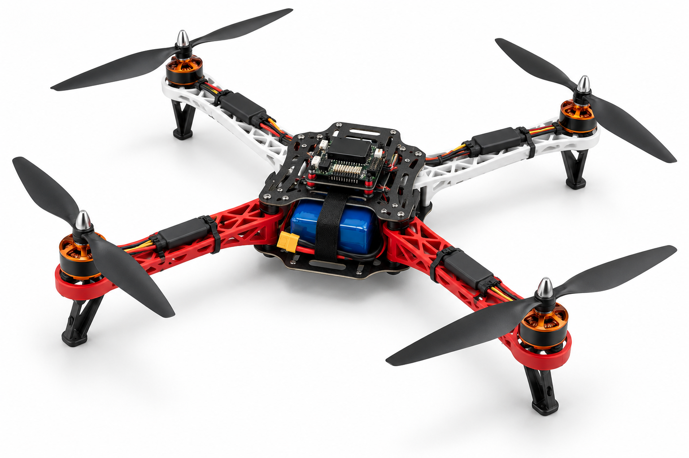

# IntelQCopter — Autonomous Quadcopter

**USTHB · FGE · Département Automatique · RSI**
Fourth-year engineering · Personal and Professional Project (RSI7.8)
Report edition: **27 October 2026**

## Choose your reading depth

| Edition | Open | What it contains |
|---|---|---|
| **Visual report · 23 pages** | **[PDF](IntelQCopter.pdf)** · [Browser](report/index.html) · [Source](report/report.md) | PID diagrams, Nyquist, complex-plane pole map, sensing, ROS/YOLO, simulation and resources |
| **Full mathematical reference · 55 pages** | **[PDF](IntelQCopter-Full.pdf)** · [Browser](full/index.html) · [Source](full/report.md) | Complete Nyquist contours, anti-windup proof, applied derivations, Bode, Black–Nichols, 3D stability surface, statistical proofs and full registers |
| Preserved previous full edition · 38 pages | [Original PDF](reference/full-edition-4.1.pdf) | Unchanged historical reference, retained for traceability |

<p align="center"></p>

*AI concept artwork. Physical evidence, analytic examples and proposed designs are labelled separately. Frequency-analysis gains are educational assumptions, not flight settings.*

1. **Flight controller:** physics, PID, sensors, calibration and estimation.
2. **ROS 2 and YOLO:** companion computer, perception and navigation.
3. **Gazebo and RViz:** model, environment and actual FC command-path validation.
4. **Resources:** hardware, software and professional method.
5. **Handheld and links:** RP2040, LoRa, reserved CC1101 and companion communication.

The intended aircraft uses an RP2350. Raspberry Pi 4/5 or Jetson is being sought; stable pilot operation remains independent. Physical motor outputs remain disabled; flight acceptance is pending.

## Evidence and reproducibility

- [Materials inventory](report/bill-of-materials.csv) · [50 requirements](report/requirements-register.json)
- [Original-evidence hashes](report/evidence-manifest.json) · [Inspected sources](report/source-inventory.json)
- [Illustrative PID model and checks](analysis/control-design-example.json)
- [Short QA](report/validation.json) · [Full QA](full/validation.json)
- [Curated knowledge catalog](knowledge/README.md): small domains, explicit status/provenance, compact events.

Selected published recording-derived reports/data remain in evidence/. They do not replace private original recordings. No hidden forces or pose overrides are accepted as proof of a successful FC simulation.

## Rebuild and verify

Python 3, pinned packages below and Windows Arial fonts are required. No MATLAB or control-toolbox installation is needed for these plots.

```powershell
python -m pip install -r requirements.txt
python tools/control_design_example.py
python tools/build_report.py .
python tools/build_report.py . --full
python tools/check_report.py
python tools/check_knowledge.py .
```

Student/supervisor names and the teacher's marking rubric remain to complete. The [official RSI curriculum](https://fge.usthb.dz/storage/disk/Robotique-et-systemes-intelligents-MAJ-2025.pdf), PDF p. 11, lists Projet Personnel Professionnel, RSI7.8, semester 7, 2 credits and coefficient 1.

## Selected engineering notes

[Illustrated engineering notes](learning/index.html): important implementation lessons, measured evidence, equations and expandable code explanations. These supplements do not change the dated report PDFs or their page counts.
