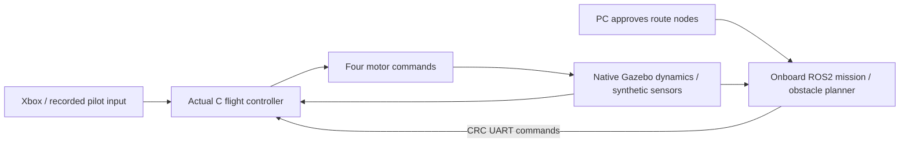

# IntelQCopter · ESP32-S3 + Xbox

F450 research quadcopter: ESP32-S3 flight controller, Xbox Series X/S manual input and an optional ROS2 companion for navigation.

**Branch: `esp32-xbox`.** The [main branch](https://github.com/BenMohStem/IntelQCopter/tree/main) retains the RP2350 aircraft + RP2040 handheld + LoRa/CC1101 architecture.

> Bench prototype: physical motor arming and ESC outputs remain disabled. Simulation gains and hardware interfaces are not flight-validated.

## Fly the simulation

On the configured Windows PC, open PowerShell in this checkout:

```powershell
cd C:\Users\Mohamed\Desktop\Work\QCopter-ESP32-Xbox
.\qcopter.ps1 xbox-check
.\qcopter.ps1 station
```

Open [the workshop](http://127.0.0.1:8088/), select manual or ROS2 navigation and a garden, then **Start simulation**. It opens in a new tab. Recordings save automatically at 15 fps; **End session** finalizes them and closes the flight tab. Closing a tab alone does not stop the simulation.

**[Complete launch instructions, fresh-clone prerequisites and troubleshooting](docs/run-simulation.md).**

## How commands reach the aircraft



Manual uses roll/pitch **angle** targets, yaw rate and vertical speed/hover. Gentle is the default. RT raises the collective ceiling to 0.80, LT lowers it; attitude corrections retain headroom. Position-aided braking on release currently relies on ideal simulated localization. ROS2 is optional for manual FC operation.

## Read and build

| Area | Entry point |
|---|---|
| All documentation | [Documentation map](docs/README.md) |
| Detailed math, six PIDs and Kalman derivations | [Illustrated F450 guide](docs/current-model-and-fc-integration.html) |
| Editable settings and command authority | [Control workshop](docs/control-workbench.html) |
| Current facts, assumptions and open work | [Knowledge overview](knowledge/current.md), [status](docs/status.md) |
| ESP32 C / ROS2 implementation | [Code map](docs/code-map.md), [protocol](docs/xbox-ros2-protocol.md) |
| Home-etched competition PCB | [Schematic, board and assembly](hardware/home-etched-fc/README.md) |
| Real measurement procedures | [Worksheets](measurements/README.md) |
| Preserved verification results | [Hardening report](artifacts/reports/hardening-20261021/index.html), [ESP32 emulation](simulation/emulation/README.md) |

## Repository layout

`firmware/` C runtime + ESP32 adapters · `companion/` ROS2 packages · `simulation/` Gazebo/emulation · `hardware/` current CAD · `docs/` maintained guides · `measurements/` procedures · `knowledge/` factual versioned ledger · `tools/` commands grouped by purpose · `artifacts/` original evidence · `archive/` historical references.

`project.json` and `.\qcopter.ps1 help` are the command catalog. Local environments, downloaded SDKs, caches and build outputs are ignored. [Earlier document versions](archive/documentation/README.md) remain recoverable without duplicating them throughout the active guides.

## What the results mean

Native Gazebo trials run the host-compiled C FC with actual ROS2 C++ nodes. They use provisional mass/inertia/thrust, synthetic sensors and ideal localization. QEMU demonstrates compiled firmware execution with synthetic inputs; neither establishes physical BLE/UART/ESC behavior, MCU deadlines or real flight stability. Original failed trials are preserved alongside successful ones.
