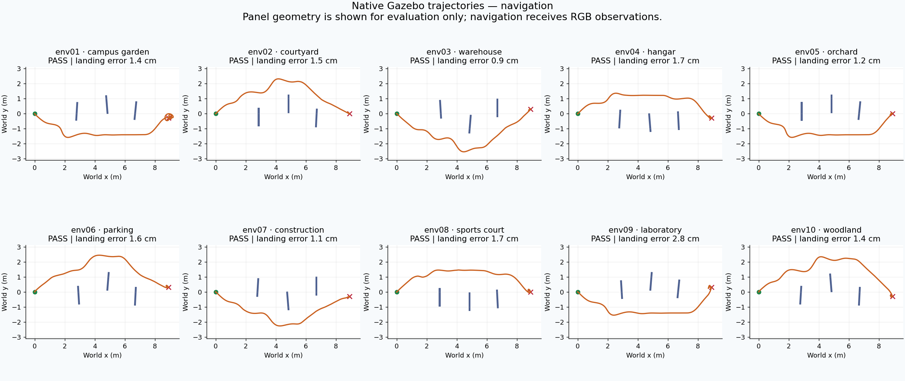

# IntelQCopter · ESP32-S3 + Xbox

**Branch: esp32-xbox** · ESP32-S3 on the aircraft · Xbox Series X/S over BLE.

The [main branch](https://github.com/BenMohStem/IntelQCopter/tree/main) keeps the
RP2350 flight controller and RP2040 handheld. This branch replaces both custom
radio endpoints with a commercial Xbox controller connected directly to the ESP32-S3.

> **Bench prototype. Physical motor outputs are disabled.**
> No ESC pulse driver or arming action is included. Gains, axes and timing are not validated on this airframe.

**Start here:** [Illustrated F450 linear/discrete guide](docs/current-model-and-fc-integration.html) ·
[Run the ESP32-S3 emulator](simulation/emulation/README.md) · [Code map](docs/code-map.md).

## Play live with your Xbox

```powershell
.\qcopter.ps1 xbox-check
.\qcopter.ps1 play       # standalone FC, no ROS2 companion
# OR, after ending that session:
.\qcopter.ps1 play-ros   # ROS2 obstacle navigation + 2/3-point PC map
```

Live native cameras: **http://127.0.0.1:8087**. PC route map: **http://127.0.0.1:8086** (companion launch).
Hold Down+A five seconds for stable; Down+B five seconds for navigation.
[Complete launch, control, route and UART guide](docs/live-xbox-and-companion.md).
The live simulator uses the active C host DLL, synthetic sensors and an assumed aircraft model; physical outputs remain disabled.

## What is active

| Part | Implementation |
|---|---|
| Flight control | One C file: firmware/src/flight_controller.c |
| Hardware boundary | Small C++ adapter for Arduino, I²C sensors, Xbox BLE and NVS |
| Controller | XboxSeriesXControllerESP32_asukiaaa 1.1.3 with NimBLE 2.5.1 |
| Sensors | MPU6050 acquisition; BMP280 pressure acquisition and session ground reference |
| Control mode | Roll/pitch angle cascades, yaw rate, vertical-speed throttle with height hold |
| Scheduling | 2 ms timer requests; measured elapsed time; missed/late cycles and execution time reported |
| Calibration | Stationary gyro verification, six-face accel capture, versioned/CRC/board-bound NVS record |
| CPU emulation | Espressif QEMU ESP32-S3; 44 passing checks on the active C core with synthetic inputs |
| Battery policy | 35% estimated-SOC warning, 20% latched disarm; voltage/current acquisition unfinished |

## Controls

| Xbox input | Command |
|---|---|
| Left stick horizontal | Yaw rate |
| Left stick vertical | Climb/descent; center holds height |
| Right stick horizontal / vertical | Roll / pitch angle |
| RT / LT | Smooth climb/collective boost / reduction |
| D-pad Down + A, held 5 s | Select stable angle/yaw-rate/vertical-speed flight |
| D-pad Down + B, held 5 s | Select drone ROS2 navigation authority |
| D-pad Down + LT at least 90%, held 2 s | Latched disarm; restart required |
| LB / RB and remaining buttons | Reserved |

## Build

Install [PlatformIO](https://docs.platformio.org/en/latest/core/installation/index.html), then from this branch checkout:

    pio pkg install
    pio run -e esp32-s3

Dependency installation precedes the guarded Xbox callback hook.
Build is separate from flashing. See [setup, wiring and calibration](docs/setup.md).

## Clean project map

| Folder | Purpose |
|---|---|
| firmware/ | Active C control core and minimal C++ platform adapter |
| docs/ | Illustrated LTI/discrete model, setup, code map and current status |
| simulation/emulation/ | Reproducible ESP32-S3 CPU replay and original-check runner |
| knowledge/ | Versioned facts, evidence sources and dependency relationships |
| simulation/gazebo/ | Native physics, cameras, raw Xbox/ROS2 transport and scenarios |
| companion/ | ROS2 C++ drone navigation, YOLO/PnP, UART bridge and PC endpoint map |
| artifacts/ | Original evidence produced for this branch |
| archive/reference-drone/ | Unmodified source snapshot from the user's Drone folder |
| archive/ | Historical Git snapshot index and original Drone reference |
| .cache/archive/ | Verified local snapshot payload; recoverable from Git |

**Read next:** [Current status](docs/status.md) · [Knowledge index](knowledge/README.md) ·
[Review of Drone](docs/drone-review.md).

Use `.\qcopter.ps1 help` for the command catalog. See [architecture and migration](docs/architecture.md).
Open `IntelQCopter.code-workspace` for an editor view focused on active files.
Generated tools, firmware images and the searchable SQLite index live in ignored `build/`.

## Build evidence

The latest ESP32-S3 hardware firmware compiles successfully: **31,836 bytes static RAM** and
**590,573 bytes reported program flash**. These size figures do not include every
runtime heap/task allocation. [Latest compiler and interface logs](artifacts/validation/2026-10-21/).
No flashing, pairing, physical calibration or flight has been performed.

QEMU passed 39 checks in the current input replay. [Latest original UART log](artifacts/emulation/uart-mode-gestures-2026-10-21/uart.log).
The original baseline executed 4,982 logical steps and passed 19 checks. [Original UART log](artifacts/emulation/verified-replay/uart.log) ·
[Recorded samples](artifacts/emulation/verified-replay/telemetry.png).
The replay uses stationary synthetic sensors; motor demands do not drive a flight plant.

The [mathematical paper](https://github.com/BenMohStem/IntelQCopter/blob/8432cf33300fc1f92aeab97f01548aac2b1d2e48/archive/rp2350/output/pdf/IntelQcopter-model-guide.pdf)
remains useful for airframe/control equations. Its RP2350 flash and old runtime descriptions
are historical and do not describe the ESP32 NVS/platform layer.

## Native Gazebo flights

[Run the 10-world suite and PC map](simulation/gazebo/README.md) · [Controls and UART protocol](docs/xbox-ros2-protocol.md).

Gazebo drives the active C core at 500 Hz through simulated IMU/barometer samples.
The ground PC sends Xbox-format reports or a ROS2 endpoint request. The drone
C++ companion handles navigation and RGB perception. Physical ESC outputs stay disabled.
CPU emulation and host flight simulation are separate evidence categories.

## Verified simulation evidence · 21 October 2026

| Check | Result |
|---|---|
| ESP32-S3 hardware build | Pass; no flashing |
| ESP32-S3 QEMU | 39/39 checks |
| Native Gazebo manual Xbox flights | 5/5; zero companion flight packets |
| Native Gazebo ROS2 navigation | 10/10 layouts; no native panel contacts |
| Additional PC map mission | Custom endpoint/height accepted over ROS2; landed/disarmed |

[Results, limitations and measurements](docs/gazebo-results-2026-10-21.md) ·
[Video and graph index — open locally](artifacts/reports/gazebo-verified-20261021/index.html) ·
[Launch and choose your own endpoints](simulation/gazebo/README.md#pc-endpoint-selection).



Mean simulated landing error: **9.49 cm manual**, **1.53 cm navigation**. This
uses unmeasured aircraft parameters, synthetic sensors and simulated localization.
RGB distance is specific to known panel fixtures; physical interfaces remain unvalidated.
