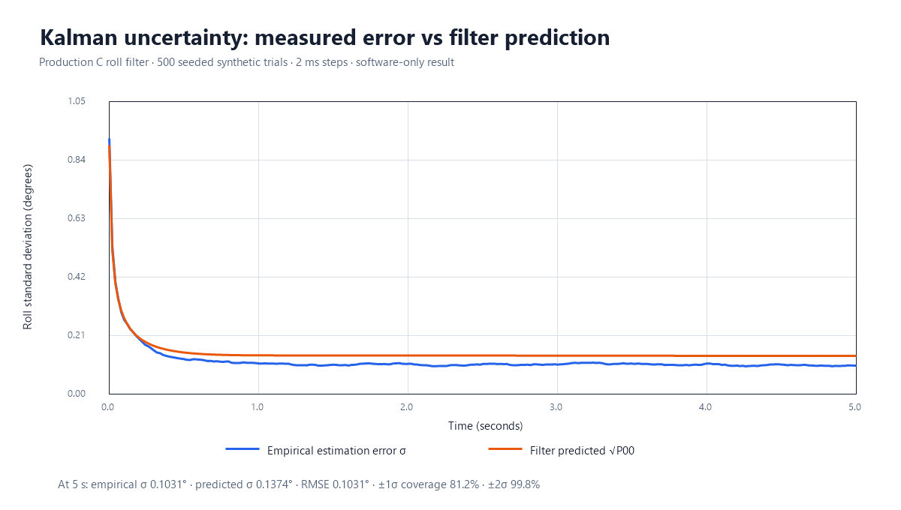
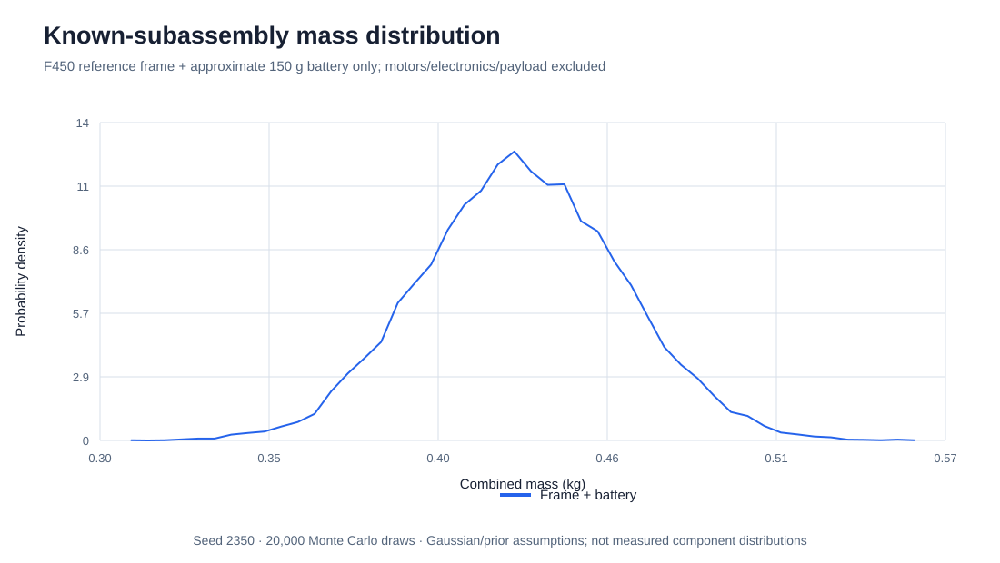
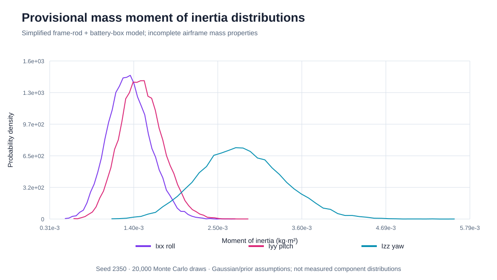
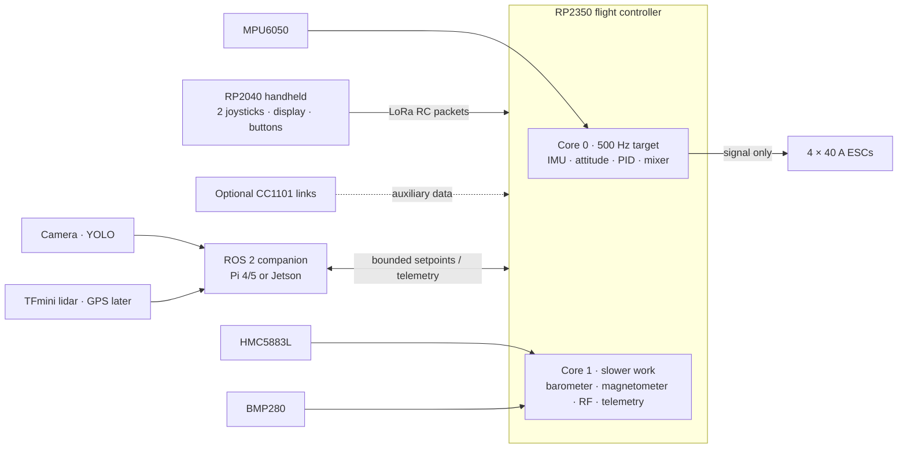

<div align="center">

# IntelQcopter

**An open, safety-first quadcopter flight-controller project**
RP2350 flight controller · RP2040 handheld controller · F450/Q450 airframe


</div>

> [!CAUTION]
> **Prototype only. Do not fly this firmware.** The current RP2350 image does not initialize sensors or drive ESCs. Mixer signs, motor order, radio link, failsafes, frame mass properties, and motor/propeller performance have not been validated. Keep propellers removed during any future bench testing.

## Project at a glance

IntelQcopter is a C-first Pico SDK project for a custom quadcopter. The aircraft target is an RP2350; a separate RP2040 target is reserved for a two-joystick handheld controller. The chosen frame family is the 450 mm F450/Q450 X-frame with two red and two white arms.

> [!IMPORTANT]
> **Current stage: firmware scaffold and software math checks.** The hand controller has no joystick/display/radio implementation. The flight firmware has no I²C sensor drivers, radio receiver, arming state machine, or ESC signal output. No airframe physics simulation or flight test has run. The code keeps motor outputs disabled.

The control design target is a 500 Hz attitude loop: roll and pitch use angle setpoints with inner gyro-rate loops, yaw is rate-controlled, and altitude hold is intended to use a barometer/vertical-state estimator. LoRa is planned as the primary pilot link; CC1101 radios are optional auxiliary links. A ROS 2 companion may later provide camera/YOLO, lidar, and GPS setpoints while the RP2350 retains motor control and failsafe authority.

### Current evidence

| Area | Result | What it does not prove |
|---|---|---|
| RP2350 firmware | Builds for Pico 2 / ARM-S | No physical board or sensor drivers yet |
| RP2040 firmware | Builds for Pico | Handheld application is still a placeholder |
| Flight math | Host checks pass; 500-trial C Kalman Monte Carlo recorded | Not closed-loop aircraft stability or tuned gains |
| Battery monitor | Host checks cover voltage/SOC Kalman math, alarms, and input faults | No drivers, calibrated OCV curve, thresholds, or cell monitor are connected |
| RP2350 emulator | 1,000,000 instruction steps complete | Emulator reports unsupported peripherals; not timing or I/O validation |
| PCB | Editable KiCad logic-carrier draft; power/current-sensor/BMS interfaces added | DRC: 0 geometry violations; 76 pads unrouted, not manufacturable |
| CAD / URDF | Parametric F450 visual and XML-valid URDF | OpenSCAD rendering/physics calibration not verified |
| Isaac Sim / ROS 2 | URDF starter and ROS 2 planning notes exist | No runnable local vehicle simulation or ROS 2 connection |

Open the [recorded logs and data index](artifacts/test-runs/README.md) for proof files and the limits of each check. The [interactive uncertainty dashboard](artifacts/visualizations/uncertainty-dashboard.html) plots actual saved Monte Carlo rows and replays its 5-second aggregate Kalman trace. It is a replayable chart, **not a vehicle simulation or video recording**. The original emulator log includes step-by-step progress and its unsupported-peripheral messages.

Recorded Kalman uncertainty from the seeded C test:



The mass and inertia density plots use the assumed priors documented below:





The [controller code walkthrough](docs/reading-the-code.md) explains each section of the RP2350 C file and the RP2040 placeholder. The [documentation index](docs/README.md) links PCB, uncertainty, simulator, code, and evidence notes.

## Architecture



The fast loop must never wait on RF, display, ROS 2, or slow sensors. Actual acquisition and actuator drivers are not implemented. The 500 Hz rate is a **design target**; the physical RP2350 deadline has not been measured.

## Hardware assumptions and open measurements

| Item | Current project input | Confidence |
|---|---|---|
| Frame | F450/Q450, nominal 450 mm motor diagonal | User confirmed frame family; clone dimensions need measurement |
| Frame mass | 282 g reference value | DJI manual specification; clone/landing gear may differ |
| Battery | 3S, 4200 mAh, about 150 g | Battery mass is provisional, per user |
| Battery discharge label | 120C (user supplied) | Manufacturer and continuous-vs-burst meaning not verified; does not establish motor current |
| Battery monitor | Pack-voltage Kalman filter + coulomb-count SOC; BMS cell-alert inputs are supported | No sensor is connected; external current/cell-monitor hardware and calibrated limits are still needed |
| Motors | 1400 KV | Propeller, motor model, thrust curve, and current curve unknown |
| Propellers | 9047 (9.0-inch diameter × 4.7-inch pitch) | User supplied; manufacturer, material, rotation pairs, and motor-current compatibility need confirmation |
| ESCs | 40 A each | Current rating only; protocol and actual behavior unknown |
| Flight MCU | RP2350 Pico 2 module for initial build | Final PCB/module selection still to confirm |
| Sensors | MPU6050 + HMC5883L + BMP280 on I²C | Board breakouts and addresses must be checked; magnetometer variants exist |
| Radio | LoRa primary; up to two CC1101 auxiliary | Exact modules, band, antenna, packet protocol, and regional compliance open |
| Aircraft mass | Not measured | Motors, ESCs, controller, wiring, GPS/lidar/camera, and mounting hardware remain uncounted |

DJI lists the F450 diagonal wheelbase as 450 mm and frame weight as 282 g. Its stock propeller notation is 9.4 × 5.0 inch (diameter × pitch); this project uses the user's selected 9047 (9 × 4.7 inch) propeller size instead. That prop/motor combination has **not** been electrically validated for the 1400 KV motors and 3S pack. [DJI F450 User Manual](https://dl.djicdn.com/downloads/flamewheel/en/F450_User_Manual_v2.2_en.pdf)

## Mass-property uncertainty — preliminary only

The included seeded Monte Carlo model currently represents **only the F450 frame plus the approximate battery**. It omits all motors, ESCs, electronics, wiring, and payload, so it is not takeoff mass. Inputs are explicit priors: frame 282 g with assumed 10% one-sigma clone variation; battery 150 g with assumed 10% one-sigma uncertainty; 450 mm diagonal with assumed 5 mm one-sigma tolerance; plus provisional battery position/dimensions and arm-mass fraction. These tolerances are placeholders, not measurements.

20,000 samples produced a known-subassembly mass of **431.5 g mean, 32.2 g standard deviation, and 369.5–494.6 g 95% interval**. The nominal input sum is 432 g. Provisional inertia means are `Ixx = 1.347e-3`, `Iyy = 1.506e-3`, and `Izz = 2.816e-3 kg·m²`. The assumptions, intervals, and CG distributions are in [`docs/model-uncertainty.md`](docs/model-uncertainty.md). The simplified frame-rod model is a sensitivity exercise; measured component coordinates and full component masses must replace it before physics tuning.

The approximate pack energy from 11.1 V nominal × 4.2 Ah is **46.62 Wh**. This is nominal stored energy, not usable energy or a flight-time estimate. A 40 A ESC rating and a motor KV number do not establish thrust or current draw.

### Kalman uncertainty trace

The host Monte Carlo invokes the same C roll-angle Kalman update used by the firmware. It runs 500 seeded trials × 2,500 steps (5 s at 500 Hz) with a Gaussian initial roll prior, gyro-bias prior, gyro noise, accelerometer-angle noise, and bias random walk. It records empirical error standard deviation, the filter’s `sqrt(P00)` standard deviation, RMSE, and one-/two-sigma coverage over time. The configured gyro and accelerometer noise values are provisional and need characterization from the installed sensor, vibration, filtering, and sample rate.

In the current seeded roll run, empirical final error σ was 0.1031° while Kalman `sqrt(P00)` was 0.1374°; predicted ±1σ/±2σ coverage was 81.2%/99.8%. That covariance is conservative under the test's assumptions. Full metrics and the generated distribution plots are in the uncertainty report. This does not prove vehicle stability. Angular-velocity/yaw and altitude covariance checks, sensor dropout and bias runs, real sensor logs, and a calibrated rigid-body/actuator simulation remain future work.

## Build and reproduce

Requirements: Raspberry Pi Pico SDK 2.3.0, ARM embedded toolchain, CMake, and Ninja. The current workstation setup expects the SDK under `C:\WinLibs\pico-sdk`; set `PICO_SDK_PATH` on another machine.

```powershell
.\tools\build_firmware.ps1 -Target flight
.\tools\build_firmware.ps1 -Target controller
.\tools\run_flight_controller_tests.ps1 `
  -TracePath artifacts\test-runs\flight-control.csv `
  -KalmanPath artifacts\test-runs\kalman-roll-monte-carlo.csv
node sim\rp2350js\boot_check.cjs build\flight-rp2350\qcopter.hex 1000000
.venv-tests\Scripts\python.exe tools\model_uncertainty.py artifacts\test-runs\mass-model
```

The host-test script uses Zig’s C compiler in `.venv-tests`; install it there with `python -m pip install ziglang`. The Python uncertainty model uses the standard library only. Emulator progress is printed every 100,000 steps and its peripheral warnings are expected from this limited emulator build. Save the complete output with PowerShell `Tee-Object` when capturing a run.

These checks are software evidence only. The emulator does not model an RP2350 wall-clock deadline, I²C sensors, RF propagation, PWM/DShot, ESCs, motor/propeller dynamics, or a flight plant.

## Repository map

```text
flight_controller/                 RP2350 C firmware and host tests
controller/                        RP2040 handheld-controller placeholder
hardware/flight_controller_pcb/    KiCad logic-carrier draft, pin map, BOM
sim/model/qcopter_f450.scad        Parametric visual frame model
sim/isaac/assets/qcopter.urdf      Provisional ROS/robotics description
sim/rp2350js/                      RP2350 emulator boot checker
tools/                             Build, test, trace, and uncertainty tools
artifacts/test-runs/               Reproducible logs, CSVs, and reports
docs/                              Interfaces and development notes
```

`build/` and `.venv-tests/` are local ignored working files, not source deliverables. `.venv-tests/` holds Zig for the host C checks. Pico SDK/toolchain live outside the project under `C:\WinLibs`. TensorFlow is unrelated to QCopter and its 1.5 GB `.venv-tf210` has been removed; there is no TensorFlow dependency in this project. Isaac Sim is not installed in this checkout.

## Development priorities

1. Confirm the exact frame, motor model, propeller model, ESC input protocol, board, and component locations; weigh each component and the assembled vehicle.
2. Implement and review sensor drivers, timestamps, calibration, the arming/failsafe state machine, and explicit sensor-degraded modes.
3. Route the flight-controller schematic/PCB, then verify rails and signals on a current-limited bench with propellers removed.
4. Add a calibrated vehicle + actuator model and run closed-loop disturbance, saturation, sensor dropout, and timing tests.
5. Implement the handheld radio protocol and loss-of-link behavior; measure latency and packet-loss distribution.
6. Add companion ROS 2 setpoints, camera/YOLO, lidar, and GPS only after local flight stabilization is validated.

## License and third-party references

No project reuse license has been selected yet. Source repositories listed in project notes are reference candidates only; third-party driver code has not been vendored into the flight-control path. Review and record each dependency’s license before copying code into this repository.
