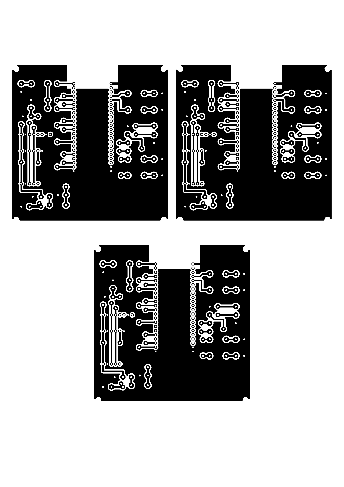
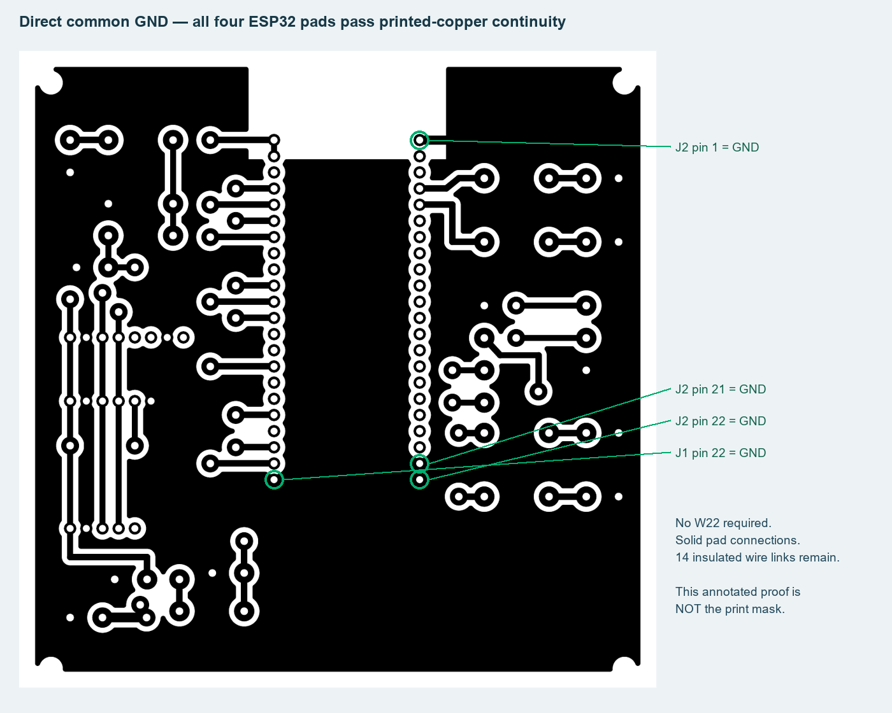

# PCB correction from sensor photos - 23 October 2026

## What changed

The previous sensor ports had only four pins with carrier-specific order. They have been replaced by GY-521 MPU6050 **8-pin**, GY-BM280 **6-pin** and GY-271/HW-246 **5-pin** solder/header landings. Pins1-4 now follow the photo labels: VCC,GND,SCL,SDA. The earlier PCB, mask and guide are preserved in `archive/hardware/2026-10-23-before-photo-headers/previous-carrier.zip`; do not manufacture those earlier files.

BMP280 CSB is connected high through **W24**, and SDO is grounded (I2C0x76). MPU6050 AD0 is grounded (0x68). Unused XDA/XCL/INT/DRDY remain isolated. The LiDAR keeps four large wire pads: commonGND, regulated5V, FC-RX from LiDAR-TX, FC-TX to LiDAR-RX. No invented fifth LiDAR signal is assigned. ESP32 GPIO9/8 I2C and the existing ESC/companion assignments are unchanged.

## Actual results

| Check | Result / original evidence |
|---|---|
| KiCad10.0.6 native PCB DRC |0 violations;0 unconnected;0 parity issues: `drc.json` |
| Native schematic ERC |0 violations: `erc.json` |
| Independent schematic/model nets | Match: `schematic-netlist.xml`, `verification-summary.json` |
| Independent photo/DevKit pin expectations |41 expected pin nets,8/6/5pin sensors,4pin LiDAR: `pinout-verification.json` |
| DevKit manufacturer geometry |44 reference pad positions match; passive body/USB clearance: `mechanical-verification.json` |
| Native copper extraction |69 tracks,133 electrical pads,one connected GND fill; no top routes or vias |
| Printed mask continuity and shorts |65 copper nets continuous; no different-net shorts;10 intended GPIO jumper bridges match: `mask-power-audit.json` |
| Common ground |21 solid GND pads, including all4 DevKit GND pads, joined on printed copper: `mask-ground-continuity.json` |
| Drilling |399 white electrical drill centres across3 copies |
| Power after insulated jumpers |GND/3.3V/5V/pack sense separate; W21 removes external5V from DevKit USB supply: `mask-power-audit.json` |
| Print geometry |One A4 page,3 copies,72/25.4points/mm,PrintScaling=None,no text: `pdf-scale-verification.json` |
| Original failed first check |`drc-01.json` and `tooling-notes.md`; no failures discarded |

## Visual evidence

[Current photo wiring drawing](../../../hardware/home-etched-fc/sensor-wiring-guide.png) and [assembly guide](../../../hardware/home-etched-fc/README.md).

## Scope and assumptions

Engine: native KiCad10.0.6, ReportLab vector PDF, pypdf content-stream checks, Poppler300dpi rasterization and NumPy/SciPy four-connected pixel analysis. This was a **digital PCB verification**, not a simulation, emulator or flight test. The graph models explicit copper and insulated jumpers; it does not treat resistors, capacitors or the DevKit regulator as ideal wires.

Header signal labels come from the user photos; their nominal2.54mm spacing and unknown module body/hole geometry were not physically measured. Bodies stay offboard and use wires. The ESP32 module footprint remains the genuine/reference2x22DevKitC-1. GY-271 branding does not guarantee HMC versus QMC silicon. External5V regulator, current sensor, sensor-LDO voltage, pull-ups, manufactured copper, real printer scaling, frame fit, RF and all hardware operation still need measurement. Firmware and physical motor arming were not changed. Personal screenshots are not published. Primary source links are in `sources.json`.
