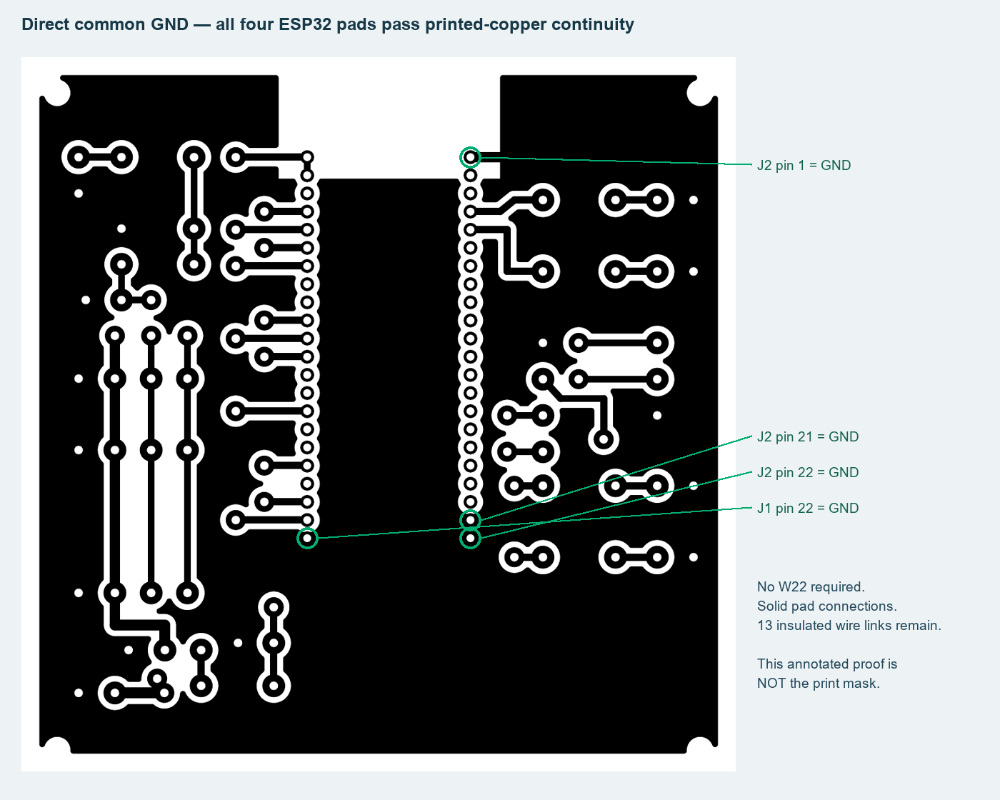

# Manufacturer-reference PCB dimensions — 23 October 2026

**Actual engine:** KiCad10.0.6 native CAD, independent pad/geometry comparison and a raster analysis of the final vector mask. No flight simulator or physical measurement is used here.

## Corrections

- DevKitC-1 body corrected to published25.40 x62.74mm; nominal2.54mm pin pitch and22.86mm rows independently verified.
- Socket holes increased to1.1mm for the selected1.02mm-recommended reference, with1.94mm round pads. Nominal annulus0.42mm, minimum rule0.4mm, pad gap0.60mm. This is the dense-header compromise; all other solder pads remain larger.
- Both100nF capacitors now have5mm pitch. C2 body and pads face away from the USB service envelope.
- Native F.Fab passive bodies and the MCU body reference are included; wire-port pin maps are regenerated from actual nets to prevent stale labels.
- Single bottom copper, all19 solid GND pads, thirteen insulated top links and three text-free1:1 masks are retained.

## Evidence

| Original report | Scope |
|---|---|
| [research-provenance.json](research-provenance.json) | Chosen references, primary URLs and downloaded-document SHA256 |
| [mechanical-verification.json](mechanical-verification.json) | All44 MCU positions, socket drills/pads, eight resistor/two capacitor spans and body/USB clearance |
| [drc.json](drc.json), [erc.json](erc.json) | Native clearance, unrouted/parity and schematic checks |
| [verification-summary.json](verification-summary.json) | Independent netlist agreement |
| [print-verification.json](print-verification.json) | Final PDF hash,1:1 page transforms,3 placements and no text |
| [mask-power-audit.json](mask-power-audit.json) | Actual printed copper continuity, separated assembled rails and white drill centres |

[Current manufacturer reference guide](../../../hardware/home-etched-fc/component-dimensions.md). These selected references do not identify unknown clones or prove real module fit. Sensor modules are connected by mapped wires, not by these carrier hole patterns. F450 mounting, actual cable/plug clearance, hand-drilling accuracy and electrical/RF operation remain unmeasured. Physical motor outputs stay disabled. Earlier reports and failed iterations are preserved in their original folders.
