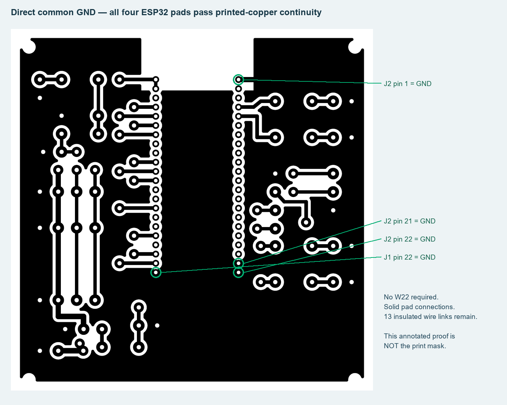

# Solid-ground PCB and mask audit — 21 October 2026

**Actual engine:** KiCad 10.0.6 pcbnew + native CLI DRC/ERC and schematic netlist. This is a digital carrier-board check, not an etched-board measurement or flight simulation.

## Changes

- All 19 GND pads connect solidly to the single common B.Cu plane; no thermal crosses.
- Both reference DevKit 3.3V pins connect to the same rail.
- TOFSense-F2 Mini power is regulated external5V via insulated W23; UART is 3.3V. Do not feed it raw battery voltage. Firmware range driver remains pending.
- The three-copy A4 print has white round drill centres, black retained copper, no text or silkscreen.

## Original checks

| Check | Result / original evidence |
|---|---|
| Native DRC, unrouted, schematic parity | All zero: [drc.json](drc.json) |
| Native schematic ERC | Zero: [erc.json](erc.json) |
| Independent schematic/model comparison | 35 connected nets, 37 components, 13 wire links: [verification-summary.json](verification-summary.json) |
| Actual printed copper, including NC islands | 60 copper nets, 124 pads continuous; no different-net copper short: [mask-power-audit.json](mask-power-audit.json) |
| Explicit wire-link assembly graph | GND / 3.3V / 5V / raw battery-sense remain separate; W21 removal isolates DevKit5V |
| Reference power pins | 20 independently specified power/ground pins match |
| White drill centres | All 372 electrical-pad centres across 3 mask copies |
| PDF source/scale/polarity | [print-verification.json](print-verification.json) |

The unannotated print file is [here](../../../hardware/home-etched-fc/output/pdf/etch-mask-3-copies-A4-1to1.pdf). Print actual size /100%, no extra mirroring. The annotated image above is not the manufacturing mask.

## Assumptions and remaining checks

Reference ESP32-S3-DevKitC-1 geometry, 100x100mm carrier, externally regulated5V, mapped 3.3V-compatible sensor pigtails, all thirteen insulated jumpers correctly installed. The exact modules/frame have not been measured. Bare copper and jumper checks do not model regulators, resistors, capacitors, sensor internals, current capacity, RF or flight performance. No hardware motor outputs are enabled. Verify manufactured continuity/insulation, supply voltages and module fit before assembly.

Power references: [Espressif](https://docs.espressif.com/projects/esp-dev-kits/en/latest/esp32s3/esp32-s3-devkitc-1/user_guide_v1.0.html), [Nooploop F2 Mini V1.0](https://ftp.nooploop.com/downloads/tofsense/TOFSense_F2_Mini_Datasheet_V1.0_en.pdf).
