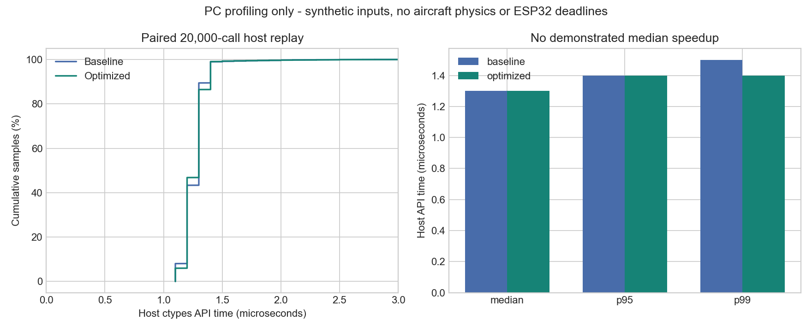

# C controller optimization and debugging — 21 October 2026

## Changes

- Skip derivative calculation when a PID has zero Kd. Measurement history is still maintained; nonzero-Kd paths are retained.
- Cache gyro standard deviations until calibration variances change, avoiding repeated square roots at 500 Hz.
- Reuse attitude sine/cosine values and remove a duplicated innovation assignment.
- Public `fc_step` rejects missing inputs and invalid dt with a fault/zero demands before calibration or estimator mutation. Missing-input calls through `fc_control_step` reset the control integrators.
- Add integer-only timing sample/total/min/max/last/over-budget accounting. The adapter publishes a bounded snapshot; mean calculation and serial formatting run on the slow task.
- Isolated DLL output paths allow old/new comparison without replacing the DLL used by an existing simulation session.

The six PID architecture, gains, Gentle inputs, RT/LT headroom, yaw sign, optional companion and position-aided braking are unchanged. There is no controller named “multilinear” in the active source. Which feature the user wants removed remains unclarified; no mode was removed by guessing.

## Actual evidence

| Execution | Result | Scope |
|---|---|---|
| [Paired replay](../fc-opt-comparison-20261021/summary.json) | 20,000 old/new steps, maximum recorded state/output difference 0; 8 checks pass | Host-compiled actual C, deterministic synthetic gravity/gyro/pressure/HID; no physics |
| [Fault/stress run](../fc-opt-after-20261021/summary.json) | 28 checks pass; 20,000 malformed packets; 30,000-step soak | Host input, allocator and finite/covariance checks |
| [ESP32-S3 QEMU UART](../../emulation/fc-optimized-20261021/uart.log) | 63 checks, zero failures | Compiled Xtensa C firmware with synthetic inputs, no BLE/ESC/aircraft physics |
| [Hardware compilation](hardware-build.log) | default, standalone and debug builds succeed | Compile/link evidence; no board flashed |

Both host medians are **1.3 microseconds**, both p95 values **1.4 microseconds**. This run does not demonstrate a speedup. Python/ctypes overhead and Windows scheduling are included. Neither host API times nor QEMU wall time establish physical 500 Hz deadlines.

Original paired timings, replay differences and individual summaries remain in their run folders. The baseline C/header/adapter are retained in `sources-before/` from commit d943626; the comparison report pins both DLL hashes and the current C hash. A fixed synthetic sample stream is not a flight trajectory or proof of plant stability. Existing Gazebo trials still use the provisional model, synthetic sensors and ideal localization; no new Gazebo mission was claimed in this step.

## Read profiling on hardware later

`PROFILE` lines expose samples, total_us, min_us, mean_us, max_us, last_us and over_2ms. Their measured scope is `loop_before_status_publish`: it includes IMU acquisition, queue draining and C control, but excludes the final shared-state publication and scheduler latency after the sample. Existing missed-tick/late-cycle counters complement it. No actual board timing is available yet. All physical motor outputs remain disabled.

Before the next simulation, stop it normally, run `.\qcopter.ps1 build-host`, then start a fresh session. This step used a separate optimized DLL and did not replace a library already loaded by a live session.
