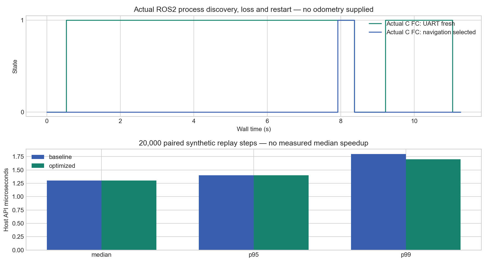

# One-file ESP32-S3 firmware and optional ROS2 link — 21 October 2026

## Active code

The application is now **one `firmware/src/flight_controller.cpp`**. Its first section retains C-style POD state, functions, six PIDs, Kalman filters, calibration and packet parsing. Its final hardware section contains the minimal Arduino/Wire/MPU/BMP/NVS/Xbox-library calls. The IMU word decoder and pin loops use ordinary C-style functions/loops. `fc_api.h` contains shared declarations only. No owned classes, templates, heap allocation or serial output were added to the control math.

PlatformIO uses GNU C++17 and the existing pinned XboxSeriesXControllerESP32_asukiaaa/NimBLE libraries. Host and QEMU compile the same `.cpp` core with `FC_CORE_ONLY`, excluding only physical I/O. Hardware compiles the entire source. The previous C file and adapter are preserved by immutable Git references in `archive/firmware/` and in historical evidence.

## Optional companion behavior

| Condition | FC behavior |
|---|---|
| Boot / no ROS2 | Stable Xbox mode |
| Valid companion appears | Record presence; stay in stable mode |
| Down+B held 5 seconds with fresh valid UART | Select navigation |
| Companion silent for over 150 ms during navigation | Reset control integrators/reference capture, switch to stable Xbox |
| Companion reconnects/restarts | Rediscover; do not automatically resume navigation |
| Compile-time standalone | Reject all companion packets; do not start companion UART |

Fresh Xbox input and healthy calibrated sensors remain required. Existing physical output/arming disablement is preserved. The companion is connected through crossed 3.3 V TX17/RX18 and common ground, powered separately; no physical transport proof exists yet.

The ROS2 mission process now supplies neutral sequence/CRC heartbeats on an independent 20 ms wall timer while idle/manual, before odometry or camera is available. Active navigation remains sensor-driven. The first integrated process test failed because the heartbeat was inadvertently tied to odometry. That original failed run and its logs are retained at `../single-cpp-real-ros-link-20261021/`; the corrected process test passes without feeding pose or images.

## Original execution evidence

| Evidence | Result |
|---|---|
| [Final QEMU UART](../../emulation/single-cpp-release-20261021/uart.log) | 67 checks, zero failures |
| [Actual host FC + actual ROS2 process](../single-cpp-real-ros-link-release-20261021/summary.json) | 9 presence/authority/loss/restart checks |
| [Actual ROS2 process fault checks](../single-cpp-ros-faults-final-20261021/summary.json) | 12 checks |
| [Host stress/fuzz/soak](../single-cpp-final-stress-20261021/summary.json) | 28 checks, 20,000 malformed packets, 30,000-step soak |
| [Paired C/C++ host replay](../single-cpp-final-comparison-20261021/summary.json) | 20,000 steps, zero recorded manual-state/output difference; 8 checks |
| [Hardware builds](hardware-final-build.log) | Normal, standalone and debug compile/link successfully |

The paired host API median is 1.3 microseconds for both versions in this run; p95 is 1.4 microseconds for both. There is no demonstrated median speedup. Python/ctypes overhead and Windows scheduling are included. Integer timing counters, bounded trace/debug levels and slow-task PROFILE/LINK logs remain available for a real board later. Nominal 2 ms inputs in replay and QEMU wall time do not prove a physical 500 Hz deadline.

Scope: these are native host API/process checks, hardware builds and Espressif QEMU synthetic replay. No new Gazebo flight is claimed for this revision. The existing Gazebo plant uses assumed parameters, synthetic sensors and ideal localization; physical BLE/UART/sensor/ESC interfaces, thrust/inertia and real timing remain unvalidated. Original failures and intermediate successes remain in artifacts.

The active simulator DLL was not replaced while an existing session could be using it. End a session normally, run `.\qcopter.ps1 build-host`, then start a new simulation to use the new firmware core.
