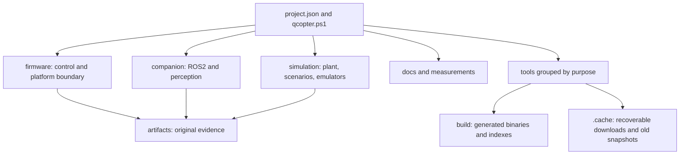

# Project architecture and file lifecycle

The project has two separate Git worktrees and branches:

| Local checkout | Branch | Aircraft / pilot input |
|---|---|---|
| QCopter/ | main | RP2350 + RP2040 handheld |
| QCopter-ESP32-Xbox/ | esp32-xbox | ESP32-S3 + Xbox Series X/S |

The ESP32 worktree was moved out of the Pico `build/` directory. It is now a sibling
checkout registered with Git. Run `git worktree list` to inspect both. Each has its
own root `project.json`, `qcopter.ps1` command entry point and AGENTS instructions.
The root editor workspace can display both checkouts; an ordinary clone can use its
own folder if the optional sibling does not exist.

## Domains

On main, `sim/` is the existing simulation domain. It keeps that name so existing
engine integration and installed companion assets have a stable reference. The
ESP32 branch uses `simulation/`, including `simulation/emulation/`. ROS2 packages
retain their standard workspace structure. The ESP32 application is one C-style flight_controller.cpp; the separate Pico branch retains one C file per runtime.

## Durable files versus disposable files

| Class | Location | Retention |
|---|---|---|
| Active source/configuration | firmware/, companion/, sim/ or simulation/, tools/, project.json | Versioned |
| Human explanation/model source | docs/, measurements/ | Versioned |
| Original logs, failures, recordings, result manifests | artifacts/ | Versioned evidence; preserve bytes |
| Historical source needed for context | archive/ or immutable Git snapshot reference | Preserve/recover explicitly |
| Compiled products, search DBs, render dependencies | build/ | Ignored and regenerable |
| Recoverable old snapshot payloads | .cache/archive/ | Ignored; verified inventory and restore command |
| Machine paths/preferences | .local/ | Ignored |
| Python/SDK environments | Existing environment/tool installation | Keep separate from source; recreate rather than casually move |

Never treat original evidence as a disposable cache. A build folder must not contain
a source checkout. Cache recovery must be documented before removing the last local
payload. Existing virtual environments keep their paths because their launchers and
installed packages may embed them.

## Main migration map

| Previous path | Current path |
|---|---|
| flight_controller/ | firmware/flight_controller/ |
| handler_controller/ | firmware/handler_controller/ |
| tools/build_firmware.ps1 | tools/build/build_firmware.ps1 or qcopter.ps1 build-flight |
| tools/build_sitl.ps1 | tools/build/build_sitl.ps1 or qcopter.ps1 build-sitl |
| tools/run_native_garden.ps1 | tools/simulation/run_native_garden.ps1 or qcopter.ps1 garden |
| tools/view_f450_windows.cmd | tools/simulation/view_f450_windows.cmd or qcopter.ps1 view-model |
| tools/ros2_windows.cmd | tools/ros2/ros2_windows.cmd |
| output/pdf/IntelQcopter-model-guide.pdf | docs/reports/IntelQcopter-model-guide.pdf |
| sim/isaac/ | archive/isaac/ |
| One-off setup/old report generators | archive/tools/ |

`artifacts/organization/2026-10-21/main-moves.json` lists every moved tool and hashes
of byte-preserved firmware/historical files. Old report/log text can still mention
original paths; that text is historical provenance. New commands use the new layout.

## Local configuration

`QCOPTER_PYTHON` can select a Python runtime. Alternatively put a `python` path in
`.local/config.json`. The launcher next checks existing local environments and the
installed PlatformIO Python. The ESP32 workstation config currently selects the
existing Torch/OpenCV/SciPy environment in the Pico checkout for mathematical plots.
This local absolute path is excluded from Git.

Use `qcopter.ps1 help` for the command catalog. Commands execute from their checkout
root and restore the previous shell directory on exit. Extra arguments go to the
selected script; a failing command returns an error. No command flashes firmware.

Use `qcopter.ps1 garden -Describe -RunPrefix example` on main, or
`qcopter.ps1 emulator-run -Describe --name example` on ESP32 to inspect a resolved
command without executing it. The launcher passes named PowerShell arguments
through a child shell so their parameter names are bound correctly.
