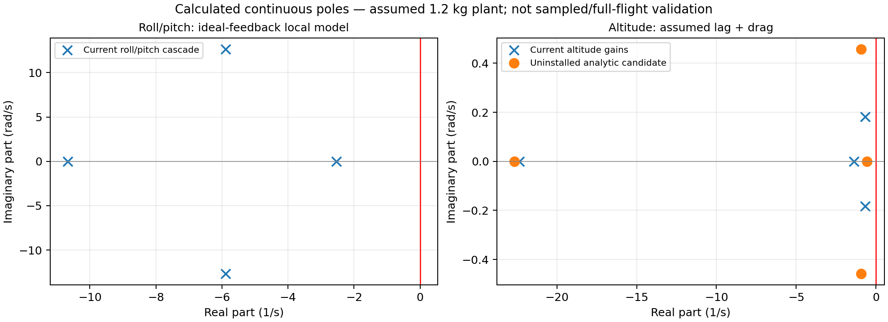

# From propeller force to flight control
## Nonlinear model · uncertainty · measured gains · RP2350 integration

**Start with the [illustrated mathematical paper](../output/pdf/IntelQcopter-model-guide.pdf).**
It derives the equations step by step, including coordinate frames, angular momentum,
motor/battery coupling, all six gain calculations, Kalman covariance and real measurement procedures.
Its editable source is [main.tex](model-guide/main.tex).
This page is the shorter navigation guide and worked introduction.

| Read next | What you will learn |
|---|---|
| [1. Forces](#1-what-is-t) | What each T means and where the translation equation comes from |
| [2. Rotation](#2-why-rotation-has-a-cross-product) | Torque, inertia, angular momentum and nonlinear coupling |
| [3. Model and controllers](#3-keep-the-nonlinear-model) | What remains nonlinear; what a transfer function can describe |
| [4. Uncertainty](#5-standard-deviation-is-not-the-whole-error) | Noise, bias, uncertainty of the mean and reference measurements |
| [5. Measurement plan](../measurements/README.md) | Apparatus, capture order and blank CSV worksheets |
| [6. Persistent calibration](calibration-flash.md) | Flash journal, boot verification, recalculation and USB commands |
| [7. Integration](#8-ros-2-and-gazebo) | Current simulation path versus future physical companion |

> **Status:** No actual aircraft parameters have been newly measured.
> The full nonlinear equations are a model specification, not a claim that every additional
> aerodynamic/electrical term is already implemented in the simulator.
> Physical arming and ESC outputs remain disabled. This change has build evidence, not a new flight recording.

---

## 1. What is T?

A motor turns a propeller. The propeller accelerates air downward; the resulting aerodynamic
reaction pushes the aircraft upward along that rotor's axis.

$$T_i=\text{magnitude of thrust from propeller }i\quad[\mathrm N].$$

It is a **force**, not throttle percentage, torque, electrical power, or motor KV.
For four parallel rotors pointing along body +z:

$$\mathbf F_{1,B}=\begin{bmatrix}0\\0\\T_1\end{bmatrix},\quad\ldots,\quad
\mathbf F_{4,B}=\begin{bmatrix}0\\0\\T_4\end{bmatrix}.$$

Forces add as vectors:

$$\mathbf F_{\mathrm{prop},B}
=\sum_{i=1}^4\mathbf F_{i,B}
=\begin{bmatrix}0+0+0+0\\0+0+0+0\\T_1+T_2+T_3+T_4\end{bmatrix}
=\begin{bmatrix}0\\0\\T\end{bmatrix},\qquad
T=\sum_{i=1}^4T_i.$$

### 1.1 Choose coordinates before writing signs

Use world +z upward, body +x forward, +y left, +z upward.
Let R map a vector expressed in body coordinates to world coordinates:

$$\mathbf a_W=R\mathbf a_B,\qquad R^TR=I,\qquad\det R=1.$$

Let roll, pitch, yaw be φ, θ, ψ, with

$$R=R_z(\psi)R_y(\theta)R_x(\phi).$$

The third column of R tells us where the rotor axis points in the world:

$$R\begin{bmatrix}0\\0\\1\end{bmatrix}
=\begin{bmatrix}
\cos\psi\sin\theta\cos\phi+\sin\psi\sin\phi\\
\sin\psi\sin\theta\cos\phi-\cos\psi\sin\phi\\
\cos\theta\cos\phi
\end{bmatrix}.$$

Tilting redirects some thrust sideways. It does not create extra thrust.

### 1.2 Derive the equation from Newton's law

Define aircraft position and velocity in the world frame:

$$\mathbf r=\begin{bmatrix}x\\y\\z\end{bmatrix},\qquad
\mathbf v=\dot{\mathbf r},\qquad
\dot{\mathbf v}=\ddot{\mathbf r}.$$

For constant mass m, linear momentum is m v:

$$\frac{d}{dt}(m\mathbf v)=\sum\mathbf F_W
\quad\Longrightarrow\quad
m\dot{\mathbf v}=\sum\mathbf F_W.$$

Now list each force in the **same frame**:

| Force | World expression | Reason |
|---|---|---|
| Propeller thrust | R[0,0,T]ᵀ | Rotors are attached to the tilted body |
| Gravity | [0,0,−mg]ᵀ | World +z is upward |
| Assumed linear drag | −d v | Opposes velocity; d has units N·s/m |
| Other forces | f_disturbance | Wind/contact/unmodelled effects |

Substitute that list into Newton's law:

$$\boxed{
m\dot{\mathbf v}
=R\begin{bmatrix}0\\0\\T\end{bmatrix}
-\begin{bmatrix}0\\0\\mg\end{bmatrix}
-d\mathbf v+\mathbf f_{\mathrm{disturbance}}
}.$$

Every term has units of newtons because kg·m/s² = N.
The vertical row is

$$m\ddot z=T\cos\phi\cos\theta-mg-d\dot z+f_z.$$

At level stationary hover, φ=θ=0, vz=0 and fz=0:

$$0=T-mg\quad\Longrightarrow\quad T=mg.$$

If all four motors share equally:

$$T_i=\frac{mg}{4}.$$

**Illustrative baseline only:** m=1.2 kg gives T=11.76798 N and T_i=2.941995 N.
For 30° roll and zero pitch at constant height:

$$T=\frac{mg}{\cos30^\circ}=13.5885\ \mathrm N.$$

That increase explains why tilted flight needs collective headroom.
These are conditional calculations, not measured motor capabilities.

---

## 2. Why rotation has a cross product

### 2.1 Force away from the centre creates torque

For displacement r_i from the centre of mass to rotor i:

$$\boldsymbol\tau_i=\mathbf r_i\times\mathbf F_i.$$

With r_i=[x_i,y_i,z_i]ᵀ and F_i=[0,0,T_i]ᵀ:

$$\boldsymbol\tau_i
=\begin{bmatrix}y_iT_i\\-x_iT_i\\0\end{bmatrix}.$$

So roll and pitch come from unequal thrust and lever arms.
Yaw additionally uses the rotors' aerodynamic reaction torques.

### 2.2 Inertia depends on where the mass is

For a small element dm at position ρ relative to the centre:

$$J=\int\left((\boldsymbol\rho^T\boldsymbol\rho)I
-\boldsymbol\rho\boldsymbol\rho^T\right)\,dm.$$

For example:

$$J_{xx}=\int(y^2+z^2)\,dm,\qquad J_{xy}=-\int xy\,dm.$$

Units are kg·m². Moving the battery away from an axis increases inertia about that axis.
Total mass alone therefore cannot determine J.

The body's angular velocity is ω=[p,q,r_b]ᵀ in rad/s.
These are body rotation rates; at general attitude they are not simply the three Euler-angle derivatives.
Angular momentum in body coordinates is

$$\mathbf H_B=J\boldsymbol\omega.$$

### 2.3 Differentiate angular momentum in the world

Angular-momentum balance in the inertial frame is

$$\boldsymbol\tau_W=\frac{d\mathbf H_W}{dt}.$$

Since H_W=R H_B, the product rule gives

$$\dot{\mathbf H}_W=\dot R\mathbf H_B+R\dot{\mathbf H}_B.$$

Rotation kinematics gives

$$\dot R=R[\boldsymbol\omega]_\times,\qquad
[\boldsymbol\omega]_\times\mathbf H_B=\boldsymbol\omega\times\mathbf H_B.$$

Therefore

$$\dot{\mathbf H}_W
=R\left(\dot{\mathbf H}_B+\boldsymbol\omega\times\mathbf H_B\right).$$

Multiply by Rᵀ, use RᵀR=I, and express torque in body coordinates:

$$\boldsymbol\tau_B=\dot{\mathbf H}_B+\boldsymbol\omega\times\mathbf H_B.$$

For a fixed rigid assembly J is constant, so substitute H_B=Jω:

$$\boldsymbol\tau_B=J\dot{\boldsymbol\omega}
+\boldsymbol\omega\times(J\boldsymbol\omega).$$

Rearrange:

$$\boxed{J\dot{\boldsymbol\omega}
=\boldsymbol\tau_B-\boldsymbol\omega\times(J\boldsymbol\omega)}.$$

The cross term appears because the coordinates themselves rotate.
It is not an arbitrary correction added to a scalar equation.

For principal axes J=diag(Jx,Jy,Jz):

$$\dot p=\frac{\tau_x+(J_y-J_z)qr_b}{J_x},$$
$$\dot q=\frac{\tau_y+(J_z-J_x)pr_b}{J_y},$$
$$\dot r_b=\frac{\tau_z+(J_x-J_y)pq}{J_z}.$$

The products qr_b, pr_b, pq couple the axes nonlinearly.
The paper derives the inertia integral and each component before using them.

---

## 3. Keep the nonlinear model

The complete proposed state contains position, velocity, attitude quaternion,
body rates, rotor speeds, effective motor currents and battery states:

$$\mathbf x=(\mathbf r,\mathbf v,\mathbf q,\boldsymbol\omega,
\Omega_1,\dots,\Omega_4,I_1,\dots,I_4,V_p,z_{\rm SOC}).$$

Representative coupled equations are

$$\dot{\mathbf r}=\mathbf v,\qquad
m\dot{\mathbf v}=R(\mathbf q)\mathbf F_B+m\mathbf g_W+\mathbf F_{\rm aero},$$

$$J\dot{\boldsymbol\omega}
=\boldsymbol\tau_{\rm external}
-\boldsymbol\omega\times(J\boldsymbol\omega),$$

$$J_{m,i}\dot\Omega_i=k_{t,i}I_i-Q_i(\Omega_i,V,\ldots)-b_i\Omega_i,$$

$$L_i\dot I_i=D_i(u_i)V_{\rm battery}-R_iI_i-k_{e,i}\Omega_i,$$

$$T_i=k_{T,i}\Omega_i^2,\qquad Q_i=k_{Q,i}\Omega_i^2,$$

$$\dot z_{\rm SOC}=-\frac{\eta I_{\rm battery}}{3600C_{\rm Ah}},\qquad
V_{\rm battery}=V_{\rm OCV}(z,T)-I_{\rm battery}R_0-V_p.$$

The effective DC electrical model is an approximation to ESC/BLDC commutation; its parameters
must be identified. Aerodynamic coefficients depend on propeller and inflow.
Unknown coefficients stay symbolic. Adding unmeasured coefficients does not itself increase accuracy.

The **existing native flight adapter** still uses assumed first-order thrust lag and drag.
The paper distinguishes those implemented assumptions from the richer proposed equations.
It retains exact attitude rotation and explains optional rotor angular momentum consistently.

### Why still calculate transfer functions?

A single global constant transfer function does not describe this nonlinear aircraft.
Around a chosen equilibrium:

$$\dot{\mathbf x}=f(\mathbf x,\mathbf u),\qquad f(\mathbf x_0,\mathbf u_0)=0,$$
$$\delta\dot{\mathbf x}\simeq A\delta\mathbf x+B\delta\mathbf u,\qquad
A=\left.\frac{\partial f}{\partial\mathbf x}\right|_0,\quad
B=\left.\frac{\partial f}{\partial\mathbf u}\right|_0.$$

Then a **local** transfer function is

$$G(s)=C(sI-A)^{-1}B+D.$$

We use it to understand poles/gains near hover and retain the nonlinear equations for broader simulation.
The paper keeps motor lag, drag, cascaded-loop coupling and higher-order characteristic polynomials
when calculating local stability. It also explains why continuous poles alone do not prove sampled nonlinear stability.

---

## 4. Why not nonzero Ki and Kd everywhere?

The common controller form is

$$u=K_Pe+K_I\int e\,dt+K_D\dot e.$$

Every nonzero term changes dynamics and introduces tradeoffs.
Six controller objects do not require eighteen nonzero coefficients.

| Loop | Current structure | Reason |
|---|---|---|
| Roll angle / pitch angle | P → body-rate target | Inner rate PI already supplies integral action |
| Roll rate / pitch rate | PI | Rejects persistent torque error; avoids raw gyro differentiation |
| Yaw rate | PI | Rate command and persistent torque rejection |
| Altitude | PID using estimated vertical speed | Height correction, steady offset rejection, velocity damping |

For independent measurement noise variance σ², a raw finite-difference derivative has

$$D_k=\frac{n_k-n_{k-1}}{\Delta t},\qquad
\operatorname{Var}(D_k)=\frac{2\sigma^2}{\Delta t^2}.$$

At Δt=.002 s, this can greatly amplify noise. Filtering reduces it but adds delay.
More integral terms add states and can worsen saturation/windup.
The paper derives existing gains, Routh conditions and a possible lag/drag-aware altitude design;
**it does not install speculative new gains**.

Current reproducible scenario calculations:
[calculation script](../tools/calculate_current_control_design.py),
[full numerical results](../artifacts/model-design/current/calculations.json).

---

## 5. Standard deviation is not the whole error

A useful measurement model is

$$y_k=x_{\rm true}+b+n_k.$$

Here b is bias, while n_k describes fluctuation. Repeating a biased measurement
many times can produce a very precise mean that is still wrong.

For N independent readings:

$$\bar y=\frac1N\sum y_k,\qquad
s^2=\frac{1}{N-1}\sum(y_k-\bar y)^2,\qquad
u_A(\bar y)=\frac{s}{\sqrt N}.$$

- s describes individual-reading scatter.
- s/√N describes uncertainty of the mean under the independence assumption.
- Instrument calibration, temperature, alignment and reference uncertainty add other contributions.
- A fixed aircraft mass is not fluctuating just because the scale does.
- “About 150 g” does not specify a distribution or standard deviation.

For correlated inputs with covariance Σ:

$$u_f^2\simeq\nabla f^T\Sigma\nabla f.$$

Example for hover thrust per rotor:

$$T_i=\frac{mg}{4},\qquad
u^2(T_i)\simeq\left(\frac g4\right)^2u_m^2+
\left(\frac m4\right)^2u_g^2+
2\frac g4\frac m4\operatorname{Cov}(m,g).$$

A reference is a better characterized measurement, not absolute truth.
Use a checked scale, calibrated voltage/current reference, known length target or suitable angular reference,
and preserve their uncertainty with the comparison.
The paper covers uniform/triangular bounds, resolution, correlations, drift and Allan variance,
with explicitly invented teaching examples.

References: [NIST Type A](https://physics.nist.gov/cuu/Uncertainty/typea.html),
[NIST Type B](https://physics.nist.gov/cuu/Uncertainty/typeb.html).

---

## 6. How to measure what is missing

Follow the [measurement plan and blank CSV worksheets](../measurements/README.md).
The paper gives full apparatus equations and uncertainty propagation.

| Unknown | Measurement | Core calculation |
|---|---|---|
| Total flying mass | Weigh complete aircraft repeatedly; check scale bias | Mean, scatter, reference uncertainty |
| Centre of mass | Reactions on two known supports for each axis | x_COM = L R₂/(R₁+R₂) |
| Inertia | Bifilar pendulum for each axis; subtract fixture | J = mga²T_period²/(4π²L) |
| Static thrust | Secured thrust stand at several commands and voltages | T from load cell; identify ∂T/∂u at hover |
| Motor lag and delay | Timestamp command step and thrust response | Fit T(t)=T₀+ΔT(1−exp(−(t−t_d)/τ)) |
| Reaction torque | Known lever arm and force | Q=ℓF |
| Gyro noise/bias | Stationary log across temperature/configurations | Mean bias, variance, correlations, Allan plot |
| Accel bias/scale | ±x, ±y, ±z reference poses | Offset and scale from opposite-face means |
| Barometer/lidar | Compare against known heights and stationary logs | Offset, scale, residual variance, latency |
| Battery capacity | Controlled charger/discharger plus current log | C_Ah=∫I dt/3600 |
| Camera/extrinsics | Calibration target and measured sensor transforms | Intrinsics, distortion, pose and reprojection residual |
| Communication delay | Timestamped sequence/receive/application records | Latency distribution, jitter and dropouts |

For a bifilar pendulum, a is **half the separation** of the two strings.
Measure several cycles, not a single period; use small oscillations and correct the fixture contribution.
Each row in the paper includes assumptions and things that can bias the result.

---

## 7. Calibration in flash, and Kalman noise

Gyro calibration estimates the stationary mean and subtracts it:

$$g_k=\omega_k+b+n_k,\qquad \hat b=\frac1N\sum g_k,\qquad
g_k^{\rm corrected}=g_k-\hat b.$$

The C implementation uses Welford's online mean/variance to avoid storing every sample.
New flash storage saves validated fits, loads them after reboot and verifies the gyro again.
Use [the exact flash/boot guide](calibration-flash.md) for commands and failure behavior.

The common Kalman recursion is

$$\hat x^-_k=F_k\hat x^+_{k-1}+B_ku_k,\qquad
P^-_k=F_kP^+_{k-1}F_k^T+Q_k,$$

$$S_k=H_kP^-_kH_k^T+R_k,\qquad
K_k=P^-_kH_k^TS_k^{-1},$$

$$\hat x^+_k=\hat x^-_k+K_k(y_k-H_k\hat x^-_k).$$

Its gains depend on uncertainty models, sample timing and sensor quality.
A large printed K is not automatically better than a small one.

The independent roll/pitch filters actually each have two states, angle and gyro bias:

$$x_{\rm angle}=[\theta,b]^T,\quad
F=\begin{bmatrix}1&-\Delta t\\0&1\end{bmatrix},\quad H=[1,0].$$

The altitude filter has height and vertical speed:

$$x_h=[h,v_z]^T,\quad
F_h=\begin{bmatrix}1&\Delta t\\0&1\end{bmatrix},\quad
B_h=\begin{bmatrix}\Delta t^2/2\\\Delta t\end{bmatrix},\quad H_h=[1,0].$$

Accelerometers measure **specific force**, so gravity removal requires attitude and sign conventions.
At rest, magnitude is about 1g; in ideal free fall it approaches zero.
The paper derives this before using vertical acceleration and explains periodic multi-rate gains.
Saved sample variances are not yet automatically mapped into every estimator setting.

---

## 8. ROS 2 and Gazebo

### Current simulation path

Native Gazebo physics/RGB → sensor model and common C++ mission core →
ROS 2 DDS adapters/local IPC → host-compiled flight_controller.c →
motor/thrust model → applied Gazebo link wrench.

The flight library runs production C math on the PC; it is not an RP2350 emulator.
The recorded garden uses simulated local odometry and synthetic inertial/height measurements,
with native camera pixels. The floor range is an analytical ray.
The separately built standard C++ ROS graph is not claimed to have replaced every adapter in that recording.

Rebuild after C changes using tools/build_sitl.ps1.
The launcher is tools/run_native_garden.ps1; see [README](../README.md) for its command and environment.

### New battery policy input for simulation

Publish a Float32 estimated SOC percentage to **/qcopter/battery_soc_percent**.
The same C instance used by flight control sets flags published as UInt8 on
**/qcopter/battery_policy**: bit 0 warning, bit 1 disarm latch.

In an already configured ROS 2 terminal, these are example commands:

    ros2 topic pub --once /qcopter/battery_soc_percent std_msgs/msg/Float32 "{data: 35.0}"
    ros2 topic echo /qcopter/battery_policy --qos-durability transient_local

At 20 or below, the mathematical motor demands are inhibited and the simulated aircraft can fall.
The bridge does not invent a battery-discharge trace. This new topic path has not been exercised in a new flight.

### Future physical companion

ROS mission → framed USB/UART commands → RP2350 parser → local 500 Hz loop.
Actual physical transport framing, freshness, CRC, authority and acknowledgements remain unfinished.
ROS uses radians; the C interface currently uses degrees.
A slow mission setpoint stream must not determine the inner-loop period.

## 9. Requested battery behavior

| Estimated SOC | Behavior |
|---|---|
| Above 35% | Normal SOC policy |
| At/below 35%, above 20% | Warning |
| At/below 20% | Latched disarm, regardless of height |

There is **no automatic battery landing**. Once set, disarm does not clear on an SOC rebound.
An explicit disarmed reset starts a new policy session.
Critical configured external cell/BMS alerts also latch disarm.

Notifications currently mean USB status and the simulation ROS flags.
Handheld LoRa delivery, real voltage/current acquisition and physical ESC inhibition remain unfinished.
A voltage divider alone cannot measure discharge current.
SOC is uncertain; its threshold crossing is not proof of exact remaining capacity.
With motors stopped in air, thrust decays and the aircraft falls—the paper derives that case too.
