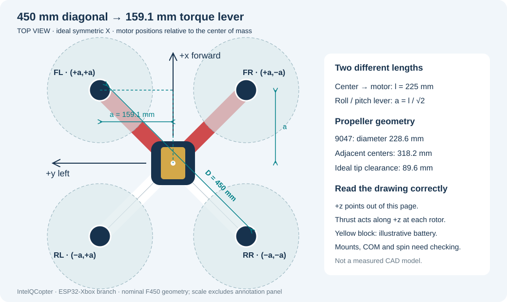
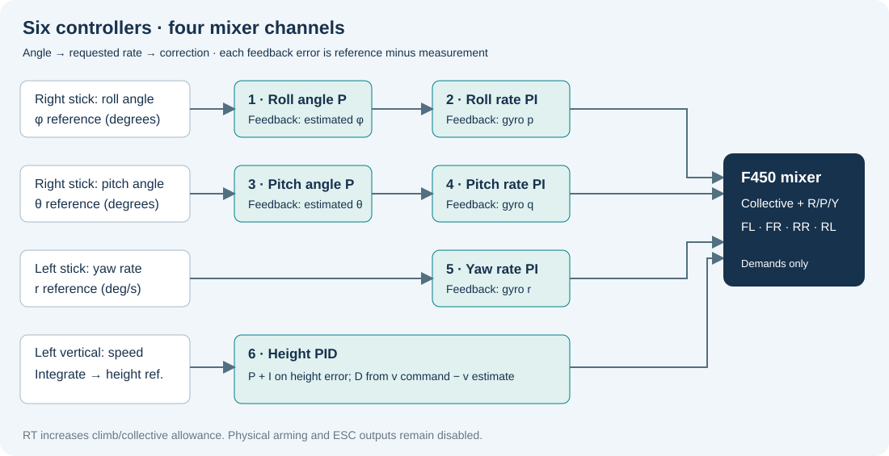
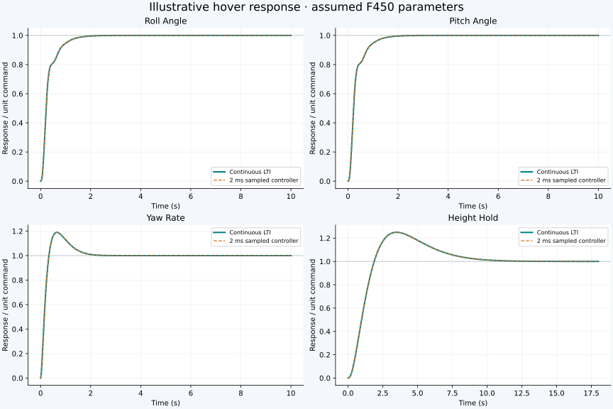

# Your F450, one equation at a time

<div class="hero-note">A guided path from the four propellers to a linear hover model, six controller gains and a 2 ms implementation.</div>

**[Open the illustrated offline reading view](current-model-and-fc-integration.html).**

This edition follows your request for **linear, time-invariant (LTI) equations**. We study small movements around level hovering. The airframe itself is not globally linear: this model is useful near that operating point. It cannot predict flips, large tilt, motor saturation or a battery shutdown accurately. You do not need the nonlinear derivations to follow this guide.

The calculations below use the same provisional gains as the active ESP32 C file. The model and discretization also apply to the RP2350 architecture; platform drivers and storage differ. We have **not** measured the complete aircraft mass, inertia or propeller thrust. The numerical examples are a transparent calculation scenario, not flight-certified settings.

<nav class="chapter-links"><a href="#1-what-is-t">1 · Force</a><a href="#2-draw-the-f450-before-writing-torques">2 · F450 geometry</a><a href="#4-build-the-linear-differential-equations">4 · Differential equations</a><a href="#6-from-a-differential-equation-to-a-transfer-function">6 · Transfer functions</a><a href="#8-calculate-the-six-controller-gains">8 · Six gains</a><a href="#10-turn-continuous-equations-into-2-ms-updates">10 · Discrete time</a><a href="#12-kalman-filtering-with-every-step-shown">12 · Kalman</a><a href="#16-why-centring-the-stick-requires-a-braking-loop">16 · Braking</a><a href="#17-gentle-inputs-rtlt-and-the-pid-headroom-calculation">17 · Trigger headroom</a><a href="#18-what-the-present-filters-and-experiments-establish">18 · Evidence limits</a></nav>

<div class="hero-note"><strong>Current implementation:</strong> Gentle stick inputs; angle roll/pitch, yaw rate, vertical-speed/hover control; optional position-aided braking. Read chapters 16–18 after the six-PID and Kalman derivations. The real hardware does not yet have the simulated horizontal localization.</div>

**Navigation:** [Run a simulation](run-simulation.md) · [Settings and command authority](control-workbench.md) · [PCB assembly](../hardware/home-etched-fc/README.md) · [Measurements still needed](../measurements/README.md).

## 0. Read the symbols as short sentences

| Symbol | Read it as | Unit |
|---|---|---|
| $h$ | Height above the selected reference | m |
| $\dot h=v_z$ | How quickly height changes | m/s |
| $\ddot h=\dot v_z$ | How quickly vertical speed changes | m/s² |
| $\phi,\theta,\psi$ | Roll, pitch, yaw angles | rad in the physical model |
| $p,q,r$ | Rotation speeds about body x, y, z | rad/s in the physical model |
| $T_i$ | Upward force from propeller $i$ | N |
| $\tau_x,\tau_y,\tau_z$ | Turning action about each axis | N·m |
| $m$ | Total takeoff mass | kg |
| $J_x,J_y,J_z$ | Resistance to angular acceleration | kg·m² |
| $u_i$ | Normalized mathematical motor command | dimensionless |
| $s$ | Laplace variable used to describe continuous dynamics | 1/s |
| $k$ | Integer sample number: 0, 1, 2, … | no unit |
| $\Delta t$ | Time between two control updates | s |

A dot means a derivative with respect to time. A subscript often names a direction or sample. A capital $T_i$ is thrust; our sample interval is always $\Delta t$, so these cannot be confused.

$$
\dot h=\frac{dh}{dt},\qquad
\ddot h=\frac{d}{dt}\left(\frac{dh}{dt}\right),\qquad
h_k=h(k\Delta t).
$$

For example: height rises from 1.000 m to 1.004 m in 0.002 s. Its average vertical speed during that interval is

$$
\frac{\Delta h}{\Delta t}=\frac{1.004-1.000}{0.002}=2\ \mathrm{m/s}.
$$

This calculation is a definition of average speed. We generally use the altitude filter's velocity estimate in the controller because differentiating a noisy height reading amplifies noise.

## 1. What is T?

Each spinning propeller pushes air down. The air exerts an upward force on the propeller, motor and frame. Call that force's magnitude $T_i$. Four parallel rotors contribute to the same upward direction when the drone is level:

$$
T=T_{FL}+T_{FR}+T_{RR}+T_{RL}.
$$

FL means front-left, FR front-right, RR rear-right, RL rear-left. This is the logical order in the C mixer. It still needs checking against physical wiring.

Gravity supplies a downward force $mg$. Choose upward as positive. Newton's law says **net force equals mass times acceleration**:

$$
\underbrace{T}_{\text{upward}}
-\underbrace{mg}_{\text{downward}}
=\underbrace{m\ddot h}_{\text{mass times vertical acceleration}}.
$$

Level hover means no vertical acceleration and no vertical speed. Substitute $\ddot h=0$:

$$
T_0-mg=m(0)=0
\quad\Longrightarrow\quad T_0=mg.
$$

With a centered center of mass and equal loading, each rotor supplies a quarter:

$$
T_{i0}=\frac{mg}{4}.
$$

**Example only:** choose $m=1.2$ kg and $g=9.80665$ m/s². Then

$$
T_0=1.2(9.80665)=11.76798\ \mathrm N,
\qquad T_{i0}=2.941995\ \mathrm N.
$$

If the motors add 1.2 N of total thrust above this hover value, with no drag,

$$
\ddot h=\frac{(11.76798+1.2)-11.76798}{1.2}
=1\ \mathrm{m/s^2}.
$$

Notice that this is acceleration, not speed. Starting at rest, that acceleration would produce 1 m/s after one second if it remained constant.

## 2. Draw the F450 before writing torques



Our body axes are **x forward, y left, z up**. Positive rotation follows the right-hand rule around that axis. This choice is right-handed. Positive pitch rotates the forward axis toward downward z; check stick and IMU signs against this convention before wiring motors.

Use an ideal symmetric F450 X geometry. The nominal **450 mm** is the opposite-motor center distance, not the length of one arm and not the pitch/roll torque lever. Measure your clone before treating it as exact.

Let $D=0.450$ m be that diagonal. The center-to-motor distance is $l=D/2$. Each arm makes 45° with the forward axis. Its forward and lateral projections are equal:

$$
l=\frac{D}{2}=0.225\ \mathrm m,
\qquad
a=l\cos45^\circ=\frac{D}{2\sqrt2}=0.159099\ \mathrm m.
$$

We can obtain the same result using Pythagoras:

$$
l^2=a^2+a^2=2a^2
\quad\Longrightarrow\quad a^2=\frac{l^2}{2}
\quad\Longrightarrow\quad a=\frac{l}{\sqrt2}.
$$

| Rotor | Forward coordinate x | Left coordinate y | Roll torque per thrust | Pitch torque per thrust |
|---|---:|---:|---:|---:|
| FL | $+a$ | $+a$ | $+aT_{FL}$ | $-aT_{FL}$ |
| FR | $+a$ | $-a$ | $-aT_{FR}$ | $-aT_{FR}$ |
| RR | $-a$ | $-a$ | $-aT_{RR}$ | $+aT_{RR}$ |
| RL | $-a$ | $+a$ | $+aT_{RL}$ | $+aT_{RL}$ |

### 2.1 Why force multiplied by distance is torque

A force at the center lifts the drone without that force's lever arm turning it. The same vertical force away from the center also turns it. The perpendicular distance to the roll axis is the motor's y coordinate. Therefore its roll torque is $y_iT_i$. The corresponding signed pitch torque is $-x_iT_i$.

The vector form makes both signs explicit. Here the force has only a z component:

$$
\begin{bmatrix}x_i\\y_i\\0\end{bmatrix}
\times
\begin{bmatrix}0\\0\\T_i\end{bmatrix}
=
\begin{bmatrix}y_iT_i-0\cdot0\\0\cdot0-x_iT_i\\x_i\cdot0-y_i\cdot0\end{bmatrix}
=\begin{bmatrix}y_iT_i\\-x_iT_i\\0\end{bmatrix}.
$$

Add the four rotor contributions:

$$
\tau_x=a(T_{FL}-T_{FR}-T_{RR}+T_{RL}),
$$

$$
\tau_y=a(-T_{FL}-T_{FR}+T_{RR}+T_{RL}).
$$

**Try a number:** increase each left rotor by 0.10 N and decrease each right rotor by 0.10 N. The total thrust change is zero, but the roll torque is not:

$$
\delta T=0.10-0.10-0.10+0.10=0,
$$

$$
\delta\tau_x=a(0.10+0.10+0.10+0.10)
=0.159099(0.40)=0.0636396\ \mathrm{N\,m}.
$$

This is how we command a roll while approximately preserving altitude near hover.

### 2.2 Yaw comes from propeller reaction torque

Vertical thrust at a horizontal lever arm gives no yaw term in the cross product above. Yaw instead comes from the air's reaction to propeller rotation. Counter-rotating pairs allow those reactions to cancel at hover.

Use a local proportionality $\kappa$ with units of meters, since torque/thrust has units $(\mathrm{N\,m})/\mathrm N$. Choose the reaction signs used by our logical mixer:

$$
\tau_z=\kappa(-T_{FL}+T_{FR}-T_{RR}+T_{RL}).
$$

The negative/positive signs specify torque on the aircraft. They are a **provisional spin convention**, not a verified propeller installation. Changing spin order changes this row.

### 2.3 Put the four sums into one multivariable equation

Each row below is one sum we already derived. Each column describes one rotor:

$$
\begin{bmatrix}T\\\tau_x\\\tau_y\\\tau_z\end{bmatrix}
=
\underbrace{\begin{bmatrix}
1&1&1&1\\
a&-a&-a&a\\
-a&-a&a&a\\
-\kappa&\kappa&-\kappa&\kappa
\end{bmatrix}}_{M\text{, force/torque allocation}}
\begin{bmatrix}T_{FL}\\T_{FR}\\T_{RR}\\T_{RL}\end{bmatrix}.
$$

For example, row two times the column of thrusts gives exactly $aT_{FL}-aT_{FR}-aT_{RR}+aT_{RL}$. We use the matrix to keep these four physical sums together.

To recover required rotor forces from desired total force and torques, add/subtract the four equations. The result is

$$
\begin{aligned}
T_{FL}&=T/4+\tau_x/(4a)-\tau_y/(4a)-\tau_z/(4\kappa),\\
T_{FR}&=T/4-\tau_x/(4a)-\tau_y/(4a)+\tau_z/(4\kappa),\\
T_{RR}&=T/4-\tau_x/(4a)+\tau_y/(4a)-\tau_z/(4\kappa),\\
T_{RL}&=T/4+\tau_x/(4a)+\tau_y/(4a)+\tau_z/(4\kappa).
\end{aligned}
$$

These are **forces in N**. The C mixer instead combines dimensionless collective, roll, pitch and yaw corrections with the same sign pattern. The physical conversion between those corrections and torques must use a measured thrust slope.

### 2.4 Your 9047 propellers and battery

The nominal prop diameter is 9 inches = 0.2286 m; nominal pitch is 4.7 inches = 0.11938 m. Pitch is a geometric specification, not actual distance traveled per revolution. Ideal adjacent motor spacing is $2a=0.318198$ m, leaving about $0.089598$ m between ideal coplanar propeller tip circles. Check real frame, prop deflection and mounting dimensions.

The pack label gives 3S, 4.2 Ah and nominal 11.1 V. Its nominal energy is $11.1(4.2)=46.62$ Wh. This does not establish useful flight time or delivered power. Likewise 1400 KV gives an approximate unloaded speed constant, not thrust or motor torque. We must measure those separately.

## 3. Specify the operating point and the unknowns

An operating point is the condition around which we calculate small changes. Ours is level, stationary hover, with zero yaw angle used as the world-axis reference:

$$
\phi_0=\theta_0=\psi_0=0,\quad
v_{x0}=v_{y0}=v_{z0}=0,\quad p_0=q_0=r_0=0,\quad T_0=mg.
$$

Define a perturbation as the departure from that condition:

$$
\delta T=T-T_0,\quad \delta u_i=u_i-u_{i0},\quad
\delta h=h-h_0.
$$

If a motor supplies 3.041995 N while its hover value is 2.941995 N, its perturbation is 0.10 N. The symbol $\delta$ does not mean uncertainty here; it means a change from the chosen equilibrium.

| Quantity | Numerical scenario | Status |
|---|---:|---|
| Motor diagonal $D$ | 0.450 m | Nominal F450 geometry; measure |
| Complete mass $m$ | 1.200 kg | Assumed flight scenario |
| $J_x,J_y,J_z$ | 0.012, 0.012, 0.022 kg·m² | Assumed |
| Local thrust slope $k_T$ | 6 N / normalized command | Assumed per rotor |
| Motor time constant $\tau_m$ | 0.040 s | Assumed |
| Reaction ratio $\kappa$ | 0.015 m | Assumed |
| Translational drag $d_x,d_y,d_z$ | 0.12 N·s/m | Assumed |
| Sample period $\Delta t$ | 0.002 s | Firmware target; real deadlines unmeasured |
| Battery mass | about 0.150 kg | User estimate, not a measured total mass |

The archived component model's 0.740 kg is a different assumption. Do not combine it with the 1.2 kg example as if both were measurements of the same build.

### 3.1 How the F450 geometry contributes to inertia

For roll, a point mass at $(x_i,y_i,z_i)$ contributes $m_i(y_i^2+z_i^2)$. Moving the mass farther from the roll axis increases the resistance to roll acceleration. Four identical motor/ESC groups of mass $m_e$ at $(\pm a,\pm a,0)$ contribute

$$
J_{x,\mathrm{ends}}=4m_ea^2,\quad
J_{y,\mathrm{ends}}=4m_ea^2,\quad
J_{z,\mathrm{ends}}=8m_ea^2.
$$

For a centered rectangular battery of dimensions $L_x,L_y,L_z$:

$$
J_{x,b}=\frac{m_b}{12}(L_y^2+L_z^2),\quad
J_{y,b}=\frac{m_b}{12}(L_x^2+L_z^2),\quad
J_{z,b}=\frac{m_b}{12}(L_x^2+L_y^2).
$$

If the battery center is displaced by $(x_b,y_b,z_b)$ from the complete aircraft's center of mass, add $m_b(y_b^2+z_b^2)$ to its roll inertia, and the analogous terms to the other axes. This is the parallel-axis theorem. The frame has distributed mass and must also be included. We cannot infer all inertia values from 150 g of estimated battery mass alone.

## 4. Build the linear differential equations

### 4.1 Height: remove the constant hover force

Start with upward thrust minus weight minus vertical drag:

$$
m\ddot h=T-mg-d_z\dot h.
$$

Insert $T=mg+\delta T$ and $h=h_0+\delta h$. The reference $h_0$ is constant, so its derivatives are zero:

$$
m\delta\ddot h=(mg+\delta T)-mg-d_z\delta\dot h.
$$

Cancel the two $mg$ terms and put the drag term on the left:

$$
\boxed{m\delta\ddot h+d_z\delta\dot h=\delta T.}
$$

This is second order because height's second derivative appears. It is linear because the coefficients $m,d_z$ are constants and no unknown states multiply each other. Gravity has not disappeared physically: it is balanced by the constant hover thrust.

### 4.2 Roll and pitch: the rotational version of Newton's law

For small rotations near level hover and approximately principal body axes, torque equals inertia times angular acceleration:

$$
J_x\dot p=\tau_x,\qquad J_y\dot q=\tau_y,\qquad J_z\dot r=\tau_z.
$$

Near the operating point, body rates coincide with Euler-angle derivatives:

$$
\dot\phi=p,\quad\dot\theta=q,\quad\dot\psi=r.
$$

Substitute the first equality into the roll equation and repeat for pitch:

$$
\boxed{J_x\ddot\phi=\tau_x,\qquad J_y\ddot\theta=\tau_y.}
$$

The approximation omits products of angular rates. At small rates their effect is of higher order than the terms retained here. It is the reason these equations are a local hover model. We do not need to carry those omitted terms through this tutorial.

Using the torque example from §2, with assumed $J_x=0.012$:

$$
\ddot\phi=\frac{0.0636396}{0.012}=5.3033\ \mathrm{rad/s^2}.
$$

The yaw controller regulates $r$, not $\psi$. Its plant therefore needs only one integration from yaw torque to yaw rate, plus the motor dynamics added below.

### 4.3 Horizontal motion: the multivariable connection

For small tilt around our zero-heading reference, pitch directs thrust along +x, and positive roll directs it along −y. A small angle in radians gives approximately that same fraction of hover thrust sideways:

$$
F_x\approx mg\theta,\qquad F_y\approx-mg\phi.
$$

Apply Newton's law and divide every term by $m$:

$$
m\ddot x=mg\theta-d_x\dot x
\quad\Longrightarrow\quad
\boxed{\ddot x=g\theta-\frac{d_x}{m}\dot x,}
$$

$$
\boxed{\ddot y=-g\phi-\frac{d_y}{m}\dot y.}
$$

For a 5° pitch, convert to radians before using this physical equation:

$$
\theta=5\frac{\pi}{180}=0.0872665,
\qquad \ddot x\approx9.80665(0.0872665)=0.8558\ \mathrm{m/s^2}
$$

at zero horizontal speed. This explains why an autonomous position controller can request pitch/roll angles from the flight controller. The current six loops do not themselves close horizontal position feedback.

### 4.4 Keep motor response delay while staying linear

Let $\delta T_i$ be a rotor's actual force change. A command does not create that force instantly. A first-order local motor/propeller model is

$$
\boxed{\tau_m\delta\dot T_i+\delta T_i=k_T\delta u_i.}
$$

Rearrange it as an update direction:

$$
\delta\dot T_i=\frac{k_T\delta u_i-\delta T_i}{\tau_m}.
$$

If the desired force change is 0.6 N and the current force change is zero, the initial slope is $0.6/0.04=15$ N/s. As actual thrust approaches 0.6 N, the difference shrinks, so the slope shrinks. At one time constant the response reaches about 63.2% of the final change. This is a **linear** differential equation.

## 5. A compact multivariable state model

Define the twelve body/motion states in this exact order:

$$
X=\begin{bmatrix}x&y&\delta h&v_x&v_y&v_z&\phi&\theta&\psi&p&q&r\end{bmatrix}^T,
\quad U=\begin{bmatrix}\delta T&\tau_x&\tau_y&\tau_z\end{bmatrix}^T.
$$

Instead of a wide table of mostly zeros, write the state equation by groups of three:

$$
\frac{d}{dt}\begin{bmatrix}\mathbf p\\\mathbf v\\\boldsymbol\eta\\\boldsymbol\omega\end{bmatrix}
=
\underbrace{\begin{bmatrix}
0&I&0&0\\
0&-\Lambda&G&0\\
0&0&0&I\\
0&0&0&0
\end{bmatrix}}_A
\begin{bmatrix}\mathbf p\\\mathbf v\\\boldsymbol\eta\\\boldsymbol\omega\end{bmatrix}
+BU,
$$

$$
\Lambda=\operatorname{diag}(d_x/m,d_y/m,d_z/m),\quad
G=\begin{bmatrix}0&g&0\\-g&0&0\\0&0&0\end{bmatrix},\quad
B=\begin{bmatrix}
0&0&0&0\\0&0&0&0\\0&0&0&0\\
0&0&0&0\\0&0&0&0\\1/m&0&0&0\\
0&0&0&0\\0&0&0&0\\0&0&0&0\\
0&1/J_x&0&0\\0&0&1/J_y&0\\0&0&0&1/J_z
\end{bmatrix}.
$$

Here $\mathbf p=[x,y,\delta h]^T$, $\boldsymbol\eta=[\phi,\theta,\psi]^T$, and each zero in the block matrix is a 3×3 zero block. The first row of blocks simply says $\dot{\mathbf p}=\mathbf v$. The second contains the three acceleration equations from §4. The third says angle changes at the corresponding rotation rate.

To include four rotor lags, append four more states $\mathbf f=[\delta T_{FL},\delta T_{FR},\delta T_{RR},\delta T_{RL}]^T$ and use $U=M\mathbf f$:

$$
\frac{d}{dt}\begin{bmatrix}X\\\mathbf f\end{bmatrix}
=\begin{bmatrix}A&BM\\0&-I_4/\tau_m\end{bmatrix}
\begin{bmatrix}X\\\mathbf f\end{bmatrix}
+\begin{bmatrix}0\\k_TI_4/\tau_m\end{bmatrix}\delta\mathbf u.
$$

That is a **16-state, four-input LTI model**. The generated [calculation data](assets/lti/calculations.json) contains every numerical matrix entry, its state order and its exact zero-order-hold discrete version. A model having 16 states does not mean we need 16 PIDs: it describes the coupled plant, while the six selected loops control attitude, yaw rate and height.

## 6. From a differential equation to a transfer function

### 6.1 What the Laplace substitution actually does

A transfer function compares an output to an input with zero initial perturbations. For that calculation, the Laplace transform turns differentiation into multiplication by $s$:

$$
\mathcal L\{\dot h\}=sH(s)-h(0)=sH(s),\qquad
\mathcal L\{\ddot h\}=s^2H(s)-sh(0)-\dot h(0)=s^2H(s).
$$

The initial conditions are not always zero in reality. We set them to zero to define the input/output transfer function; state equations can separately include a nonzero initial tilt or speed.

Transform the altitude equation term by term:

$$
m\delta\ddot h+d_z\delta\dot h=\delta T
\quad\Longrightarrow\quad
ms^2H(s)+d_zsH(s)=\Delta T(s).
$$

Factor out $H(s)$, then divide both sides by its coefficient and the input:

$$
(ms^2+d_zs)H(s)=\Delta T(s),
\qquad \boxed{\frac{H(s)}{\Delta T(s)}=\frac{1}{s(ms+d_z)}.}
$$

No controller is involved yet. This is the plant's height response to additional total thrust.

### 6.2 The normalized commands used by the C mixer

Let $c,R,P,Y$ be collective, roll, pitch and yaw command perturbations. Before limiting, the mixer uses

$$
\delta\mathbf u=
\begin{bmatrix}c+R-P-Y\\c-R-P+Y\\c-R+P-Y\\c+R+P+Y\end{bmatrix}.
$$

For a pure roll correction, the thrust changes are proportional to $[R,-R,-R,R]^T$. Substitute into the torque sum:

$$
\delta\tau_x=k_Ta[R-(-R)-(-R)+R]=4ak_TR.
$$

Therefore the roll angular acceleration gain in radians is $4ak_T/J_x$. The firmware uses degrees, so multiply by $180/\pi$:

$$
b_p=\frac{4ak_T}{J_x}\frac{180}{\pi}
=18231.4054\ \frac{\mathrm{deg/s^2}}{\text{unit correction}}.
$$

Similarly,

$$
b_q=\frac{4ak_T}{J_y}\frac{180}{\pi},\quad
b_r=\frac{4\kappa k_T}{J_z}\frac{180}{\pi}=937.5673,\quad
b_h=\frac{4k_T}{m}=20\ \frac{\mathrm{m/s^2}}{\text{unit collective}}.
$$

Use radians consistently for the multivariable physical model; use degrees consistently when reproducing the firmware gains. Mixing the two gives a factor-of-57.3 error.

### 6.3 Keep lag in the final plant transfer functions

The motor equation transforms to $\Delta T_i/\Delta u_i=k_T/(\tau_ms+1)$. Cascaded physical effects multiply, giving

$$
\boxed{\frac{p_{\deg}(s)}{R(s)}=\frac{b_p}{s(\tau_ms+1)}},\qquad
\boxed{\frac{\Phi_{\deg}(s)}{R(s)}=\frac{b_p}{s^2(\tau_ms+1)}}.
$$

Pitch has the same form using $b_q$. Yaw rate uses $b_r/[s(\tau_ms+1)]$. Height uses

$$
\boxed{\frac{H(s)}{c(s)}=\frac{b_h}{s(s+\lambda_z)(\tau_ms+1)}},
\qquad\lambda_z=\frac{d_z}{m}=0.1\ \mathrm{s^{-1}}.
$$

Thus the final rate plants are second order, and the angle/height plants are third order. Including lag makes these models more informative while keeping them linear.

For example,

$$
\frac{H(s)}{c(s)}=\frac{20}{s(s+0.1)(0.04s+1)}
=\frac{20}{0.04s^3+1.004s^2+0.1s}.
$$

The simpler $b_h/s^2$ plant is used below only as a first gain-design step. We then check the selected gains against the lag-and-drag plant.

## 7. Understand the six loops before choosing gains



| # | Loop | Error | Output |
|---|---|---|---|
| 1 | Roll angle | desired angle − estimated roll | desired roll rate |
| 2 | Roll rate | desired rate − measured rate | roll mixer correction |
| 3 | Pitch angle | desired angle − estimated pitch | desired pitch rate |
| 4 | Pitch rate | desired rate − measured rate | pitch mixer correction |
| 5 | Yaw rate | desired rate − measured rate | yaw mixer correction |
| 6 | Height | reference height − estimated height | collective correction |

The centered left vertical stick requests zero vertical speed. It freezes the height reference. A displaced stick requests a vertical speed, which advances that reference. The altitude PID's derivative term uses commanded minus estimated vertical speed; there is no separate seventh vertical-rate PID.

For one controller, define error $e=y_{\rm ref}-y$. The three contributions are

$$
u_P=K_pe,\qquad u_I=K_i\int e\,dt,\qquad u_D=K_d\dot e.
$$

P responds to the current error. I accumulates persistent error. D responds to change and can provide damping. Adding a nonzero coefficient is not automatically an improvement: a derivative of noisy gyro data can amplify noise, and multiple integrators complicate a cascade. We initially use outer P, inner PI, yaw PI and altitude PID. These are chosen structures; the same PID data type stores zero coefficients where a term is not used.

## 8. Calculate the six controller gains

### 8.1 Roll/pitch rate PI: derive the characteristic equation

Begin with the simplified rate plant $G(s)=b_p/s$ and controller $C(s)=K_p+K_i/s=(K_ps+K_i)/s$. Negative feedback means

$$
Y=GC(Y_{\rm ref}-Y)=GCY_{\rm ref}-GCY.
$$

Move the second term to the left and factor:

$$
Y+GCY=GCY_{\rm ref},\quad
Y(1+GC)=GCY_{\rm ref},\quad
\frac{Y}{Y_{\rm ref}}=\frac{GC}{1+GC}.
$$

Its denominator determines its poles. Substitute $G$ and $C$:

$$
1+\frac{b_p(K_ps+K_i)}{s^2}=0
\quad\Longrightarrow\quad
s^2+b_pK_ps+b_pK_i=0.
$$

Choose a desired second-order denominator $s^2+2\zeta\omega_ns+\omega_n^2$. Here $\zeta$ describes damping and $\omega_n$ describes the chosen response speed in rad/s. Matching the coefficient of $s$ and the constant term separately gives

$$
b_pK_p=2\zeta\omega_n,\quad b_pK_i=\omega_n^2
\quad\Longrightarrow\quad
\boxed{K_p=\frac{2\zeta\omega_n}{b_p},\quad K_i=\frac{\omega_n^2}{b_p}.}
$$

Choose $\zeta=0.9$, $\omega_n=8.4$ rad/s. These are design choices, not sensor readings. Substitute each number:

$$
2\zeta\omega_n=2(0.9)(8.4)=15.12,\quad
\omega_n^2=8.4^2=70.56,
$$

$$
K_p=15.12/18231.4054=0.0008293381,\quad
K_i=70.56/18231.4054=0.0038702447.
$$

Pitch uses the same values in this symmetric inertia scenario. An actual difference between $J_x$ and $J_y$ changes them.

### 8.2 The outer roll and pitch angle loops

If the inner rate loop followed its reference instantly, $p=K_a(\phi_{\rm ref}-\phi)$. Since $\dot\phi=p$:

$$
\dot\phi+K_a\phi=K_a\phi_{\rm ref},\qquad
\frac{\Phi}{\Phi_{\rm ref}}=\frac{K_a}{s+K_a}.
$$

Choosing $K_a=3\ \mathrm{s^{-1}}$ would give an ideal time constant of $1/3$ s. The inner loop is not instantaneous; §9 checks the complete cascade with motor lag rather than treating this ideal estimate as the final answer.

### 8.3 Yaw rate PI

Use the same rate-PI calculation with yaw gain $b_r=937.5673$, chosen $\omega_n=2.8$ rad/s and $\zeta=0.9$:

$$
K_{p,r}=\frac{2(0.9)(2.8)}{937.5673}=0.0053756141,
\quad K_{i,r}=\frac{2.8^2}{937.5673}=0.0083620664.
$$

Yaw rate has a lower chosen response bandwidth. There is no yaw-angle target or heading lock in this design.

### 8.4 Height PID: expand all terms

Start with $G_h=b_h/s^2$ and $C_h=K_p+K_i/s+K_ds$. The characteristic equation is

$$
1+\frac{b_h(K_ds^2+K_ps+K_i)}{s^3}=0
\quad\Longrightarrow\quad
s^3+b_hK_ds^2+b_hK_ps+b_hK_i=0.
$$

A third-order polynomial needs three poles. Choose a real pole at $-p_h$ and a second-order pair:

$$
(s+p_h)(s^2+2\zeta_h\omega_hs+\omega_h^2).
$$

Distribute $s$, then distribute $p_h$:

$$
\begin{aligned}
&s^3+2\zeta_h\omega_hs^2+\omega_h^2s\\
&\quad+p_hs^2+2\zeta_h\omega_hp_hs+p_h\omega_h^2.
\end{aligned}
$$

Collect equal powers:

$$
s^3+(2\zeta_h\omega_h+p_h)s^2
+(\omega_h^2+2\zeta_h\omega_hp_h)s+p_h\omega_h^2.
$$

Now match three coefficients, just as for the rate loop:

$$
K_d=\frac{2\zeta_h\omega_h+p_h}{b_h},\quad
K_p=\frac{\omega_h^2+2\zeta_h\omega_hp_h}{b_h},\quad
K_i=\frac{p_h\omega_h^2}{b_h}.
$$

Choose $\omega_h=1.05$, $p_h=0.56$, $\zeta_h=0.9$, $b_h=20$. The intermediate arithmetic is

$$
2\zeta_h\omega_h=1.89,\quad \omega_h^2=1.1025,\quad
1.89(0.56)=1.0584,\quad0.56(1.1025)=0.6174.
$$

Therefore

$$
K_d=(1.89+0.56)/20=0.1225,
$$

$$
K_p=(1.1025+1.0584)/20=0.108045,\qquad
K_i=0.6174/20=0.03087.
$$

### 8.5 Values currently in the C file

| Loop | $K_p$ | $K_i$ | $K_d$ | Units of error → output |
|---|---:|---:|---:|---|
| Roll angle | 3 | 0 | 0 | deg → deg/s |
| Roll rate | 0.000829338 | 0.003870245 | 0 | deg/s → normalized correction |
| Pitch angle | 3 | 0 | 0 | deg → deg/s |
| Pitch rate | 0.000829338 | 0.003870245 | 0 | deg/s → normalized correction |
| Yaw rate | 0.005375614 | 0.008362066 | 0 | deg/s → normalized correction |
| Height | 0.108045 | 0.03087 | 0.1225 | m → normalized collective correction |

These numbers are provisional. We have explained how the existing values arise; this document does not silently retune the firmware from unmeasured aircraft parameters.

## 9. Check stability with motor lag and drag included

### 9.1 What a stable pole means

A pole $s=-a$ with $a>0$ contributes a decaying response proportional to $e^{-at}$. A positive real part grows. A conjugate pair with negative real parts decays while oscillating. For a continuous LTI feedback system, every pole must have negative real part for asymptotic stability.

For the rate PI with motor lag, multiplying the closed-loop denominator gives

$$
\tau_ms^3+s^2+bK_ps+bK_i.
$$

The cubic Routh table's first column is $\tau_m$, $1$, $b(K_p-\tau_mK_i)$, $bK_i$. With positive $b,\tau_m$, it is positive only if

$$
K_i>0,\qquad K_p>\tau_mK_i.
$$

For roll, $\tau_mK_i=0.04(0.003870245)=0.00015481$, which is smaller than $K_p=0.000829338$. This is a check on the inner loop under the assumed lag, not yet a check on the outer loop.

### 9.2 The complete angle cascade is fourth order

The inner closed-loop rate transfer is

$$
T_p(s)=\frac{b(K_ps+K_i)}{\tau_ms^3+s^2+bK_ps+bK_i}.
$$

The outer loop has angle integration $1/s$ and gain $K_a$. Its characteristic equation is $1+K_aT_p(s)/s=0$. Multiply by the denominator and then distribute:

$$
s(\tau_ms^3+s^2+bK_ps+bK_i)+K_ab(K_ps+K_i)=0,
$$

$$
\boxed{\tau_ms^4+s^3+bK_ps^2+b(K_i+K_aK_p)s+K_abK_i=0.}
$$

For height with drag and lag, the equivalent characteristic polynomial is

$$
\boxed{\tau_ms^4+(1+\tau_m\lambda_z)s^3+(\lambda_z+b_hK_d)s^2+b_hK_ps+b_hK_i.}
$$

To check a quartic $a_4s^4+a_3s^3+a_2s^2+a_1s+a_0$, form

$$
\Delta_2=a_3a_2-a_4a_1,\qquad
\Delta_3=\Delta_2a_1-a_3^2a_0.
$$

If all five coefficients and these two quantities are positive, the Routh criterion places all four poles in the stable half-plane. The height numbers give

$$
(a_4,a_3,a_2,a_1,a_0)=(0.04,1.004,2.55,2.1609,0.6174),
$$

$$
\Delta_2=1.004(2.55)-0.04(2.1609)=2.473764>0,
$$

$$
\Delta_3=2.473764(2.1609)-1.004^2(0.6174)=4.7232075492>0.
$$

The generated numerical eigenvalues use the rounded values actually written in C:

| Loop | Continuous closed-loop poles, approximately | Largest sampled pole magnitude |
|---|---|---:|
| Roll and pitch angle cascades | $-5.8936\pm12.6651j,\ -10.6716,\ -2.5412$ | 0.994932 |
| Yaw rate | $-18.8745,\ -3.0627\pm1.0020j$ | 0.993840 |
| Height hold | $-22.3550,\ -1.3755,\ -0.6847\pm0.1819j$ | 0.998631 |



These are **calculated LTI responses with ideal state measurements**, not Gazebo, real sensor, radio or flight results. The plotted reference is a small unit step: one degree for roll/pitch, one degree/second for yaw rate, one meter for height. For the linear model, scaling the input scales the output; real actuator limits break that property. The height plot steps a reference directly to illustrate height hold; a stick climb advances it gradually instead.

## 10. Turn continuous equations into 2 ms updates

The microcontroller runs numbered steps. At 500 Hz,

$$
\Delta t=\frac{1}{500}=0.002\ \mathrm s.
$$

Use the **measured** interval in the real C functions. The target does not prove every deadline is met.

### 10.1 Integrate a constant acceleration over one interval

If acceleration is constant during a sample, speed grows linearly:

$$
v(t_k+\xi)=v_k+a_k\xi,\qquad 0\le\xi\le\Delta t.
$$

At the next sample,

$$
v_{k+1}=v_k+a_k\Delta t.
$$

Height changes by the area under that speed curve: a rectangle plus a triangle:

$$
h_{k+1}-h_k=v_k\Delta t+\frac12(a_k\Delta t)\Delta t,
$$

$$
\boxed{h_{k+1}=h_k+v_k\Delta t+\tfrac12a_k\Delta t^2.}
$$

With $h_k=1$, $v_k=0.2$, $a_k=0.5$, we get $v_{k+1}=0.201$ m/s and $h_{k+1}=1.000401$ m. Both equations use the **old** velocity $v_k$. Updating velocity first and then using it in the height equation double-counts part of the acceleration effect.

### 10.2 Exact discrete motor lag for a held command

Hold the target $f_*=k_T\delta u_k$ constant for this interval. Let $e_f=\delta T-f_*$. The motor equation becomes

$$
\dot e_f=-e_f/\tau_m
\quad\Longrightarrow\quad
e_f(t_k+\Delta t)=e_f(t_k)e^{-\Delta t/\tau_m}.
$$

Add the target back to both sides:

$$
\boxed{\delta T_{k+1}=\alpha\delta T_k+(1-\alpha)k_T\delta u_k},\qquad
\alpha=e^{-\Delta t/\tau_m}=e^{-0.05}=0.9512294.
$$

Starting from zero force change with a target of 0.6 N gives $\delta T_{k+1}=0.0487706(0.6)=0.0292624$ N. This is exact for the first-order model and a held command. A forward-Euler approximation would use $\alpha\approx1-\Delta t/\tau_m=0.95$.

### 10.3 General state update: preserve coupling

For the full linear plant, use

$$
X_{k+1}=A_dX_k+B_du_k,\qquad
A_d=e^{A\Delta t},\quad B_d=\int_0^{\Delta t}e^{A\xi}B\,d\xi.
$$

You do not need to calculate a general matrix exponential by hand. `tools/model/model_lti.py` calculates these matrices once using a numerical library. The microcontroller can then multiply by constant precomputed coefficients if that plant model is needed there. Its actual estimator already has small explicit equations.

For the simple height/velocity constant-acceleration model, the exact matrices are familiar:

$$
\begin{bmatrix}h_{k+1}\\v_{k+1}\end{bmatrix}
=\begin{bmatrix}1&\Delta t\\0&1\end{bmatrix}
\begin{bmatrix}h_k\\v_k\end{bmatrix}
+\begin{bmatrix}\Delta t^2/2\\\Delta t\end{bmatrix}a_k.
$$

The 16-state plant's exact matrices are in the calculation JSON. Combining independent scalar updates in the wrong order would generally differ from this coupled zero-order-hold model.

## 11. The controller's discrete equations, matched to C

### 11.1 One PI/PID step

At step $k$, calculate $e_k=r_k-y_k$. First compute a candidate integral using the **current** error:

$$
I_k^*=\operatorname{clip}(I_{k-1}+e_k\Delta t,-I_{\max},I_{\max}).
$$

The derivative uses the measurement change, avoiding a derivative kick when the setpoint jumps:

$$
D_k=\frac{y_k-y_{k-1}}{\Delta t},\qquad
u_k^*=K_pe_k+K_iI_k^*-K_dD_k.
$$

On the first step, C sets $D_k=0$ because it has no previous measurement. Clip the candidate output to the permitted range. Accept the candidate integral if the output is unsaturated, or if the error would move a saturated output back toward its range. This is the implemented conditional integration rule. It does not account for every later mixer saturation.

**Numerical rate step:** desired rate 10°/s, measured rate 2°/s, previous integral 0, $\Delta t=0.002$:

$$
e_k=8,\quad I_k^*=0+8(0.002)=0.016,
$$

$$
u_k=0.000829338(8)+0.003870245(0.016)=0.006696628.
$$

This is a dimensionless roll correction. The four mixer entries receive plus/minus this correction; it is not a force in N.

### 11.2 Height reference and its derivative contribution

For vertical stick command $s_v\in[-1,1]$ and boost $b\in[0,1]$, the present code has

$$
v_{\rm cmd}=s_v(2+b)\ \mathrm{m/s},\quad
h_{{\rm ref},k}=h_{{\rm ref},k-1}+v_{{\rm cmd},k}\Delta t.
$$

It bounds that reference to within 2 m of estimated height. The height controller calculates

$$
u_{h,k}=K_p(h_{{\rm ref},k}-\hat h_k)+K_iI_k^*
+K_d(v_{{\rm cmd},k}-\hat v_k).
$$

When the stick centers, $v_{\rm cmd}=0$ and the reference stops moving. If the drone still rises, $\hat v_k>0$, so the D contribution becomes negative and reduces collective.

### 11.3 Discrete transfer expressions and stability

Away from clamps, the integral update has the discrete transfer

$$
\frac{I(z)}{E(z)}=\frac{\Delta t}{1-z^{-1}}.
$$

To see why, shift the sequence equation $I_k-I_{k-1}=\Delta t e_k$ into the z-domain. A one-sample delay becomes multiplication by $z^{-1}$, giving $I(z)-z^{-1}I(z)=\Delta t E(z)$; factor and divide.

Thus the PI controller has $C(z)=K_p+K_i\Delta t/(1-z^{-1})$. With derivative on measurement, the general controller is

$$
U(z)=\left(K_p+\frac{K_i\Delta t}{1-z^{-1}}\right)(R(z)-Y(z))
-K_d\frac{1-z^{-1}}{\Delta t}Y(z).
$$

A sampled pole $z=0.99$ contributes powers $0.99^k$, which decay. A sampled pole with magnitude above 1 grows. Therefore require $|z_i|<1$. The script forms the **sampled controller plus held-input plant**, matching use of the candidate integral, and calculates the pole magnitudes listed in §9. It does not merely exponentiate the continuous closed-loop poles.

This calculation assumes zero computation/communication delay, ideal states and no saturation. A later hardware timing measurement must supply realistic delay and jitter before calling the complete implementation stable in practice.

### 11.4 An important boundary between model and firmware

The firmware still includes saturation, reference limiting, boost ramps, tilt compensation, calibration gates and disarm logic. Those useful implementation behaviors are not LTI. We keep them in the code while using an unsaturated near-hover LTI approximation to understand and calculate the gains.

The code's hover collective is still 0.50. If we additionally assume the global force law $T_i=6u_i$, the equilibrium would instead be $11.76798/24=0.4903325$. A local slope $k_T=6$ alone does not determine that global offset. This is why the real hover collective must be measured rather than copied from the linear slope.

## 12. Kalman filtering with every step shown

### 12.1 Variance tells us how uncertain a number is

Given $N$ stationary readings $x_i$, the sample mean and sample variance are

$$
\bar x=\frac{x_1+\cdots+x_N}{N},\quad
s^2=\frac{(x_1-\bar x)^2+\cdots+(x_N-\bar x)^2}{N-1},\quad \sigma=s.
$$

For three gyro readings 0.7, 0.8, 0.9°/s while truly stationary, the mean is 0.8°/s. Squared deviations are 0.01, 0, 0.01, so $s^2=0.02/2=0.01$ (°/s)² and $s=0.1$°/s. Subtracting the mean corrects the estimated stationary bias; it does not remove random noise or temperature drift. The real code uses 500 accepted stationary samples and checks motion/noise before accepting a fit.

If samples are independent, uncertainty of the mean is $s/\sqrt N$. Filtered sensor samples are often correlated, so that formula can be optimistic. Repeat captures, examine correlation, and include the reference instrument's uncertainty.

### 12.2 A scalar Kalman update before adding more states

Suppose a predicted angle is 4° with variance $P^-=1$ deg². The accelerometer says 6° with measurement variance $R=4$ deg². The gain is

$$
K=\frac{P^-}{P^-+R}=\frac{1}{1+4}=0.2.
$$

First subtract the prediction from the measurement. That difference is the innovation:

$$
\nu=6-4=2^\circ.
$$

Then add only the gain-weighted innovation:

$$
\hat\phi^+=4+0.2(2)=4.4^\circ,\qquad
P^+=(1-K)P^-=0.8\ \mathrm{deg^2}.
$$

The new standard deviation is $\sqrt{0.8}=0.8944$°. The estimate trusts the accelerometer less because its assumed variance is larger. Kalman gain follows these uncertainty values; it is not an extra fixed PID tuning number.

### 12.3 What the current “1D IMU filter” actually stores

We estimate one angular axis at a time, but each axis has **two states**: angle and residual gyro bias. Calling it “1D” describes the angular axis, not its state dimension:

$$
x=\begin{bmatrix}\phi\\b_g\end{bmatrix},\quad
F=\begin{bmatrix}1&-\Delta t\\0&1\end{bmatrix},\quad
B=\begin{bmatrix}\Delta t\\0\end{bmatrix},\quad H=\begin{bmatrix}1&0\end{bmatrix}.
$$

The prediction multiplies out to

$$
\hat\phi_k^-=\hat\phi_{k-1}^++\Delta t(\omega_{g,k}-\hat b_{g,k-1}^+),\qquad
\hat b_{g,k}^-=\hat b_{g,k-1}^+.
$$

The gyro input here is already corrected by stationary calibration. This filter bias state accounts for residual drift. Roll and pitch each have their own copy.

Write uncertainty as

$$
P=\begin{bmatrix}P_{00}&P_{01}\\P_{10}&P_{11}\end{bmatrix}.
$$

$P_{00}$ is angle variance, $P_{11}$ is bias variance, and $P_{01}=P_{10}$ is their covariance. Prediction uses $P^-=FP^+F^T+Q$. Expanding just the entries needed in C, with $q_g$ a per-sample gyro variance and $q_b$ the bias random-walk intensity:

$$
\begin{aligned}
P_{00}^-&=P_{00}-\Delta t(P_{01}+P_{10})+\Delta t^2P_{11}+q_g\Delta t^2+q_b\Delta t^3/3,\\
P_{01}^-&=P_{01}-\Delta tP_{11}-q_b\Delta t^2/2,\\
P_{10}^-&=P_{10}-\Delta tP_{11}-q_b\Delta t^2/2,\\
P_{11}^-&=P_{11}+q_b\Delta t.
\end{aligned}
$$

Because the accelerometer observes the first state, the innovation variance and the two gains are particularly simple:

$$
S=P_{00}^-+R_a,\quad K_0=P_{00}^-/S,\quad K_1=P_{10}^-/S,
$$

$$
\nu=\phi_a-\hat\phi^-,\quad
\hat\phi^+=\hat\phi^-+K_0\nu,\quad
\hat b_g^+=\hat b_g^-+K_1\nu.
$$

Current assumptions are $q_g=0.04$ (°/s)², $q_b=0.0001$ (°/s)²/s, $R_a=4$ deg². With initial $P=\operatorname{diag}(1,0.01)$ and $\Delta t=0.002$:

$$
P_{00}^-=1.00000020000027,\quad P_{10}^-=-0.0000200002,
$$

$$
K_0\approx0.200000032,\qquad K_1\approx-0.00000400004.
$$

Later gains change as covariance evolves. A negative bias gain is expected here because a positive bias makes the integrated angle drift upward, producing a negative accelerometer innovation.

### 12.4 Altitude has height and velocity states

Use the two-state equation from §10 and a barometer that observes height:

$$
x=\begin{bmatrix}h\\v_z\end{bmatrix},\quad
F=\begin{bmatrix}1&\Delta t\\0&1\end{bmatrix},\quad
B=\begin{bmatrix}\Delta t^2/2\\\Delta t\end{bmatrix},\quad H=\begin{bmatrix}1&0\end{bmatrix}.
$$

The accelerometer input must represent **world-up acceleration with gravity removed**. At rest its raw vertical reading is about 1 g, while the acceleration used here must be zero.

If the input acceleration error is constant over each interval with variance $\sigma_a^2$, its covariance contribution is

$$
Q=B\sigma_a^2B^T
=\sigma_a^2\begin{bmatrix}\Delta t^4/4&\Delta t^3/2\\\Delta t^3/2&\Delta t^2\end{bmatrix}.
$$

This is a **per-sample acceleration-error model**. A continuous white-noise acceleration intensity has different units and a different discrete $Q$; do not swap its numerical value into this formula.

Expand the prediction:

$$
\begin{aligned}
P_{00}^-&=P_{00}+\Delta t(P_{01}+P_{10})+\Delta t^2P_{11}+\sigma_a^2\Delta t^4/4,\\
P_{01}^-&=P_{01}+\Delta tP_{11}+\sigma_a^2\Delta t^3/2,\\
P_{10}^-&=P_{10}+\Delta tP_{11}+\sigma_a^2\Delta t^3/2,\\
P_{11}^-&=P_{11}+\sigma_a^2\Delta t^2.
\end{aligned}
$$

For a new height observation $z_h$, use

$$
S=P_{00}^-+R_h,\quad K_h=P_{00}^-/S,\quad K_v=P_{10}^-/S,\quad
\nu=z_h-\hat h^-,
$$

$$
\hat h^+=\hat h^-+K_h\nu,\qquad \hat v^+=\hat v^-+K_v\nu.
$$

The cross-covariance $P_{10}$ lets a height measurement also correct velocity. With initial diagonal variances 1 and 1, $\sigma_a=1.5$ m/s², $R_h=2$ m², and a single 2 ms prediction, $P_{00}^-=1.000004000009$, $P_{10}^-=0.002000009$, giving $K_h\approx0.333334222$ and $K_v\approx0.000666669$ s⁻¹. This is an illustrative single update, not the steady-state gain or the gain after a whole barometer interval.

The filter predicts at the control rate but corrects only when a **new pressure sequence** arrives. Reusing one barometer reading as if it were 10 independent readings would artificially shrink covariance. Current pressure polling is about 50 Hz and the BMP filter adds correlation/delay that still needs measurement.

### 12.5 Preserve sensible covariance numerically

The C code uses the Joseph correction form

$$
P^+=(I-KH)P^-(I-KH)^T+KRK^T.
$$

For $H=[1,0]$, write $P^-=[[a,b],[b,d]]$, $K=[k_0,k_1]^T$ and $z=1-k_0$. Its entries are

$$
\begin{aligned}
P_{00}^+&=z^2a+k_0^2R,\\
P_{01}^+=P_{10}^+&=z(b-k_1a)+k_0k_1R,\\
P_{11}^+&=d-2k_1b+k_1^2a+k_1^2R.
\end{aligned}
$$

This is the exact scalar-observation form expanded in `covariance_correct()`. Standard deviations are square roots of the diagonal entries. They quantify uncertainty **under the assumed model**; unmodeled vibration, drift or wrong axes can make the real error larger.

## 13. What we must measure to replace assumptions

| Measurement | Practical procedure | Model quantity improved |
|---|---|---|
| Total mass | Weigh the complete flight configuration repeatedly on a checked scale | $m$ and hover force |
| Motor positions | Measure opposite motor centers and each motor's offsets from the center of mass | $D,a,M$ |
| Center of mass | Balance the complete aircraft along two horizontal directions; record battery position | Moment arms, asymmetric hover loading |
| Inertia | Use a documented bifilar/trifilar pendulum with measured suspension geometry; repeat periods and propagate length/mass/timing uncertainty | $J_x,J_y,J_z$ |
| Thrust slope | On a restrained thrust stand, record thrust, command, pack voltage, current and prop model around hover | Local $k_T$ and hover command |
| Motor lag | Apply small command steps around an operating point; fit force transient; log sensor bandwidth and timestamps | $\tau_m$ and transport delay |
| Reaction torque | A torque-capable stand with known lever and force measurement, including fixture tare | $\kappa$ |
| IMU bias/noise | Still-air stationary captures at several temperatures, then six fixed faces | Bias, scale, $q_g,R_a$ and drift |
| Altitude error | Compare to measured height/reference, logging synchronized pressure/acceleration | $R_h,\sigma_a$ and delay |
| Timing | Actual sensor/controller timestamps, missed cycles and report-age histograms | Sampling delay and jitter |
| Battery | Measured usable capacity and calibrated voltage/current logging; rested pack characterization | SOC confidence and usable endurance |

Thrust/torque measurements require a fixture intended for spinning propellers; do not hold a running motor by hand. The archived [measurement worksheets](https://github.com/BenMohStem/IntelQCopter/blob/8432cf33300fc1f92aeab97f01548aac2b1d2e48/archive/rp2350/measurements/README.md) retain the detailed apparatus procedures and blank tables.

For an uncertain quantity $b=4ak_T/J_x$, independent small relative uncertainties approximately combine as

$$
\left(\frac{\sigma_b}{b}\right)^2
\approx\left(\frac{\sigma_a}{a}\right)^2+
\left(\frac{\sigma_{k_T}}{k_T}\right)^2+
\left(\frac{\sigma_{J_x}}{J_x}\right)^2.
$$

If 2%, 10% and 15% are justified **standard deviations**, then $\sigma_b/b\approx\sqrt{0.02^2+0.10^2+0.15^2}=18.14\%$. An approximate guessed range is not automatically a standard deviation. Record which values are repeated measurements, calibration specifications, assumed distributions or hard bounds. Correlated uncertainties require covariance terms.

## 14. Locate each equation in the implementation

| Mathematical job | Active source symbol |
|---|---|
| Stationary mean/variance and six-face fitting | `cal_stats3_add`, `imu_gyro_cal_finish`, `imu_accel_cal_finish` |
| Degree-based PID gains | `roll_angle_pid`, `roll_rate_pid`, `pitch_angle_pid`, `pitch_rate_pid`, `yaw_rate_pid`, `altitude_pid` |
| Candidate integral, measurement derivative, conditional integration | `pid_update` |
| Angle/bias prediction and correction | `angle_kf_update` |
| Height/velocity prediction and barometer correction | `altitude_kf_predict`, `altitude_kf_baro_update` |
| Joseph covariance equations | `covariance_correct` |
| Vertical reference and F450 mixer | `flight_control_step` |
| Full session reset and platform interface | `fc_init`, `fc_step` |
| Calibration record integrity | `fc_cal_load`, `fc_cal_take_pending` |

All these symbols are in [flight_controller.cpp](../firmware/src/flight_controller.cpp). The hardware-boundary section at the end of the same file handles Arduino, I²C, BLE, task scheduling and NVS. Physical motor pins remain inputs; no ESC output driver is attached.

The new [ESP32-S3 emulator](../simulation/emulation/README.md) executes the compiled C core on QEMU with synthetic inputs. The graphs in this guide come from the separate mathematical LTI calculation script. Keeping those evidence types explicit lets us see what each result actually establishes.

## 15. Reproduce and continue the calculation

From the `esp32-xbox` checkout, with Python plus NumPy/SciPy/Matplotlib:

```powershell
python tools/model/model_lti.py
```

This generates [parameters, allocation, continuous/discrete matrices and poles](assets/lti/calculations.json) and the response figure. The current calculation uses ideal feedback states. Next refinements should add measured delay, estimator dynamics, parameter ranges and actuator constraints before any physical flight claim.

To rebuild this offline reading view after editing its LaTeX-authored Markdown:

```powershell
npm --prefix build/doc-math install --ignore-scripts --no-audit --no-fund --save-exact katex@0.19.0 marked@18.1.1
node tools/docs/render_math_guides.cjs
```

The reader itself needs no network, JavaScript or installed LaTeX package. The old nonlinear paper remains in the archive for later study. This guide is the active explanation for learning the F450 hover model in smaller steps.


## 16. Why centring the stick requires a braking loop

Angle control does not directly command position. In the small-angle hover model from §4,

$$
\ddot x\approx g\theta,\qquad \ddot y\approx-g\phi.
$$

If $\theta=0$, then $\ddot x\approx0$. Integrating once gives $\dot x(t)\approx\dot x(0)$, **not necessarily zero**. A level drone can keep moving. Drag reduces this eventually, but cannot promise that it stops where the stick was released.

### 16.1 Define the desired point and signs

At the instant of stick release, save the observed position $x_h=x(t_0)$. Define

$$
e_x=x_h-x,\qquad \dot e_x=-\dot x=-v_x,\qquad\ddot e_x=-\ddot x=-a_x.
$$

There is a minus sign because the held target is constant: $d x_h/dt=0$. If the aircraft is moving forward, $v_x>0$ and $\dot e_x<0$. It is leaving the target even though the initial position error is zero.

Ask for acceleration using a position term and a braking term:

$$
a_x^*=k_x e_x-k_vv_x=0.9e_x-1.9v_x.
$$

For $e_x=0$ and $v_x>0$, this gives negative acceleration. That is the counter-tilt you see after releasing the stick. The units are $k_x:\mathrm{s^{-2}}$ and $k_v:\mathrm{s^{-1}}$, so each term has acceleration units.

### 16.2 Derive the ideal error dynamics, one substitution at a time

Suppose the inner loops track the requested acceleration exactly, with no limit or delay. Substitute $a_x=a_x^*$ and $v_x=-\dot e_x$:

$$
\ddot e_x=-a_x^*=-0.9e_x+1.9v_x
=-0.9e_x-1.9\dot e_x.
$$

Bring everything to the left:

$$
\ddot e_x+1.9\dot e_x+0.9e_x=0.
$$

Its characteristic polynomial factors directly:

$$
s^2+1.9s+0.9=(s+0.9)(s+1),\qquad s_1=-0.9,\quad s_2=-1.
$$

Both ideal modes decay. This is a calculation for an **ideal outer loop**, not a proof that the full uncertain aircraft is stable. The six inner angle/rate/height controllers, motor lag, observations and limits still matter.

### 16.3 Why even this stable loop overshoots the release point

Let $t=0$ mean release, and let $v_0>0$ be its speed then. We have $e_x(0)=0$ and $\dot e_x(0)=-v_0$. The general ideal solution is

$$
e_x(t)=C_1e^{-0.9t}+C_2e^{-t}.
$$

The first initial condition gives $C_2=-C_1$. Differentiating and substituting the second gives

$$
-0.9C_1-C_2=0.1C_1=-v_0,
\qquad C_1=-10v_0,\quad C_2=10v_0.
$$

Therefore

$$
e_x(t)=10v_0(e^{-t}-e^{-0.9t}).
$$

For positive $t$ this is initially negative: the drone first moves past the release point, then returns. Our real implementation also limits acceleration to $\pm1.2\,\mathrm{m/s^2}$. Even perfect immediate braking cannot stop in less than

$$
d_{\min}=\frac{v_0^2}{2a_{\max}}.
$$

At $v_0=0.74\,\mathrm{m/s}$, this lower bound is about $0.228$ m. At $2.67\,\mathrm{m/s}$ it is about $2.97$ m. Finite motor/attitude response can increase it. A 3 cm error **after settling** is not a 3 cm maximum excursion.

### 16.4 Match the explanation to the 2 ms C implementation

The implemented acceleration requests are clipped:

$$
a_x=\operatorname{clip}(0.9(x_h-x)-1.9v_x,-1.2,1.2),\quad
a_y=\operatorname{clip}(0.9(y_h-y)-1.9v_y,-1.2,1.2).
$$

For heading $\psi$, turn world requests into body forward/left requests:

$$
a_{bx}=\cos\psi\,a_x+\sin\psi\,a_y,\qquad
a_{by}=-\sin\psi\,a_x+\cos\psi\,a_y.
$$

The LTI small-angle explanation uses $\theta_r\approx a_{bx}/g$, $\phi_r\approx-a_{by}/g$. The C implementation uses bounded arctangent equivalents and converts radians to degrees before applying its $\pm7^\circ$ braking limit. A deflected stick still commands angle directly. These two optional outer PD corrections do not replace the six PIDs derived earlier.

Fresh horizontal localization is mandatory for this loop. The simulator explicitly supplies ideal position, velocity and heading to the C FC; Python does not override the aircraft's position or motor forces. No equivalent real localization driver is implemented. After 100 ms without fresh aiding, the FC stops using position hold. The IMU/barometer alone cannot provide drift-free XY position.

## 17. Gentle inputs, RT/LT and the PID headroom calculation

### 17.1 The stick curve does not change a PID gain

Let $q$ be a raw normalized stick value. After the 12% deadband, define

$$
z=\operatorname{sign}(q)\max\left(0,\frac{|q|-0.12}{0.88}\right).
$$

Gentle maps roll/pitch to $5z|z|$ degrees. Thus halfway through the active travel, $z=0.5$ gives $5(0.5)^2=1.25^\circ$. Full travel gives $5^\circ$. The PID compares this requested angle with its estimate as before; neither $K_p$ nor $K_i$ is secretly multiplied by the stick curve.

Gentle is now the physical C boot default and the UI default. The simulator's explicitly labelled input mapper applies this curve once and its C host decoder is configured to avoid applying it again. Triggers retain full travel.

### 17.2 Trigger slew and collective ceiling

Let $b^*=\operatorname{clip}(RT-LT,-1,1)$. At each sample the FC updates

$$
b_k=b_{k-1}+\operatorname{clip}(b^*-b_{k-1},-10\Delta t,4\Delta t),
\qquad c_{\max}=0.65+0.15b_k.
$$

Neutral means $c_{\max}=0.65$, full RT permits $0.80$, and full LT reduces it to $0.50$. These are ceilings; they do not force the aircraft to use those values. Under a provisional 1000–2000 microsecond mapping,

$$
t_{\mathrm{equiv}}=(1000+1000c)\,\mathrm{\mu s},
\qquad c=0.8\Rightarrow t_{\mathrm{equiv}}=1800\,\mathrm{\mu s}.
$$

There is no physical ESC pulse driver. This conversion does not identify thrust or guarantee how a real ESC responds.

### 17.3 Keep torque corrections while respecting the ceiling

Call the four zero-sum attitude corrections $\delta_i$. Let $\ell=\min_i\delta_i$ and $u=\max_i\delta_i$. Scale infeasible differential commands together, using scale $\alpha\le1$. The feasible collective interval must satisfy

$$
0\le c+\alpha\delta_i\le1
\quad\Longrightarrow\quad
-\alpha\ell\le c\le1-\alpha u.
$$

Also require $c\le c_{\max}$. The implemented allocation is therefore

$$
c_{\mathrm{alloc}}=\operatorname{clip}\left(c_{\mathrm{request}},
-\alpha\ell,\min(c_{\max},1-\alpha u)\right),
\qquad m_i=c_{\mathrm{alloc}}+\alpha\delta_i.
$$

The scale is reduced if necessary so this interval exists, including $\alpha\le c_{\max}/(-\ell)$ when $\ell<0$. Since $\sum_i\delta_i=0$,

$$
\frac{m_1+m_2+m_3+m_4}{4}=c_{\mathrm{alloc}}\le c_{\max}.
$$

An individual motor can exceed $0.8$ to correct attitude while another decreases. That is the reserved PID authority, not an RT collective boost to $1.0$. Altitude integral growth is undone when it would push further into the actual collective ceiling; integration that unwinds saturation is allowed.

## 18. What the present filters and experiments establish

An accelerometer observes gravity mixed with translational acceleration. A sustained tilt accelerates the aircraft, so treating every accelerometer angle as gravity can bias the attitude estimate and cause angle creep. This was observed in a preserved failed simulation.

In manual mode with fresh localization, the C core estimates horizontal acceleration from velocity differences. Above $0.25\,\mathrm{m/s^2}$ it keeps gyro prediction and covariance propagation, but skips that contaminated gravity correction:

$$
\hat x_k=\hat x_k^-,\qquad P_k=P_k^-,\qquad K_k=0.
$$

The filter has not become magically certain. Its prediction uncertainty continues to evolve. The correction resumes as translation settles. This depends on ideal simulated aiding today; it is not drift-free IMU-only estimation or a hardware validation. The ROS2-navigation estimator policy remains separate.

| Evidence | What it actually demonstrates |
|---|---|
| LTI calculation in this guide | Algebra and poles for the stated model/feedback assumptions |
| C host stress tests | Input/fault handling, bounded calculations, allocator behavior and PC API timing |
| ESP32-S3 QEMU replay | Compiled C source execution with synthetic inputs, not aircraft physics or BLE timing |
| Native Gazebo flights | C controller + assumed plant/synthetic sensors + explicit ideal localization |
| ROS2 command-authority audit | One approved route; onboard planning produces UART commands consumed by C FC |
| Physical measurements | Still required for mass/inertia/thrust, interfaces, noise, timing and flight claims |

The [current report](../artifacts/reports/hardening-20261021/index.html) retains videos, source hashes, original graphs and failed cases. [Launch instructions](run-simulation.md) explain how to reproduce a session. [The debugging guide](debugging-and-flight-readiness.md) explains the counters and remaining limitations. [The PCB guide](../hardware/home-etched-fc/README.md) covers the current competition carrier; adding a connector does not implement its sensor driver.
