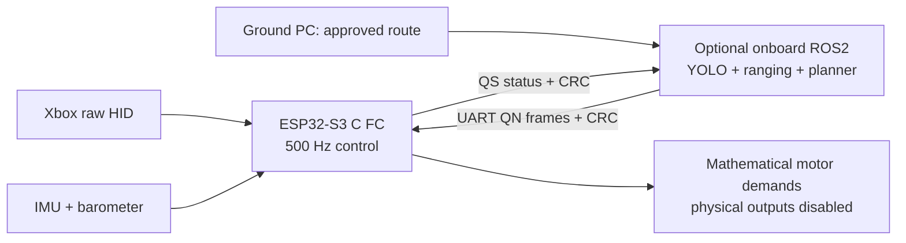

# FC and companion diagnostics — current ESP32 branch

## 1. Controls and motor headroom

Physical ESC outputs and physical motor arming are **still disabled**. Numbers below describe the mathematical allocator; they are not measured ESC pulses or thrust.

| Input | Default Gentle | Full-range simulator profile |
|---|---|---|
| Right stick | Squared curve, up to ±5° roll/pitch | Up to ±35° |
| Left vertical stick | Squared curve, up to ±0.5 m/s before trigger modification | Up to ±2 m/s |
| Left horizontal stick | Squared curve, up to ±45°/s yaw | Up to ±180°/s |
| RT | Full trigger travel; increases climb allowance and collective ceiling | Same trigger authority |
| LT | Full trigger travel; reduces vertical command and collective ceiling | Same trigger authority |
| Down + LT for 2 s | Latched disarm | Latched disarm |

Gentle is the physical C firmware boot default and the simulation UI default. The simulation's UI mapper explicitly shapes HID once, and the C host binding explicitly selects the full-range decoder to prevent applying the Gentle curve twice. Both transformations are tested against each other, allowing HID quantization error. Automated historical step tests deliberately use decoded full-range inputs; their test setup is labelled.

With a provisional 1000–2000 µs interpretation of normalized demand `u`:

```text
pulse_equivalent_us = 1000 + 1000 × u
```

**µs means microseconds.** A 1800 ms motor pulse would be 1.8 seconds, not the intended ESC control signal.

The slewed signed trigger state `b` approaches `RT − LT`, in [−1, 1]. The collective ceiling is:

```text
c_max = 0.65 + 0.15 × b
neutral → 0.65 → 1650 µs equivalent
full RT → 0.80 → 1800 µs equivalent
full LT → 0.50 → 1500 µs equivalent
```

This is a **ceiling, not a forced throttle value**: altitude control requests only the collective it needs. RT/LT modify vertical-speed demand, too. In navigation mode the companion owns vertical speed; handheld trigger boosts do not silently alter its command. The Down+LT disarm gesture remains active in either mode.

The upper 20% motor range at maximum collective is available for differential attitude corrections. An individual motor can therefore exceed 0.8 while another decreases. This is intentional PID authority, not a collective boost to 2000 µs. The arithmetic mean of all four demands remains at or below the ceiling. Zero-sum correction terms are scaled together only when necessary; independent clipping would distort the requested torque directions. The allocator now also prevents its collective shift from exceeding the ceiling. At that ceiling, altitude integration is undone when it would push further into saturation; unwinding is allowed.

These pulse equivalents do not establish the real thrust curve. ESC calibration, motor order, spin direction, minimum stable motor speed, current, and thrust measurements are still required before an output driver can be enabled.

## 2. One FC, optional ROS2 computer



The standard `esp32-s3` build starts in Stable mode and works with **no ROS2 process, no companion cable and no incoming UART packets**. Plugging in a configured companion permits commands to be received, but does not switch modes. Down+A selects Stable; Down+B selects navigation after five seconds. Navigation still requires fresh Xbox pilot reports and fresh companion commands. UART traffic cannot take over Stable mode.

Companion command freshness expires at 150 ms. In navigation, link loss commands neutral angles, zero yaw rate and zero vertical speed through the existing FC; it does not complete the route, auto-land or silently switch to a hidden pilot. Level attitude alone cannot prevent horizontal drift. IMU/barometer-only hardware cannot supply the ideal XY position hold used by the simulator. A separate explicitly labelled localization input is needed for that behavior.

The UART bridge now bounds pending work to a current frame plus one latest replacement. Partial writes retain their offset, queued commands expire after 100 ms, invalid CRC/nonfinite/out-of-range commands are rejected, and a configured missing port is retried every two seconds. This code compiles on Windows; physical UART disconnect/partial-write behavior and the Linux build still need hardware validation. Configure the serial port explicitly: there is no USB port autodiscovery.

`esp32-s3-standalone` is an optional stricter build that disables companion capability entirely. It is not necessary just to fly without a companion using the standard build.

## 3. FC debug levels and evidence

| Level | C firmware diagnostics |
|---|---|
| 0 | Disable diagnostic collection; safety checks remain |
| 1 | Input rejection, sensor faults, freshness, saturation, numeric faults and deadline counters |
| 2 — default | Add allocator state, motor extrema, Kalman innovation statistics and covariance diagonals |
| 3 | Add a fixed 64-entry trace ring sampled at most 50 Hz |

`fc_debug_configure(level)` is boot-only, before the first HID report. `fc_debug_snapshot()` and `fc_debug_trace()` are control-task-owned APIs. No allocation, file operation or serial printing occurs in the C control path. The hardware adapter copies snapshots for the slow task to print at 4 Hz. Level 3 keeps only recent samples; it is not a persistent flight recorder by itself.

Counters distinguish malformed HID, rejected UART, missing pilot, missing companion, sensor fault, numeric output fault, clipped collective, scaled torque and adapter-measured execution longer than 2000 µs. The execution histogram upper bounds are 50, 100, 250, 500, 1000, 1500, 2000 µs, then an overflow bucket. Hardware adapter timing covers work from control-task wake through sensor acquisition, queue handling, control and calibration handoff, before its final publication/diagnostic bookkeeping. It is **not a formal worst-case execution-time proof**. Missed timer notifications and late periods are logged separately.

Hardware queues now process at most eight requests per category per control iteration; slow UART input consumes at most 112 bytes per pass. Queue drops and IMU acquisition failures are observable. BLE callbacks enqueue packets and never mutate controller authority. Flash/NVS writes stay in the slow task; flash/cache stalls must still be measured on the actual ESP32 under BLE and sensor load.

Level 2 records normalized squared innovations `residual² / S`. Their statistical interpretation requires a correct noise model and accepted measurements. During rejected accelerometer gravity updates, a residual is diagnostic only; it is not evidence that an accepted Gaussian measurement passed a chi-square test. Current covariance checks are finite/nonnegative-diagonal checks, not exhaustive proofs over every parameter choice.

### Build and inspect

Run commands from the **QCopter-ESP32-Xbox** checkout:

```powershell
.\qcopter.ps1 build                 # Standard FC; companion optional; Gentle default
.\qcopter.ps1 build-standalone      # Explicit companion-disabled build
.\qcopter.ps1 build-debug           # Hardware compile, level-3 bounded trace
.\qcopter.ps1 emulator-build
.\qcopter.ps1 emulator-run --name my-unique-qemu-run
```

There is no flashing in those commands. When hardware exists, UART debug output uses 115200 baud and includes `FC`, `MODE` and `DEBUG` lines. It must continue to report `motors=DISABLED` until the user explicitly authorizes changing the arming policy.

## 4. ROS2 debugging and wall-clock profiling

The actual mission node, YOLO node, known-panel pose node and UART bridge expose startup parameters:

```text
debug_level: 0..3, default 2
profile_budget_us: positive wall-clock callback budget, default 20000
```

Use these as **startup parameters**. Level 0 disables aggregate profiling; levels 1/2 publish aggregates, and level 3 also logs `PROFILE` lines. The current implementation aggregates at both levels 1 and 2; it does not provide a different per-sample ROS trace at level 3. The `debug/profile` topic carries component, steady-wall clock, callback count, rejects, mean/max duration, over-budget count and histogram buckets. These are cumulative statistics, not exact p95/p99 samples. Publication occurs at most once per two wall seconds while callbacks execute.

```powershell
.\qcopter.ps1 ros2 ros2 topic echo /drone/debug/profile
.\qcopter.ps1 ros2 ros2 node info /drone/drone_mission_computer
```

Examples of node startup arguments are `--ros-args -p debug_level:=3 -p profile_budget_us:=100000`. A 20 ms mission budget and a perception budget are different choices. The original default-budget run deliberately retains YOLO over-budget reports; these must not be hidden or presented as a 50 Hz perception loop. Inference ran on this PC's OpenCV backend, not an onboard Jetson acceleration benchmark. Video records at 15 fps independently of inference speed.

YOLO uses a latest-frame DDS queue of one so it does not accumulate old images. Mission input guards reject nonfinite poses/velocities, non-unit quaternions, unreasonable positions/speeds, stale/future odometry, stale perception and oversized obstacle messages. Route approval requires fresh FC status and pose. A stale FC status stops companion commands; switching to Stable cancels the mission. Ground contact must be fresh before the companion requests mission-completion disarm.

Gazebo recordings include `ros2-profile.jsonl` with original profile messages, `controller-trace.jsonl` with C diagnostic fields, `wire-inputs.jsonl` with received HID/UART, original perception outputs, 500 Hz physics CSV, videos and source/binary hashes. This boundary records/forwards observations; it supplies no navigation policy or motor corrections.

## 5. Repeatable test commands

Each evidence run uses a new name. Failed runs remain intact.

```powershell
.\qcopter.ps1 build-host
.\qcopter.ps1 check-hardening --name my-fc-fault-test
.\qcopter.ps1 check-ros-faults --name my-ros-fault-test
.\qcopter.ps1 check-station --name my-station-test
.\qcopter.ps1 check-horizontal-aiding
.\qcopter.ps1 check-workbench
.\qcopter.ps1 check-planner
.\qcopter.ps1 check-manual-hold --run my-manual-flight --open-space --long-angle
```

The hardening suite uses a fixed seed, 10,000 malformed HID packets, 10,000 malformed UART packets, saturation/trigger stress, 5,000 mixed-axis control steps, sensor loss, bad control intervals, default profile equivalence and a 30,000-step healthy stationary soak. Its CSV contains actual host API durations including ctypes/Python overhead. The separately injected 2000/2001 µs histogram test is labelled as injected timing, not a measured deadline miss.

ROS2 fault injection launches the real compiled C++ mission process in an isolated DDS domain. It checks route rejection for unavailable, NaN, invalid quaternion, old/future odometry; valid mission command generation; CRC/finite outgoing values; stale FC status; Stable cancellation; stale route pose; and actual profile publication. It is not a substitute for a dynamic flight test or a serial-device test.

## 6. What is still missing before real flight

Passing host, QEMU and Gazebo tests does **not** establish physical flight readiness. The project currently has no enabled ESC output path. Remaining measurements and validations include complete mass/inertia, thrust and torque curves, ESC protocol/range, motor order/spin, sensor mounting/axes, real noise/drift/vibration, current/voltage monitor and SOC calibration, and actual 500 Hz timing during BLE, I²C, UART and NVS load. Horizontal localization hardware is unspecified. General RGB obstacle ranging is not solved by the known-size panel detector used in these tests.

Keep the original failed cases, review actual signal traces, and retune using measured parameters. Do not turn provisional simulator gains or the ideal-localization position error into a claim about real flight precision.
