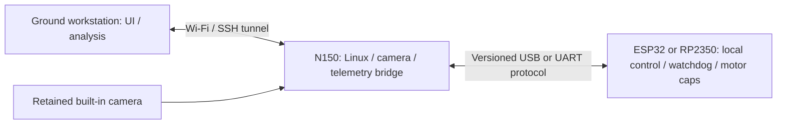

# General project plan - revision 2026-10-28

This dated revision adds the user's stripped Samsung N150 Plus onboard-computer candidate, native Debian workflow and a common PID-tuning host for ESP32/RP2350. It does not accept the hardware for flight or enable new actuators.

| Stage | Deliverable | Gate / status |
|---|---|---|
| 1. FC foundation | Verified calibration/frame mapping, fresh-input/fault stops, 10% idle / 45% normal / 65% boost final motor caps | Keep flight-critical loops on the MCU. RP GPIO/protocol and incomplete output adapters remain pending. Preserve old failed trials. |
| 2. Linux workspace alongside Windows | Existing dual boot works; assess copying its Debian userspace into WSL or cloning it into a VM | Route selection and export/storage inventory pending. Samsung disk has Windows system boot files: no raw whole-disk attachment. No WSL reinstall or disk changes performed. See [Debian clarification](native-debian-setup.md#clarification-and-windows-inventory---2026-10-29). |
| 3. Onboard N150 feasibility | Battery/display removed; motherboard, cooling, power button, necessary Wi-Fi antennas and camera retained; headless SSH | Verify exact CPU, usable RAM, supported camera modes, wireless driver, DC-only boot, stripped mass and center of gravity. See [host research](onboard-host-and-pid-research.md). |
| 4. Power and mounting | Regulated power input from the flight pack and rigid electrically insulated mounting | Measure the pack's full voltage range, board boot/load peaks, converter efficiency/transients/temperature, ripple and sensor/radio effects. Do not select a converter from nominal voltage alone. No converter or flight test is authorized by this plan. |
| 5. Wireless ROS/camera link | Small headless ROS nodes if feasible; acquisition-time-stamped camera frames; SSH administration; heavier processing offloaded as necessary | Benchmark memory/CPU, frame age/jitter, RF loss and thermal behavior. The camera must be onboard with its cable/interface verified. Linux/Wi-Fi loss cannot bypass FC stops or become its attitude-loop clock. |
| 6. PID tuning service | One host API/dashboard with separate ESP32 and RP2350 USB/UART adapters, raw logs and parameter snapshots | Read-only first; explicit versioned gain transactions only while disarmed, with FC validation/ACK/readback/rollback. No browser arm endpoint and no direct motor commands. See [server design/research](onboard-host-and-pid-research.md#pid-tuning-server-plan). |
| 7. Auto-PID research | Rate-axis identification from trustworthy logs; conservative candidate gains; simulation/held-out comparisons | Current sensor/plant/ESC response must be measured. Offline models and fixture tests are not flight acceptance. Tune inner rate loops before outer attitude/altitude loops. |
| 8. Physical deployment | Reviewed converter, mass/thrust/inertia budget, verified motor order and stopping, adequate hover authority under current caps | A stripped netbook changes the plant and payload. Do not reuse the old assumed 1.2 kg vehicle as a measurement or raise caps to make a model pass. In-flight excitation remains a later explicit experiment requiring a stable manually controlled vehicle. |

The FC keeps all time-critical control and limits locally. Proposed high-level topology:

A tuning service may initially run on the stronger ground Debian host; the N150 can relay data. Moving that service onboard is conditional on measured memory/latency, not a prerequisite for safe MCU control. TensorFlow remains an isolated Windows GPU environment under C:/WinLibs/tf210 and is not the proposed N150 inference runtime.

Scope: research/planning and portable preparation tools. No Gazebo/QEMU experiment, Linux boot, camera capture, converter test or physical flight was performed for this revision. Assumed N450/1 GB configuration, stripped mass, onboard camera interface, RF performance, power budget and hardware serial adapters remain unvalidated.

Preparation checks: Bash syntax passes; install-base rejects Windows/Git-Bash before apt/service changes; the Python inventory and qcopter host-inspect command run and correctly report that native Debian is not active; catalog/layout validation passes 53 checks. Native Debian execution, N150/camera/power measurements and the tuning service remain pending.
