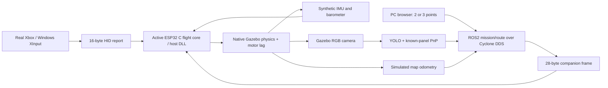

# Fly in Gazebo with your Xbox

This guide belongs to **esp32-xbox**. Your RP2350/RP2040 implementation remains on `main`.

## 1. Open the correct project

In **PowerShell**:

```powershell
cd C:\Users\Mohamed\Desktop\Work\QCopter-ESP32-Xbox
.\qcopter.ps1 xbox-check
```

Connect the Xbox Series X/S controller to Windows by USB or Bluetooth. Expect `"connected": true`. The simulator reads **real Windows XInput**; an unplugged controller produces no generated commands. This does not exercise the physical ESP32 Bluetooth radio.

Only run one simulation at a time. End the current session before launching the next one.

## 2. Play without a drone ROS2 computer

```powershell
.\qcopter.ps1 play --env env01
```

Open **http://127.0.0.1:8087**. It shows native Gazebo overview/onboard camera images, connection status, altitude/position and measured simulation speed.

1. Hold **D-pad Down + A for five seconds**, then release both.
2. Push the **left stick gently upward** to start simulated thrust and climb.
3. Centre the left stick to hold height. Lower it to descend.
4. Move the right stick gently: roll/pitch are **angles**, not horizontal speed. The drone can drift after you centre the stick; there is no horizontal position hold in stable mode.
5. To land, descend with the left stick or LT, then hold **Down + LT fully for two seconds** after touching the ground.
6. Disarm is latched: restart the session to fly again.

| Input | Stable mode |
|---|---|
| Left stick horizontal | Yaw rotation rate |
| Left stick vertical | Vertical speed; centre requests height hold |
| Right stick horizontal/vertical | Roll/pitch angle |
| RT / LT | Boost / reduce vertical demand |
| Down + A, five seconds | Stable mode |
| Down + LT ≥90%, two seconds | Latched motor disarm |

This launch runs **no ROS2 companion, YOLO or navigation process**. Down+B is rejected. It needs Gazebo and the local vision runtime only for rendering/recording. The initial gate prevents thrust while choosing a mode; it is a simulator feature, not a physical arming implementation. Physical motor outputs remain disabled.

## 3. Play with the drone ROS2 navigation computer

```powershell
.\qcopter.ps1 play-ros --env env01
```

Open these two tabs:

- **http://127.0.0.1:8087** — live native cameras and telemetry.
- **http://127.0.0.1:8086** — ground-PC mission map.

The launcher starts independent ROS2 C++ mission, YOLO, panel-pose and transport processes. It activates your existing Pixi/Jazzy installation and the project overlay. It selects **Cyclone DDS**, `ROS_DOMAIN_ID=64`, and simulation time. You do not need another `pixi shell` first.

### Two points: start → finish

1. Hold **D-pad Down+B five seconds**, then release. Keep the controller connected throughout the mission.
2. On the PC map select **Start → finish**.
3. Click **Use live pose as start**. Click the desired finish on the map.
4. Leave ground COM height at **0.082 m**, and choose cruise COM height, initially **1.25 m**.
5. Click **Send route over ROS2**. The response must say accepted.
6. The drone takes off, follows/replans the route from camera observations, and lands at the finish. After ground contact, use **Down+LT two seconds** to disarm. The live session does not generate that gesture for you.

### Three points: start → middle → finish

Select **Start → middle → finish**, use live pose as start, then click middle and finish **in that order**. Send the route. The middle point is visited at cruise height; it does **not** trigger a landing. Only the finish triggers landing.

Tested example in env01:

```text
start  = (0.0,  0.0, 0.082) m
middle = (4.0, -2.4, 0.082) m   # middle's ground location; flown at cruise z
finish = (8.9,  0.3, 0.082) m
cruise = 1.25 m
```

The start must match the vehicle's current location (within 0.25 m horizontally), with low velocity. Selecting a start on the map does not teleport an already running vehicle. Choose a different **initial** ground location before launching:

```powershell
.\qcopter.ps1 play-ros --env env01 --start -0.5 -1.0
```

Then use its live pose as the start. Initial spawn points must be inside x∈[-1,9], y∈[-3,3] m and clear of panels. Consecutive route points must be at least 0.4 m apart. Cruise z is limited to 0.6–2.5 m and at least 0.4 m above the start. This is a local metric map, not GPS or an internet satellite map. Choose short, forward routes inside the demonstrated corridor; an arbitrary route is not guaranteed feasible or collision-free.

Switch back with **Down+A five seconds**. This cancels ROS2 mission authority and returns to stable control. RT/LT controls described above are for stable mode; navigation supplies vertical demand. Down+LT disarm is still available in either mode.

## 4. Change worlds, save video, recover

```powershell
.\qcopter.ps1 play --env env02
.\qcopter.ps1 play-ros --env env10
```

Choose one command; do not launch both concurrently. Ten layouts are defined in `simulation/gazebo/environments.json`. Run names are generated automatically so previous evidence is retained.

Click **End and save this session** in the live viewer. Ctrl+C in the launch terminal also stops its child processes, but the viewer button is preferred because it finalizes the recording first. Each run is saved under `artifacts/gazebo-suite/live-<timestamp>-<environment>/`:

| File | Original evidence |
|---|---|
| gazebo.mp4 | Native overview/onboard views and HUD, recorded at 5 frames per simulated second |
| flight.csv | Gazebo state, FC estimates, motor response and contacts |
| real-xbox.csv | Actual Windows controller reports; no synthetic fallback |
| engine.log / engine-summary.json | Native engine log, parameter values, source hashes and contacts |
| live-boundary.log | Transport and viewer log |
| transport.json | ROS session counts and final state (companion launch) |
| live-summary.json | ROS-free session result (standalone launch) |
| pc-map-missions.jsonl | Original PC requests/replies (companion launch) |
| perception.jsonl | Original YOLO/PnP products (companion launch) |

Simulation speed is **observed**, not promised: the 2 ms integration step represents 500 Hz in simulation time. If rendering/inference overloads the PC, real-time factor falls below 1. A recorded video's playback follows simulation time, so inspect the reported factor and input timestamps when assessing responsiveness.

If a port is busy, end the previous session. If a log says a node exited, inspect that original node log. After disarm, restart; no hidden rearming action is provided.

## 5. What is actually simulated



The companion branch of this diagram is absent in standalone mode. Simulation exchanges the same frame bytes through its local transport rather than electrical UART. QEMU separately boots the C core on an emulated Xtensa CPU; **the live flight uses a host DLL, not QEMU and not a physical ESP32**.

Model assumptions remain unmeasured: 1.2 kg, inertia (0.012,0.012,0.022) kg·m², 450 mm diagonal, 6 N per motor, 40 ms thrust lag and synthetic sensor noise/calibration. The garden is illustrative, not a reconstruction of USTHB. RGB distance is specific to known-size blue panels (1.09×1.69 m inner face) on a known flat floor; it is not general obstacle depth. The navigation computer receives simulated localization. Trees/decor are not a validated general-obstacle perception test.

## 6. Physical ESP32 ↔ companion link

The existing portable ROS2 C++ `uart_bridge_node` sends FC setpoints and receives mode/freshness telemetry. The FC does not need ROS2 or micro-ROS installed on it.

| ESP32-S3 provisional pin | Companion connection |
|---|---|
| GPIO17 / TX2 | UART RX |
| GPIO18 / RX2 | UART TX |
| GND | GND |

Use **3.3 V logic**, crossed TX/RX, common ground, **115200 baud, 8N1**. A suitable USB-to-3.3 V-UART adapter can provide the companion-side serial port. These pins are provisional until the exact board/PCB is checked. Never connect 3S battery voltage to a GPIO. No physical UART, BLE, sensor timing or ESC validation is claimed by the simulation.

From the activated ROS2 project environment, the physical bridge command is:

```text
ros2 run qcopter_autonomy uart_bridge_node --ros-args -r __ns:=/drone -p port:=COM7
```

Replace COM7 with the actual Windows adapter port; on a future Linux companion it is the appropriate `/dev/tty...` device. The command is provided for later bench wiring, not started automatically against an unknown port. See `docs/xbox-ros2-protocol.md` for the exact CRC/sequence-checked binary format.

- **Companion → FC:** roll/pitch angles, yaw rate, vertical speed, sequence and CRC (28 bytes). Fresh commands are accepted in Xbox-selected navigation mode.
- **FC → companion:** mode, disarm, pilot/companion freshness, companion capability and accepted Xbox count (16 bytes). This is status telemetry, **not full odometry or battery telemetry**.
- Navigation commands expire after 150 ms. Pilot reports expire after 250 ms. CRC detects corruption; it does not authenticate a sender.
- Future real navigation still needs a camera driver and measured local pose/velocity source. The existing internal odometry contract uses map coordinates for pose **and velocity**, including `child_frame_id=map`; a standard physical frame adapter remains needed.

The ground PC talks to the companion over ROS2 DDS; the companion talks to the FC over UART. On separate computers use a shared reachable network, the same ROS domain and compatible Cyclone configuration. Separate-machine discovery/firewalls have not been verified here. The mission service is `/drone/mission/route` (`qcopter_autonomy/srv/RequestRoute`); this task runs the PC/drone roles as separate processes on your one PC.

## 7. Firmware with no companion fitted

```powershell
.\qcopter.ps1 build-standalone
```

This compiles environment **esp32-s3-standalone** with `FC_ENABLE_COMPANION=0`. It omits Serial2 activity, rejects companion frames and rejects Down+B navigation selection. Stable control, sensors, calibration storage, Xbox BLE and disarm stay available. The normal `build` target supports an optional companion; stable mode still operates without one. Physical motor arming/output remains disabled in **both** targets, as requested.

## 8. Your ROS2 shell, if needed separately

In **CMD**, your configuration is:

```bat
cd /d C:\dev
pixi shell
call C:\dev\jazzy\install\local_setup.bat
set RMW_IMPLEMENTATION=rmw_cyclonedds_cpp
set ROS_DOMAIN_ID=64
call C:\Users\Mohamed\Desktop\Work\QCopter-ESP32-Xbox\build\ros2-install\local_setup.bat
```

The project launcher does this activation itself. Changes here build only the project overlay; your Jazzy base installation is retained.
