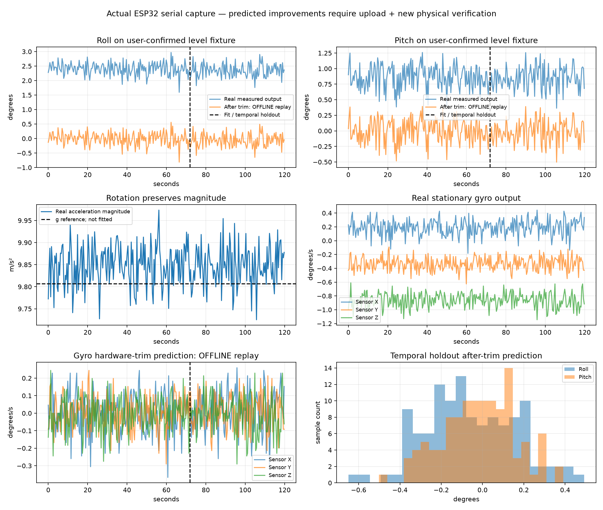

# Real sensor precision check — 25 October 2026

## What was actually run

The assistant opened the existing CH343/COM3 connection at 115200 baud and received serial output for 120 seconds. No firmware was uploaded, no calibration command was sent and no motor command was generated. The user confirmed that the drone was motionless and independently level. The original bytes remain locally in artifacts/hardware/20261024T234658557289Z/serial.log; they are not published as a raw console dump.

Capture contained **291 samples spanning 119.770003 s**, at **2.421307 Hz**. The current source has delay(400); approximately 13 ms additional read/processing/serial time appears in each reporting interval, but this does not isolate CPU time or validate a 500 Hz loop. The MPU's internal rate/settings were not read back during this capture, and no embedded source fingerprint was emitted. Source settings are assumptions about the running firmware, not independently proven configuration values.

**Live transformation proof:** all 291 MPU_BIAS_CORRECTED/IMU pairs match the original correction matrix within the four-decimal raw print rounding bounds. Maximum component disagreement was below 0.000059 m/s². This shows that the reported calibration transformation is being applied to the reported sensor values; it does not prove the offset registers or the complete running firmware identity.



Blue/original curves are the received data. All after-trim curves are **offline replay predictions**, not measurements from modified firmware. The dashed vertical line separates fit data from temporal holdout data. This is hardware serial evidence plus host analysis, not Gazebo or an emulator.

## Measured tilt and noise

The full recording had mean acceleration approximately (-0.147731, +0.409420, 9.838179) m/s² in the old drone reference. Apparent mean roll was **2.382894°**, pitch **0.859547°**, despite the user-confirmed level fixture.

| Channel | Sample standard deviation | Coordinate system |
|---|---:|---|
| Acceleration X | 0.031302 m/s² | Previously corrected drone frame |
| Acceleration Y | 0.037878 m/s² | Previously corrected drone frame |
| Acceleration Z | 0.044134 m/s² | Previously corrected drone frame |
| Gyro X | 0.00198694 rad/s | Sensor axes |
| Gyro Y | 0.00167391 rad/s | Sensor axes |
| Gyro Z | 0.00178670 rad/s | Sensor axes |
| Accelerometer roll | 0.219065° | Old reference, static observation |
| Accelerometer pitch | 0.182075° | Old reference, static observation |

These are measured sample variations from this subsampled stationary record, not noise density, not final Kalman Q, and not an absolute accuracy specification. The raw gyro mean over the full record was (0.003349512, -0.005820935, -0.015031790) rad/s. A fixed gyro bias can accumulate when integrated; a fixed acceleration tilt is a different error mechanism. An accelerometer cannot independently observe yaw about gravity.

## Method: reduce bias without pretending noise disappeared

Use the first **174 samples (60%)** to fit, retaining the final **117 samples (40%)** for a temporal holdout. A Huber-weighted location estimate reduces the influence of atypical samples without deleting them; 9 acceleration and 12 gyro training samples were downweighted. The original 291 samples remain preserved.

### A. Level-reference rotation

Let C0 be the original sensor-to-drone correction and let μ be the robust average acceleration on the known-level fixture. Normalize its direction:

$$
u=rac{mu}{|mu|},qquad e_z=(0,0,1)^T.
$$

We seek a rotation L such that Lu=e_z. For the upright case define:

$$
v=u	imes e_z,qquad c=u^T e_z,qquad
K=egin{bmatrix}0&-v_z&v_y\v_z&0&-v_x\-v_y&v_x&0end{bmatrix}.
$$

Rodrigues' expression gives:

$$
L=I+K+rac{K^2}{1+c},qquad C_{new}=LC_0.
$$

The fitted rotation is **2.559770°**. It is orthonormal with determinant +1 and preserves acceleration magnitude. Therefore it does not hide gravity-magnitude error by forcing all stationary readings to 9.80665. It is the shortest rotation aligning this known vertical; heading about gravity remains unobserved. Existing sensor bias values are not refitted from this single pose.

A known-level pose supports this constrained reference trim. It cannot independently identify a new full bias/scale/cross-axis model. If the level fixture, mounting or original calibration is inaccurate, this trim can compensate the wrong thing. Repeated independent orientations remain essential.

### B. Gyro bias

Motionless gyro output should be near zero. Robust means from the training segment were:

```text
sensor X: +0.003236840207 rad/s
sensor Y: -0.005887098652 rad/s
sensor Z: -0.015005241501 rad/s
```

Firmware now restores their integer corrections to the MPU user gyro offset words at 0x13, 0x15, 0x17, relative to the reset baseline. The modeled changes are **(-6, +11, +28)** register counts. Unlike accelerometer offset words, gyro user offset words do not reserve a temperature bit in bit 0; do not unnecessarily round their changes to even values.

Using the I2Cdevlib convention, 131 raw counts/(degree/s) at ±250 degrees/s divided by 4 gives 32.75 gyro trim counts/(degree/s). The equivalent physical correction is independent of the selected output range:

$$
Delta o_g=-operatorname{round}!left(b_grac{180}{pi}32.75
ight).
$$

Readback will verify writes after upload; this capture did not observe the new register values. No second software gyro-bias subtraction is applied. Sensor-frame gyro output remains sensor-frame output; the acceleration correction matrix contains scale/shear and must not simply be reused as a pure gyro rotation.

## Temporal holdout results: predicted, not flashed

| Mean on final 117 samples | Before | After offline replay |
|---|---:|---:|
| Roll | +2.349749° | -0.059116° |
| Pitch | +0.850828° | -0.015314° |

The after-trim scatter remains **0.221275° roll / 0.176342° pitch**. A fixed reference trim reduces the mean offset; it does not remove measurement noise. It should not be advertised as improved sensor resolution.

Circular block bootstrap (2000 resamples, block length 10 ≈4.13 seconds) gave exploratory 95% intervals for the holdout mean: roll **[-0.08844°, -0.03046°]**, pitch **[-0.04246°, +0.01357°]**. These describe uncertainty in this finite record's mean under that resampling assumption. They condition on the fitted trim as fixed: training-fit uncertainty, fixture uncertainty and unobserved thermal/long-term effects are not included. Roll still has a small systematic residual rather than being statistically proven exactly zero. The block length is a practical choice, not an optimized correlation model.

The predicted holdout gyro mean after quantized hardware correction is approximately (+0.00036662, +0.00015265, -0.00014572) rad/s. The X/Y drift trend across this short recording and the difference between training/holdout mean show why one fixed bias is not guaranteed indefinitely. Temperature was not logged in the original record, so no thermal correction was fitted. TEMP output has now been added for a future recording.

The original six-pose target residuals can increase after redefining the level reference. That is deliberate reference alignment, not proof of a better full six-pose fit. The source-expression check confirms the new expressions reproduce the intended rotated model; it does not certify all poses physically.

## Initial Kalman measurement-noise candidates

The holdout's after-trim acceleration-derived roll/pitch covariance is given below, in rad². It is a stationary R candidate for these observations, not an altitude covariance or a full flight-noise model:

```text
1.49148889e-05 1.25575794e-06
1.25575794e-06 9.47251163e-06
```

Gyro standard deviations above remain in sensor axes. Do not assign their diagonal values to drone roll/pitch rate Q without the gyro mounting rotation, time-discretization model and drift treatment. Q also depends on whether one models discrete rate errors, continuous noise density, bias random walk and correlation. No final gain or noise-density claim is made from a 2.42 Hz serial record. No Allan-deviation or high-rate spectrum claim is possible here.

## What is ready, and what remains

- Prepared source: refined accelerometer matrix, measured gyro biases in MPU registers, preserved acceleration bias registers, readback checks, and temperature output. The original measurements and preceding firmware remain in Git history.
- Raw capture, early analysis and revised analysis remain local and unchanged. The numerical summary and plot contain derived sensor results without publishing a private console dump.
- The proposed correction has NOT been uploaded. The user retains control of flashing.
- After uploading, reset and power-cycle. Capture all six offset readbacks; confirm their baseline values do not accumulate on repeats. Then repeat the independent level recording and all six poses, plus new tilted poses. Mounting changes invalidate this reference.
- Do not run a new calibration on already bias-corrected data as if it were untouched raw data. Store the source/calibration identity and configuration with each trial.
- Keep motor outputs disabled. No controller, attitude Kalman filter, safety mode or gain was added. Do not advance past calibration until the new physical checks are reviewed.

## Reproduce the analysis

The optional scientific tool is tools/calibration/refine_level.py. It requires NumPy and Matplotlib; install them into your chosen analysis environment, not the firmware. Its --level-attested flag records the explicit human confirmation used for the fit. Choose a fresh output directory so an earlier attempt is never overwritten. The tool does not open a serial port or flash hardware.

```text
python tools/calibration/refine_level.py PATH_TO_ORIGINAL_SERIAL_LOG --fit measurements/mpu6050/2026-10-24-six-pose/calculation.json --output NEW_OUTPUT_DIRECTORY --level-attested
```

Sources for the method and limitations: [NXP AN4399: high-precision accelerometer calibration](https://www.nxp.com/docs/en/application-note/AN4399.pdf) covers bias/gain, mounting and temperature models; [Analog Devices AN-1057](https://www.analog.com/en/resources/app-notes/2020/07/22/16/49/an-1057.html) explains gravity-based tilt and the effect of additional acceleration. Those references support the modeling approach, not the numerical accuracy of this particular module.


## Compile and source checks actually completed

The refined source passed the source-expression check against the intended rotated model, including accelerometer register rounding and the gyro-register deltas (-6,+11,+28). That is a source/mathematical test, not I2C execution. The PlatformIO ESP32-S3 build then succeeded with RAM 19316 bytes and flash 305645 bytes. Original compiler output is retained locally under artifacts/build/20261024T235430745054Z/compiler.log. A sanitized build/hash record is in the measurement folder. The binary has not been uploaded.

## For higher absolute accuracy after this provisional trim

This two-minute check is a useful refinement, not a laboratory calibration. A stronger next experiment would collect original samples, temperature and a trustworthy reference across 12–24 well-distributed orientations, including both signs of each axis and diagonal orientations. Hold the final sensor mounting fixed. Set aside several orientations completely before fitting, rather than holding out only time at the same pose. Measure within-pose variation, reference-angle uncertainty and repeatability after remounting or a power cycle.

With known reference acceleration vectors, an overdetermined affine fit can weight poses according to measured uncertainty rather than fitting six uncertain averages as if they were perfect. If orientations are unknown, an ellipsoid/magnitude fit can help estimate bias and scale, but magnitude alone cannot recover the sensor-to-drone rotation; a verified body-axis reference remains necessary. Temperature drift needs recordings over multiple settled temperatures, not a correction invented from a single short record. Long gyro records at suitable validated sampling rates are needed for meaningful bias stability/Allan analysis.

Reference uncertainties and mechanical alignment often become the limiting error. More decimal places, a larger sample count or a smaller fitting residual do not remove them. The level trim intentionally leaves the approximately 9.85 m/s² measured norm unchanged rather than using one pose to invent a new gravity scale.
