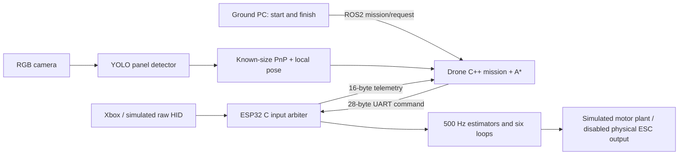

# Xbox modes and ROS2 companion link

## Controls

“Bottom of the + buttons” is interpreted as **D-pad Down**. Diagonal Down
positions also count. Neutral means both sticks centred and triggers released.

| Input | Effect |
|---|---|
| Left X | Yaw angular rate, up to ±180°/s |
| Left Y | Vertical speed; centre holds the current height reference |
| Right X / Y | Roll / pitch angle, up to ±35° |
| RT | Smooth additional climb and collective allowance |
| LT | Smooth descent and reduced collective allowance |
| Down + A for 5 seconds | Stable FC mode |
| Down + B for 5 seconds | ROS2 navigation mode, only while valid companion UART traffic is fresh |
| Down + LT ≥90% for 2 seconds | Immediate **latched disarm** at the end of the hold |

A hold fires once until released. A different combination, conflicting A+B, or
a report gap greater than 100 ms restarts its timer. Disarm takes priority.
Neither a mode change nor calibration reset clears disarm; a session restart is
required. Selecting a mode is **not physical motor arming**.

Let \(b\) be the smoothed \(RT-LT\), \(s_z\in[-1,1]\) the vertical stick:

\[
v_z^*=s_z(2+|b|)+0.6b\quad[\mathrm{m/s}],\qquad
u_{\max}=0.65+0.15b.
\]

These are provisional response limits. The vertical loop still computes
collective, and the mixer reserves correction headroom. Triggers do not bypass
the controller and write individual motors. In navigation mode, the companion
supplies angles/rates/vertical speed; the Xbox must remain fresh, and trigger
bias/reduction is suppressed while navigation owns the vertical command. LT is not a hardware power switch.

## Roles and authority

Stable mode ignores companion setpoints. Navigation accepts fresh companion
setpoints only after the five-second Xbox gesture. Companion age above 150 ms
requests level angles, zero yaw rate and centred vertical command. Xbox age above
250 ms invalidates pilot input and zeroes mathematical demands. This preserves
the project's requested disarm policy; no automatic emergency landing is added.

## Binary interface, version 1

All multibyte values are little endian. Floats are IEEE-754 binary32. CRC is
reflected CRC32/ISO-HDLC (polynomial 0xEDB88320, initial/final XOR 0xFFFFFFFF).

### Companion → FC: 28 bytes

| Offset | Bytes | Value |
|---|---|---|
| 0 | 2 | ASCII QN |
| 2 | 1 | Version 1 |
| 3 | 1 | Flags 1: valid command |
| 4 | 4 | Increasing uint32 sequence |
| 8 / 12 | 4 each | Roll / pitch, degrees, ±35 |
| 16 | 4 | Yaw rate, degrees/s, ±180 |
| 20 | 4 | Vertical speed, m/s, ±3 |
| 24 | 4 | CRC32 of bytes 0–23 |

Malformed length/header/flags/CRC, nonfinite values, out-of-range values and
duplicate/older sequences within a one-second live session are rejected.
After one second without frames a restarted companion sequence can resynchronise.
This CRC detects corruption; it is not cryptographic authentication.

### FC → companion: 16 bytes

| Offset | Bytes | Value |
|---|---|---|
| 0 | 2 | ASCII QS |
| 2 / 3 | 1 each | Version 1 / mode (0 stable, 1 navigation) |
| 4 / 5 / 6 | 1 each | User disarm / pilot fresh / companion fresh |
| 7 | 1 | Bit 0: companion enabled; other bits reserved 0 |
| 8 | 4 | Accepted Xbox report count |
| 12 | 4 | CRC32 of bytes 0–11 |

Firmware Serial2: 115200 baud, RX18/TX17, provisional routing. The portable C++
`uart_bridge_node` accepts a `port` parameter (`COM…` or `/dev/tty…`). Its empty
default opens no device. Electrical wiring, flow control, sustained transfer,
latency and physical computer integration remain untested.

## Raw Xbox report used in tests

16 bytes: six uint16 values at offsets 0–10 (LX, LY, RX, RY, LT, RT), hat at
12, A/B bits 0/1 at 13, remaining bytes reserved. Stick centre is 32768 with
12% deadband; triggers range 0–1023. This matches the pinned library's parser.
The simulator emits this format over ROS2; it does not emulate Bluetooth radio.

## Live sessions and selectable routes

See [live Xbox and companion guide](live-xbox-and-companion.md). The additional
`mission/route` service accepts 2 to 64 geometry points and a cruise height. Middle
points are visited at cruise height before the final landing. The legacy
`mission/request` service remains available for two endpoints.

`FC_ENABLE_COMPANION=0` rejects Down+B and QN frames and disables Serial2 activity.
QS byte 7 advertises this capability; its previous reserved-zero use is superseded.
Status telemetry does not provide the full pose or velocity needed for navigation.

## Navigation completion/disarm extension

QN byte 3 accepts `1` (active command) or `3` (active command plus latched disarm request). Other bits are rejected. CRC, finite-value/range and sequence validation apply before either is accepted. Flag 3 latches disarm only in navigation mode; stable mode ignores its disarm bit. Standalone rejects all companion frames. The simulated ROS2 mission emits flag 3 after its landed/contact dwell completes; it does not rely on a ground-PC test pilot to disarm. The ground-contact topic is synthetic in Gazebo, not a validated real landing sensor. Physical ESC outputs remain disabled. QEMU checks cover valid completion, unknown flags, stable isolation and navigation disarm.

## Optional companion presence and fallback

The firmware boots in stable Xbox mode, including when the companion computer is absent. The same firmware accepts CRC-checked QN UART packets on TX17/RX18 at 115200 baud, 3.3 V logic with common ground. Connect FC TX to companion RX and FC RX to companion TX. The companion is powered separately. Hardware wiring has not been bench-validated.

The ROS2 mission node sends neutral sequence-numbered QN heartbeats from a 20 ms wall timer while idle/manual, independently of camera or odometry readiness. These packets establish presence but cannot switch the FC out of stable mode. Active navigation commands still require the regular sensor-driven mission updates.

Down+B can select navigation only while a valid packet is at most 150 ms old. If this traffic expires during navigation, the C-style FC switches to stable mode, resets controller integrators/height-reference capture and accepts the fresh Xbox commands. Reconnecting the companion does not automatically resume a mission: select navigation again and approve a route. A stale Xbox still triggers the existing pilot-freshness checks; companion presence does not bypass them.

Slow-task `LINK` logs show availability, denied navigation holds and stable fallbacks. They accompany the existing `PROFILE` timing counters. Compile-time standalone builds (`FC_ENABLE_COMPANION=0`) reject companion commands entirely.
