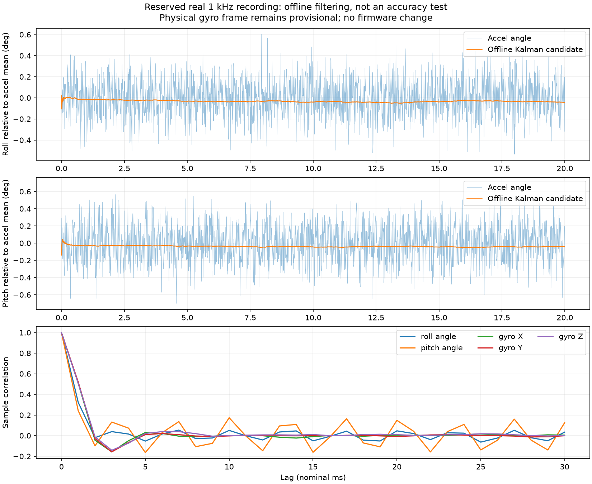
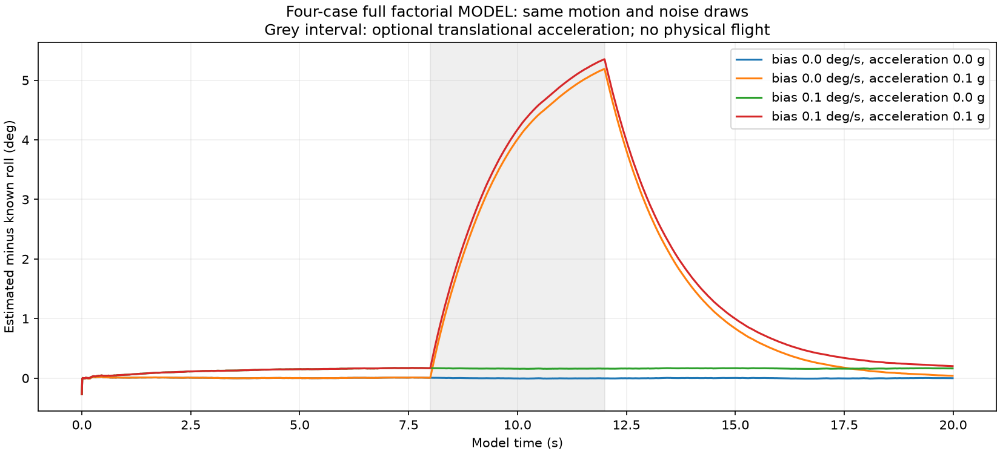

# Offline attitude preparation: real replay and four modeled disturbances

**26 October 2026. Result: an offline candidate is prepared; dynamic/physical acceptance remains pending.**

Reused 80,000 original hardware samples: 60,000 for stationary noise estimates and 20,000 reserved for this filter study. No new physical recording, serial access, upload, firmware edit or calibration change was made. Motors remain disabled.

The engine is Python float64. The first part replays real ESP32-S3/MPU6050 logs after verifying original bytes, hashes, sequencing, checksums and MCU diagnostics. The second part is an explicit synthetic angle/rate experiment. Neither is a Gazebo flight or a timing test on the ESP32.

## 1. Stationary observations and provisional parameters

| Axis | Training angle noise sigma (deg) | Body gyro noise sigma (deg/s) | R (rad²) | White-rate-only Q (rad²/step) | Conditional limiting K | Correction tau (s) |
|---|---:|---:|---:|---:|---:|---:|
| Roll | 0.177657 | 0.108633 | 9.6143606e-06 | 3.5948594e-12 | 0.00061129 | 1.635 |
| Pitch | 0.212984 | 0.102952 | 1.3818086e-05 | 3.2286779e-12 | 0.00048326 | 2.069 |

These are model-dependent starting values, not final flight gains. They were frozen before opening the reserved recording. Q includes only white rate noise; R describes stationary angle repeatability. No gain search was performed against the reserved data. Biases were not re-estimated or subtracted again.

The reserved run has lag-1 correlations of about 0.32/0.24 for roll/pitch observations and 0.51/0.52/0.51 for the three gyro channels. Successive measurements are visibly correlated. This contradicts an exact white-noise model; the filter covariance is not a verified real error bound. One-second angle block means span about 0.028° on both axes; gyro block means span 0.013–0.015 deg/s. These spans also contain any actual support motion.

## 2. Reserved recording: smoother, with no accuracy claim

| Axis | Accel angle std (deg) | Filter output std (deg) | Filter mean minus accel mean (deg) | Formal model sigma at end (deg) |
|---|---:|---:|---:|---:|
| Roll | 0.177569 | 0.007000 | -0.033769 | 0.004392 |
| Pitch | 0.213074 | 0.005692 | -0.039908 | 0.004682 |

Statistics use all samples after a fixed two-second initialization allowance, not only plotted points. Plotting displays every tenth sample (100 Hz nominal); all 1 kHz samples enter the filter. Plot offsets only subtract the common observation mean for readability; the algorithm is not forced to zero/level. The negative mean differences are retained, not fitted away.

There is no independently measured attitude reference. Stationarity is assumed from delegated bench testing. Therefore neither the reduction in fluctuation nor the formal covariance demonstrates absolute accuracy.

## 3. Four-case full factorial model result

Assumptions: pure roll, 10° amplitude at 0.5 Hz for 20 s; exact interval-average gyro rates; added body-Y acceleration during 8–12 s; independent Gaussian white angle/rate noise with training variances and fixed seed 2601026. Identical motion and random draws are reused across all four combinations. This imposed noise model is not a claim that the real sensor is Gaussian/white.

| Added gyro bias (deg/s) | Added acceleration (g) | RMSE (deg) | Peak absolute error (deg) |
|---:|---:|---:|---:|
| 0.0 | 0.0 | 0.004312 | 0.012507 |
| 0.0 | 0.1 | 2.114109 | 5.191244 |
| 0.1 | 0.0 | 0.157612 | 0.172872 |
| 0.1 | 0.1 | 2.214463 | 5.354520 |

**The modeled acceleration produces approximately 5.2° peak error, rising to 5.35° with the added gyro bias.** The candidate accepts part of the translational acceleration as gravity tilt. Smooth stationary performance is not sufficient to accept it for flight. A magnitude-only acceleration gate may miss this: for a level pose, a 0.1 g lateral component changes the vector norm to only about 1.005 g while creating 5.71° apparent roll.

RMSE and maxima use the same fixed interval after 2 s. The report retains all cases, including the poor outcomes. Main-effect contrasts and the interaction difference-of-differences are saved in analysis.json. There are no experimental significance tests or success thresholds. Four combinations preserve the chosen two-factor interaction information; they do not cover all possible maneuvers or disturbance levels.

## 4. Validation and next action

- All **54 offline checks passed**, including six new checks of discrete motion/wrapping, Riccati covariance, invalid inputs, pooled covariance/correlation, factorial identifiability and acceleration ambiguity.
- Four original recordings were reverified: 80,000 complete samples. Sources/hashes and per-run statistics are in [analysis.json](analysis.json).
- The existing 19 actual-source host fault cases were retained. They were not rerun in this step because firmware and peripheral stubs are unchanged; their earlier results remain separate evidence.
- No MCU timing claim was added. Firmware SHA remains `91947b5c8921a481ebb6a4e40cd0027a1c585abda5825118af862f3b39c496f0`.
- Physical reference rotations remain deferred. The mounting rotation and gyro sign/scale must be checked before MCU attitude/PID acceptance. BMP280, ROS2 and actuators were not involved.

Next: later obtain the operator reference rotations, then address dynamic acceleration/gyro-bias modeling and validate motion before adopting the small estimator in main.cpp. Simple changes to Q/R alone cannot uniquely distinguish all sustained acceleration from tilt.

[Step-by-step equations, DOE explanation and reproduction commands](../../../docs/attitude-preparation.md) · [Verification record](verification.json). Original serial logs remain private and preserved; the public repo contains these reviewed derivatives.
