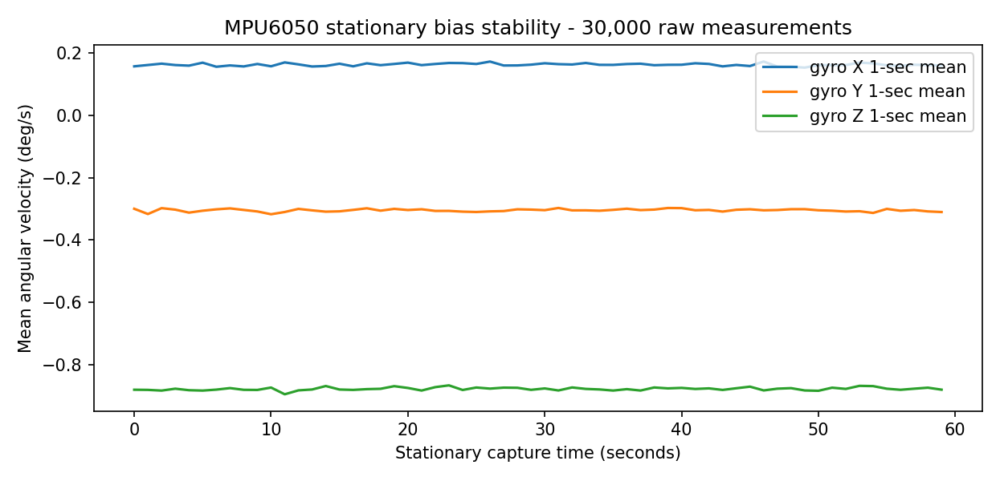
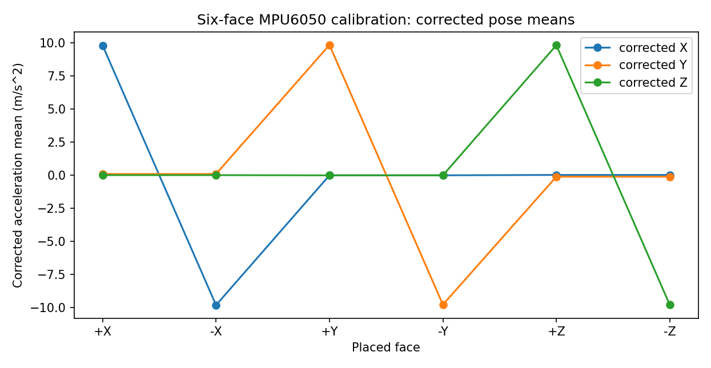
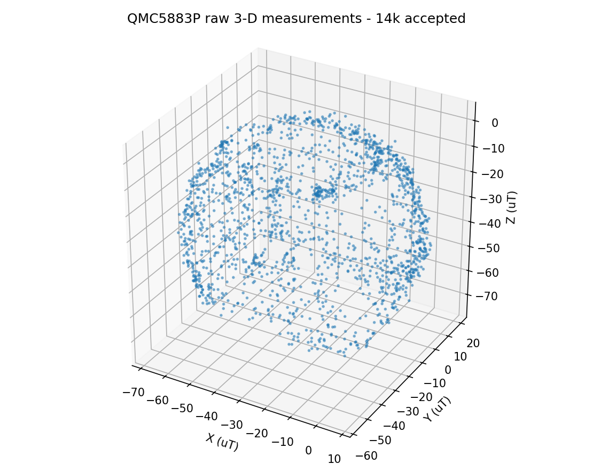
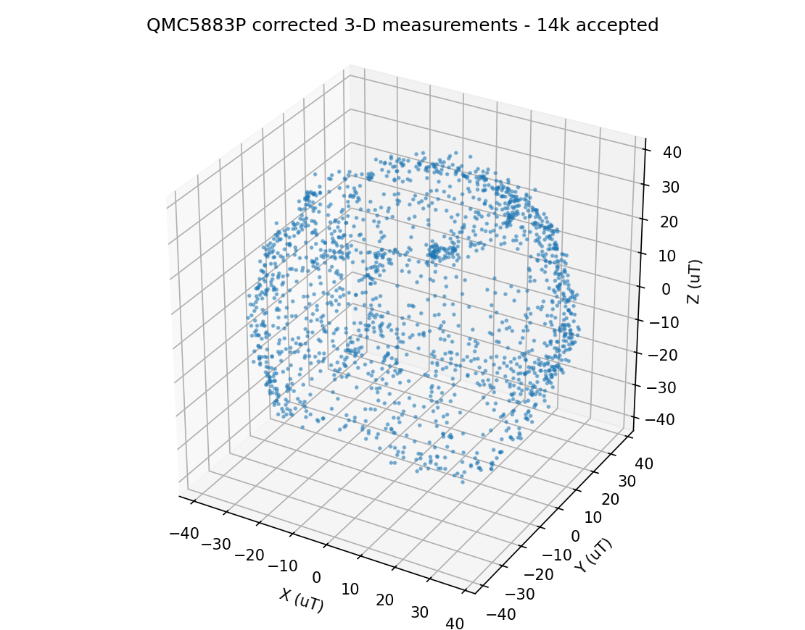
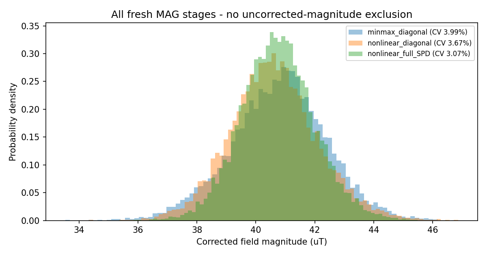
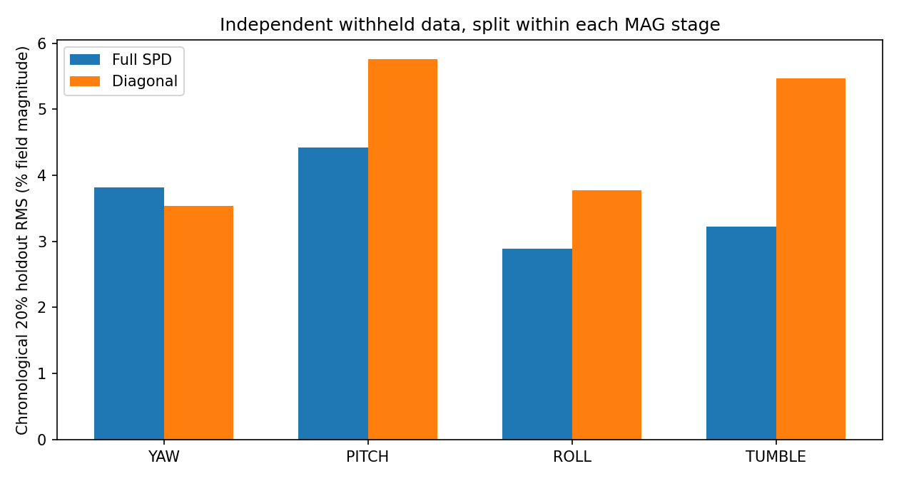
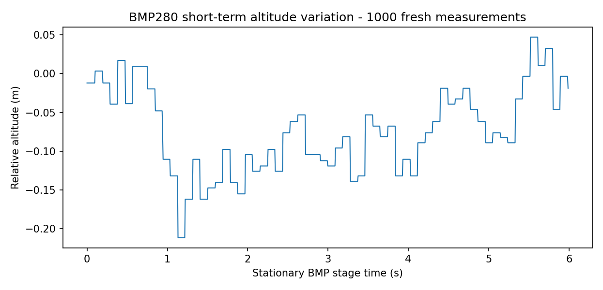

# IntelQCopter — Independent raw-data calibration audit

**Audit date:** 2026-11-04  
**Primary evidence:** `iq_500hz_20261104_100907.csv` (4 MAG stages, 98,868 data rows).  
**Associated source:** uploaded `esp32s3_qmc5883p_100hz.zip`, in particular `src/main.cpp`, `platformio.ini`, `sensor_config.json`.  
**Other sessions used only for replication:** 02:57:33 and 03:17:31 captures within the uploaded source archive. The 04:08:27 REST-only session is not considered a full calibration.  
**Methodology:** independent NumPy/SciPy models written for this audit; the earlier calibration result JSON was NOT loaded to derive any fitted parameter.

## Executive findings

1. **All three main sensors returned measurements:** 98,868 rows marked MPU6050 valid, 98,868 QMC5883P valid, 98,868 BMP280 valid. There are 38,652 fresh magnetic conversions. LiDAR has no measurements.
2. **The active MAG firmware profile is 200 Hz, not 100 Hz.** `IQ_MAG_CONTROL1=0x3D` maps to ODR=200 Hz, OSR1=1, OSR2=1; the observed fresh rate is approximately 195.47 Hz. The name of the uploaded firmware ZIP is not authoritative.
3. **Magnetometer calibration from ALL accepted 14,000 readings:** the SPD full 3x3 correction reduces corrected-field magnitude variation to 3.07% (1.250 uT SD). The supplied min/max diagonal fit gives 3.99% (1.625 uT SD) on the same unfiltered readings. An independent algebraic full-ellipsoid fit gives 3.07% CV.
4. **The saved older magnetometer matrix is not a direct correction matrix**: it is an inverse-squared ellipsoid metric, and its nonlinear quadratic regression allowed the trivial constant solution. Additionally, its raw-norm 20–100 uT filter removed 970 real candidate samples (6.93%) in an orientation-dependent way. Neither operation should be used in a corrected calibration pipeline.
5. **Accelerometer correction is repeatable *within the recorded faces*** (held-out axis RMS 0.0533 m/s2), but manual face-placement errors and inter-session changes limit physical accuracy; leave-one-face-out group prediction residuals reach 0.355 m/s2. Do not infer that the 3x3 off-diagonal values are perfectly known.
6. **Gyro bias is stable within this 60-second rest capture**, but shifts by a few hundredths of deg/s across other sessions and temperatures. The stationary-statistical confidence intervals do not cover those real operational changes.

## 1. Data identity, validity and timing

- Source file SHA-256: `e1628158c5d5f8bd99519b75d306e8a548c91654b21be21076eb190e4aecad0a`; the second copy inside the uploaded firmware ZIP matches byte-for-byte.
- 98,868 rows, 56 columns. Six accelerometer faces have exactly 5,000 rows each; REST has 30,000. Magnetometer stages have exactly 2,000 accepted fresh readings each for yaw, pitch and roll, plus 8,000 tumble, totaling 14,000. BMP has exactly 1,000 accepted fresh samples.
- Within captured contiguous segments, `t_us` increments are exclusively 1,999, 2,000, or 2,001 microseconds. No packet sequence gaps appear within these segments; there are 11 large inter-stage gaps. Do **not** count the 157,451 skipped sequence numbers between intentionally unrecorded stages as serial losses.
- The firmware reports `missed_ticks=0` and lateness 0–1 us on all selected packets. These are its **scheduler-start timestamps**, not physical measurements of I2C transaction duration or host arrival jitter. They do not establish that a future PID loop or motor pipeline meets deadlines.
- `mag_new` = 38,652/98,868 and `bmp_new` = 32,956/98,868 in the saved segments. Thus the fresh-data rates within the captured segments are approximately 195.47 Hz and 166.67 Hz. Cached sensor values repeated in 500 Hz packets are not independent ADC conversions.
- CSV values reproduce direct register conversions to < 0.000001 in their native units: accel=raw*9.80665/16384; gyro=raw/131; MAG=raw/37.5 uT (the manufacturer specifies 3750 LSB/gauss for ±8 G).

## 2. Gyroscope — stationary calibration

**30,000 stationary samples** (~60 seconds, MPU6050 at ±250 deg/s, 500 Hz):

| Axis | Bias deg/s | 1-sample SD deg/s | 95% block-bootstrap CI of this session's mean deg/s |
|---|---:|---:|---|
| X | +0.161969 | 0.047727 | [0.160939, 0.162970] |
| Y | -0.304950 | 0.044855 | [-0.306082, -0.303826] |
| Z | -0.877433 | 0.043200 | [-0.878653, -0.876318] |


Apply: **`gyro_corrected_dps = gyro_measured_dps - bias_dps`**.

One-second mean block SD is [0.00430, 0.00441, 0.00489] deg/s; the first and last 10 seconds differ by only [0.00107, -0.00218, 0.00426] deg/s. MPU die temperature was 28.00–28.18 C in this REST recording.

**Independent-session check:** REST gyro means were [0.15326, -0.32432, -0.86395] deg/s in the 02:57 capture, and [0.19641, -0.29668, -0.87648] deg/s in the 03:17 capture (different mean die temperatures ~29.38 C and 26.93 C). Their differences exceed within-session statistical uncertainty. This evidence supports rechecking gyro bias at operating temperature, not pretending a single offset is temperature-invariant.

During the magnetometer tumble, about 22% of packets approached the ±250 deg/s gyro limit; 4.8% did so during the roll stage. Do not use these saturated intervals to identify gyro scale or fast-flight dynamics. The requested gyro range adjustment is a later firmware step.



## 3. Accelerometer — six physical faces

Using all 5,000 valid rows for each of ±X, ±Y, ±Z, with gravity magnitude 9.80665 m/s2:

**Measurement equation:** `m_accel = S * true_accel + b`. To correct an incoming measurement use **`a_corrected = C * (a_measured - b)`**, where `C = inverse(S)`.

Measured bias `b` in m/s2:

```text
[1.26465557, -0.05910343, -0.67874484]
```

Correction matrix `C` (dimensionless, **row-major**, multiplies the column vector after bias subtraction):

```text
  [0.99928431, -0.03875076, -0.03296788]
  [0.04135139, 0.99279397, 0.04044912]
  [0.04248118, -0.04086697, 0.98720488]
```

The original forward matrix `S` is NOT interchangeable with correction matrix `C`. The independent ordinary-least-squares calculation reproduced the direct paired-face estimator within 4.44e-16.

| Validation | RMS |
|---|---:|
| Component error on six fitted faces | 0.05331 m/s2 |
| Corrected acceleration vector error on fitted faces | 0.09233 m/s2 |
| Corrected norm error, full capture | 0.02403 m/s2 |
| Held-out last 40% of each physical face (train first 60%) component RMS | 0.05334 m/s2 |
| Held-out norm RMS | 0.02431 m/s2 |

The face holdout data come from the **same six placements**, so they test repeatability/noise more than they test absolute pose alignment. Each face pair's effective bias is not identical: ±X, ±Y, ±Z midpoint differences contribute residual systematics. The leave-one-face-out extrapolation residuals are **not** negligible (±X 0.270, ±Y 0.095, ±Z 0.355 m/s2). This is compatible with face misalignment, placement movement, mounting alignment or unmodeled sensor behavior. With no surveyed level reference, these contributions cannot be uniquely separated.

The off-diagonal correction terms represent the six-face affine model **under its orientation assumptions**. They should not automatically be interpreted as an accurately measured physical chip-to-body rotation. Validate with a fixture or more arbitrary static orientations before relying on sub-degree attitude accuracy.



## 4. QMC5883P magnetometer — fitted independently from fresh raw XYZ

**All 14,000 accepted fresh observations used** (no raw-magnitude-based deletion). Stages: YAW=2,000, PITCH=2,000, ROLL=2,000, TUMBLE=8,000. Source CSV channels `mx_uT,my_uT,mz_uT` are *sensor frame*; do not fit the GUI's X/Y-swapped display coordinates.

Fit a positive-definite ellipsoid with a robust nonlinear norm residual and derive its symmetric square-root correction. The scalar gain is arbitrary without a known external Earth-field magnitude: set `det(Cmag)=1` and report the resulting mean magnitude as an *inferred*, not independently verified, ~40.74 uT.

**Hard-iron offset `h`** (uT, sensor axes):

```text
[-29.48230101, -18.39798374, -35.47427285]
```

**Soft-iron relative correction `Cmag`**, determinant 1 (not an inverse-squared ellipsoid metric):

```text
  [0.97336699, 0.00503697, 0.03827793]
  [0.00503697, 0.96453461, -0.01791174]
  [0.03827793, -0.01791174, 1.06701136]
```

**Correct usage:** `mag_corrected_uT = Cmag @ (mag_sensor_raw_uT - h)`. Do not multiply raw readings by the saved old file's ~0.0005 inverse-squared metric.

| Method (same 14,000 raw observations) | Corrected magnitude SD, uT | Coefficient of variation |
|---|---:|---:|
| Older min-max diagonal gains, now without censoring | 1.6254 | 3.986% |
| New nonlinear diagonal (six parameters) | 1.4901 | 3.670% |
| New full SPD (nine parameters, robust) | 1.2504 | 3.069% |
| Independent algebraic full ellipsoid | 1.2498 | 3.068% |

The algebraic independent method and robust nonlinear method differ by **at most 0.0459 uT** in center, and at most 0.00121 in any correction matrix element. They are mathematically distinct calculations, not a second invocation of the saved original calibration algorithm.

**Chronological held-out 20% per stage:** the full SPD model has 3.464% normalized-magnitude RMS error, the diagonal model 5.064%. The leave-one-named-stage-out errors of the full SPD fit are: YAW 3.61%, PITCH 4.23%, ROLL 3.13%, TUMBLE 3.80%.

**Independent runs, not merged into the model:** fit on this 10:09 capture and evaluate on 02:57: 3.794% RMS; on 03:17: 3.456% RMS. Other-session centers differ by up to approximately 0.57 uT on some axes; do not interpret the narrower block-bootstrap intervals as total absolute calibration uncertainty.

**Bootstrap uncertainty**, 50 repetitions of ~100-sample chronological blocks, *conditional on this recorded setup*: center X [-29.721, -29.457], Y [-18.556, -18.237], Z [-35.646, -35.255] uT. These are *not* guaranteed true-field measurement intervals.

**Coverage:** 96.1% of 256 sphere grid directions lie within 15 deg of at least one recorded corrected direction; largest uncovered angular distance ~27.3 deg. Good coverage, not complete. Sensor stationarity and ferrous/motor current stability remain unverified.






**Important coordinate-system risk:** `sensor_config.json` contains `[[0,1,0],[1,0,0],[0,0,1]]` as a display-only X/Y exchange. It has determinant **-1**; it is a reflection, NOT a proper body-frame 3D rotation. The MAG fit in this audit operates on unmodified sensor axes, but heading/fusion requires experimentally verified sensor-to-body rotation with determinant +1, axis signs, and magnetic declination.

## 5. BMP280 stationary pressure

The accepted BMP stage contains 1,000 *fresh* samples, in about six seconds. Pressure mean 98382.027 Pa, SD 0.640 Pa. Relative altitude mean -0.0743 m, SD 0.0548 m. Pressure mean changed by -0.194 Pa from the first 100 to the last 100 fresh observations. These are short-term stability figures, not absolute-altitude error bars or a thermal compensation model. Temperature, humidity, air drafts and sea-level pressure references were not independently controlled.



## 6. What is defensible to use now

- **Gyro bias:** appropriate as the initial 28.1 C-session bias; repeat stationary check before flight, especially at a different operating temperature.
- **Accel six-face correction:** usable as an *effective candidate*, but genuine cross-axis and hard bias cannot be isolated perfectly without a level fixture and pose repeatability checks.
- **MAG full SPD:** best of the tested relative corrections on repeated/held-out data; only provisional for heading. Do not automatically overwrite working firmware or expect a true heading error below 3% from a norm fit.
- **Barometer:** pressure stream and short-term relative-altitude noise are measurable; do not infer long-term altitude precision or absolute vertical datum.
- **LiDAR:** not captured and intentionally not assessed.

**Do not conflate calibrated sensors with a flight-ready 500 Hz controller.** The supplied firmware has motor pins INPUT only. Check body axis rotation, angle signs, independent heading reference, motor magnetic interference, inertial performance at intended gyro range, saturation, arm/disarm/failsafe, and restrained motor tests before propellers/flight.

## 7. Deliverables & reproducibility

- `independent_calibration_results.json`: detailed fit parameters, stage-wise error, bootstrap, holdout, independent-session checks.
- `independent_crosschecks.json`: conversion and independent-algorithm validation results.
- `calibration_candidate_UNVERIFIED.json`, `.hpp`: provisional parameters with exact equations and sensor-frame conventions.
- `corrected_capture_CANDIDATE.csv.gz`: original pose/timestamp/valid/new flags and calibrated candidate vectors for all 98,868 records, including stale/fresh flags to avoid counting cached samples as independent observations.
- `magnetometer_stage_model_comparison.csv`: method comparison by named MAG stage.
- `run_independent_audit.py`, `create_outputs.py`: reproducible independent Python/SciPy analysis, no imports of the supplied fit code.
- `figures/`: independent plots.

**External hardware verification only:** QST QMC5883P datasheet Rev C: https://www.tinytronics.nl/product_files/007562_QMC5883P%20Datasheet%20Rev.C%281%29.pdf (control1 fields, 3750 LSB/gauss at +/-8 G). All fitted parameters above are computed exclusively from the uploaded raw CSV.
