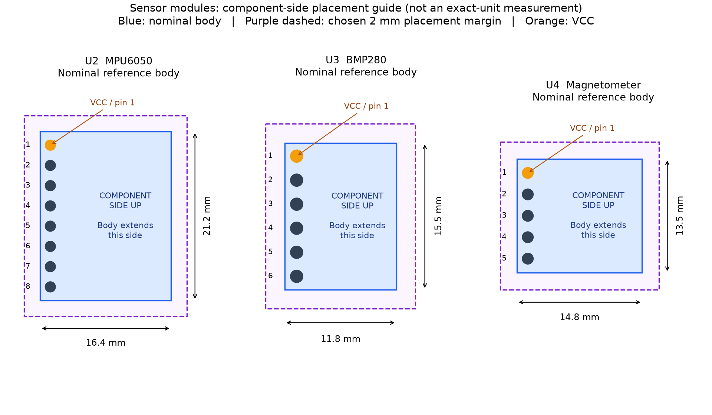

# Sensor module dimensions and assembly orientation

These are **published nominal reference boards**, matched to the styles in your
photos, not measurements or guaranteed identification of your purchased clones.
The original photographs do not establish precise edge offsets or manufacturing
tolerances. Pin order/pitch and body size are different kinds of evidence.

| Module | Length along header | Body depth perpendicular to header | Source |
|---|---:|---:|---|
| U2 MPU6050 / GY-521 | 21.2 mm | 16.4 mm | [Supplier board specification](https://99tech.com.au/product/sens-gy521/) |
| U3 compact six-pin BMP280 | 15.5 mm | 11.8 mm | [Joy-IT SEN-KY052 drawing](https://www.joy-it.net/files/files/Produkte/SEN-KY052/SEN-KY052_Datasheet_2021-10-21.pdf), page 1 |
| U4 five-pin GY-271 | 13.5 mm | 14.8 mm | [Handson mechanical photograph](https://handsontec.com/dataspecs/sensor/GY-271%20HMC5883L.pdf), page 2 |

BMP280's drawing specifies 11.8 mm while its summary table rounds this to 12 mm.
The magnetometer's **13.5 mm edge is the five-pin edge**, not the 14.8 mm depth.
Different modules sold under these names have other sizes. For example, Handson's
GY-521 guide lists 20 x 15 mm, and its BMP280 guide describes a larger board.
Do not substitute those outlines merely because the sensor chip name matches.

## What is now drawn in each footprint

- **F.Fab:** nominal body rectangle, dimension label, and COMPONENTS UP text.
- **F.SilkS:** visible nominal body perimeter and triangle/VCC marking at pin 1.
- **F.CrtYd:** body rectangle plus a chosen **2 mm margin on every side**.
- Pin spacing, pad numbers, drill diameters and copper pads are unchanged.

Use the courtyard to reserve room for adjacent parts. Enable F.CrtYd in KiCad's
Appearance panel; completed-board DRC can detect courtyard overlaps. This does
not guarantee enclosure height clearance, cable clearance or exact clone fit.
No mounting holes were added from guessed locations.

The header row is assumed centered along its board edge. Its perpendicular
center-to-edge distance is assumed to be **1.27 mm**. Neither assumption is a
dimensioned measurement of your actual modules. The 2 mm placement margin is an
engineering allowance, not a supplier tolerance or a statistical confidence bound.
Check these offsets with calipers before committing the holes to a copper plate.

## Avoiding a reversed module

View from the **component side**, with the pins pointing down into the carrier.
With the row vertical, **pin 1 = VCC at the top**, all three reference bodies extend
to the **right**. The next pin is GND. A photo of the back of a module reverses the
visible body side: do not copy the underside image directly into a top-side layout.
Keep the module component side facing up when matching this footprint.

The square pad and triangle mark VCC. Verify VCC and GND against the text on your
own module before soldering; outlines alone cannot prove its pin order or chip ID.

## Included in this connected project

The three body outlines are already included in this project. Their published
reference sizes, assumed offsets and chosen margins remain as documented above.

## Validation

Native KiCad parses all three body outlines and their exact 2 mm courtyards.
The nine components retain all 79 pads and schematic links. The body updater
checks that pad sizes/drills, pad coordinates, nets, tracks and zones survive.
Repeated application is checked in a temporary copy, never by changing your
working library. Native code checks are CAD evidence, not physical fit validation.

An early SWIG shape-editing attempt failed in staging; the final updater edits
only relevant graphics text and then reloads the result through native KiCad.
No failed output was installed. Supplier downloads and failed staging attempts
remain local; reviewed geometry, source URLs and hashes are in the repository.
