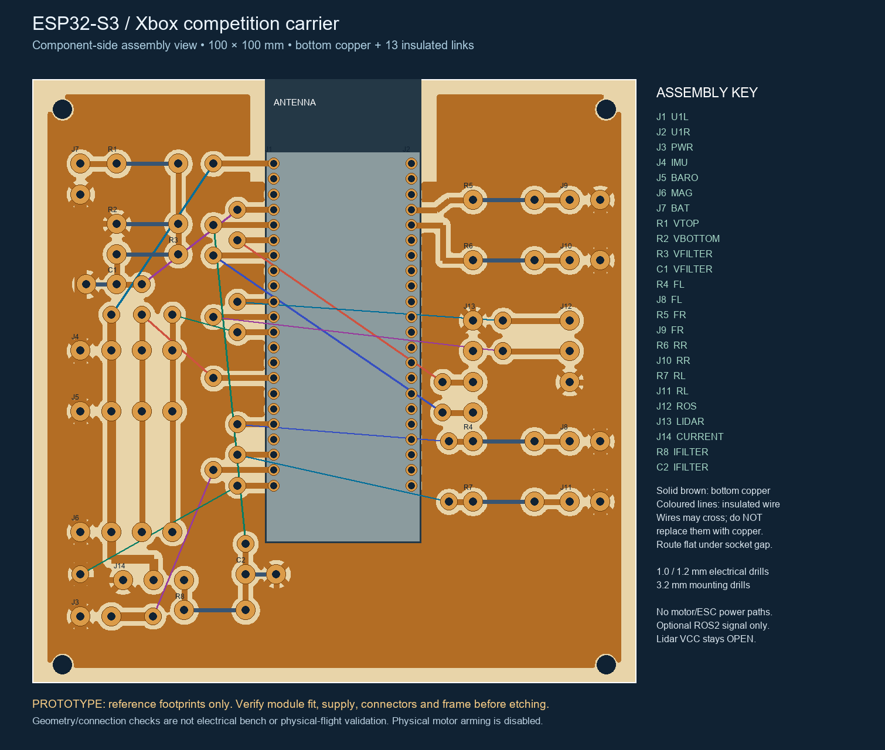

# ESP32-S3 competition carrier — home etched prototype

**Review and fit prototype. Physical motor arming remains disabled.** Native KiCad checks establish the carrier geometry and connectivity, not electrical operation or flight readiness. No physical board has been built or measured.

## Ready-to-print mask and KiCad download

- [Three identical masks on A4, no text, 1:1](output/pdf/etch-mask-3-copies-A4-1to1.pdf).
- [Complete self-contained KiCad package](output/IntelQCopter-ESP32-home-etch-KiCad.zip).

The PDF contains **only three identical copper masks**: no labels, dimensions, text, silkscreen or jumpers. Each represents the 100 x 100 mm board at actual size. Black is copper to preserve, including the large connected GND plane; white is etched away. It is a positive **face-down toner-transfer master**. The printed toner face goes against the copper; that contact produces the one required reversal. Do not enable printer mirroring. This requires heat-fusible toner, not ordinary inkjet ink.

Print **Actual size / 100%**; turn off fit-to-page and borderless enlargement. The corresponding left edges of the two upper masks are **100 mm apart** on the printed sheet. The ground-plane outer span is 95 mm because it stays 2.5 mm from each board edge. Check this before transferring. Use the separate fit/drill sheet for component and mounting dimensions.

The zone has 0.8 mm isolation clearance, 0.8 mm minimum fill width and 1.0 mm thermal spokes. Isolated zone islands are removed. A copper-free notch covers x=36..67 mm, y=0..17 mm at the reference ESP32 antenna; actual board/frame RF clearance still needs checking. The 13 insulated top wires are still required.

Native KiCad DRC reports zero violations, unrouted items and schematic-parity issues after the ground fill. Exact filled polygons, tracks and pads are extracted from the native board for the PDF. Both original labelled PDFs and earlier worksheet-bearing SVGs are retained as **superseded** evidence under `artifacts/hardware/print-mask-20261021/`. Use the new three-copy PDF.

## What to open

- `esp32_home_etch.kicad_pro`: KiCad 10 project, schematic, board and bundled libraries.
- [Connector map](connector-map.md), [assembly BOM](assembly-bom.csv), [wire links](wire-links.csv), [drill table](drill-table.csv).
- `fit-and-drill-top.svg`: 100 × 100 mm paper fit sheet. Print **100% / actual size**; check its 20 mm ruler and 22.86 mm socket-row spacing.
- `plots/copper-component-view.svg`: bottom-copper artwork viewed through the board from the component side.
- `plots/copper-solder-side-view.svg`: mirrored artwork as seen looking directly at the solder side.
- [Process coupon](process-coupon/README.md): trial widths, gaps and enlarged pads.
- [Original CAD reports and failed iterations](../../artifacts/hardware/home-etch-20261021/).

## Construction rules

| Feature | Size / method |
|---|---|
| Carrier | 100 × 100 mm; mounting pattern must be checked on the real F450 |
| Copper | One etched bottom layer; **13 insulated component-side wire links** |
| Signal tracks | 1.0 mm; minimum rule 0.8 mm |
| Logic power/ground | 1.5–2.0 mm; minimum copper gap 0.6 mm |
| DevKit socket pads | 1.9 mm diameter, 1.0 mm drill, 2.54 mm pitch |
| External connector/passive pads | 3.2 mm diameter, 1.2 mm drill |
| Wire-link pads | 2.8 mm diameter, 1.2 mm drill |
| Mounting holes | 3.2 mm, non-plated |

The two dense DevKit socket rows constrain pad enlargement: 1.9 mm pads leave 0.64 mm between pads at 2.54 mm pitch. External wiring uses much larger pads. KiCad represents through-hole pads on two copper layers, but **there are no routed top-copper tracks**. Only B.Cu, including the GND zone, is fabricated; holes are not plated. Solder from the bottom. Wire crossings require insulation.

## Reference components and power

The socket reference is the genuine **Espressif ESP32-S3-DevKitC-1**, two 22-pin rows separated by 22.86 mm. A generic board advertised as “ESP32-S3” may not fit. Compare the printed sheet with the purchased board before etching. The grey assembly area is a reserved clearance envelope, not a measured board-body outline. The grey assembly area is a reserved clearance envelope, not a measured board-body outline. Sensor modules connect by pigtail, so their clone pin orders are not assumed.

J3 takes an **external regulated 5 V supply**, never the 3S pack. W21 connects that supply to the DevKit 5 V pin: **remove W21 before USB powering/programming**. Use one board power source at a time. Motor and ESC power must remain on the separate rated power-distribution system; no 40 A path exists here. The carrier does not implement a battery cutoff or hardware BMS.

I2C: SDA GPIO9, SCL GPIO8; ports for MPU6050, BMP280 and HMC5883L. Choose breakouts with verified 3.3 V logic and compatible pull-ups. Do not connect an unknown 5 V I2C module. HMC5883L firmware integration is pending. Board antenna clearance and frame mounting require physical checking.

ESC signal assignments retain the adapter map: FL GPIO12, FR GPIO1, RR GPIO2, RL GPIO14 through 220 Ω resistors. These are signal-only connectors. Their logic threshold, ESC protocol and physical motor ordering have not been validated; physical motor outputs remain disabled.

Optional companion: GPIO17 TX, GPIO18 RX, common ground, 3.3 V UART; cross TX to RX. No companion-computer power feed is provided. The FC must remain usable without the companion.

## Battery voltage and current provisions

J7 is a low-current pack-voltage **sense input**. R1 = 47 kΩ and R2 = 10 kΩ give

`V_ADC = V_pack × 10 / 57`: 12.6 V becomes approximately 2.211 V.

R3 = 1 kΩ and C1 = 100 nF filter the GPIO4 input. With the divider's Thevenin resistance, the approximate time constant is `(47k || 10k + 1k) × 100nF = 0.925 ms`. Resistor tolerances, ADC calibration and wiring affect accuracy. Disconnect raw battery sense while the MCU supply is off; power-off input protection is not implemented. A calibrated firmware ADC driver is still needed.

J14 provides a **future external current-sensor** input on GPIO5 with R8/C2 filtering. Only a verified 0–2.5 V output and compatible supply are allowed. No current sensor or high-current shunt is selected or placed. Voltage alone cannot measure consumed capacity accurately. The requested 35% warning / 20% disarm policy needs validated voltage/current measurements and a charge estimator; this carrier does not make that policy physically ready. A balance charger does not protect cells during discharge.

Lidar UART provision: GPIO6 RX, GPIO7 TX. **Its VCC pad is intentionally disconnected** until the exact TOFSense F2 Mini supply, connector and logic levels are confirmed. Do not bridge it by guessing.

## Assembly order and review

1. Print the fit sheet at actual size. Confirm board/module/frame dimensions and available drill bits.
2. Use the coupon to establish reliable gaps and pad annuli for your etching/drilling process.
3. Choose artwork orientation for your transfer method. A face-down toner transfer reverses the printed image: use the component-view artwork for that reversal and compare the final copper against the solder-side view. Check an asymmetric connector before etching the full board; never print both masks on the same board.
4. Inspect etched tracks and drill alignment. Install passives, mapped connectors and all 13 insulated links from the wire-link table. Keep links flat under the removable module/socket gap.
5. Before inserting modules or connecting a battery, check continuity against the connector map and absence of shorts. Verify the regulated supply and divided voltage with a meter.
6. Fit the ESP32 and individually verified sensor modules. Motor power/output remains disabled pending later bench integration.

## Reproducibility and evidence limits

`generate_board.py` runs with KiCad's Python/pcbnew. `generate_schematic.py` builds the corresponding schematic; `render_assembly.py` independently compares its exported netlist with the component model and creates the assembly sheets. Native reports, source hashes and comparison counts are in `verification-summary.json` under the evidence folder. Original failing reports remain there.

Latest board/print provenance is in `artifacts/hardware/print-mask-20261021/ground-plane-verification-summary.json` and `ground-plane-print-verification.json`. The earlier source hashes remain in the original report.

The final native checks report **zero DRC violations, zero unrouted connections, zero schematic parity issues and zero ERC violations**. These checks treat external modules as passive connectors; they cannot prove voltage-domain compatibility, regulator capacity, ADC accuracy, electromagnetic behavior or flight performance.

## Primary references

- [Espressif board layout](https://dl.espressif.com/dl/PCB_ESP32-S3-DevKitC-1_V1_20210312CB.pdf) and [official footprint](https://raw.githubusercontent.com/espressif/kicad-libraries/main/footprints/Espressif.pretty/ESP32-S3-DevKitC.kicad_mod).
- [Espressif DevKitC-1 power/pin guide](https://docs.espressif.com/projects/esp-dev-kits/en/latest/esp32s3/esp32-s3-devkitc-1/user_guide_v1.0.html).
- [Espressif ADC schematic guidance](https://docs.espressif.com/projects/esp-hardware-design-guidelines/en/latest/esp32s3/schematic-checklist.html).
- [Nooploop module downloads](https://support.nooploop.com/cn/tofsense/download/): exact purchased lidar revision still needs checking.

The long-term RP2350/RP2040 + LoRa/CC1101 architecture remains on main. This carrier serves the separate ESP32-S3 competition branch only.
