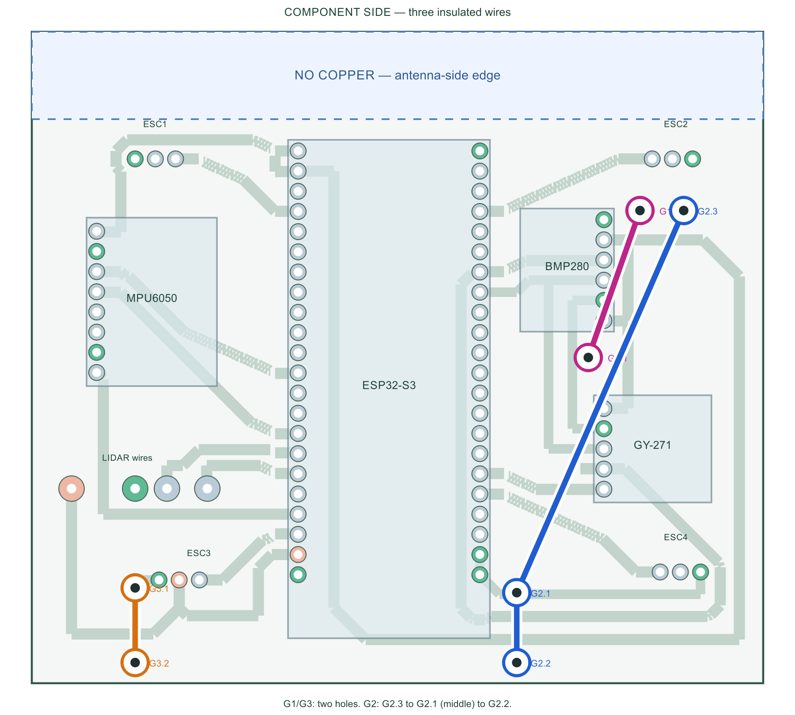

# Current PCB: antenna clearance and three GND wires

Open [QCopter.kicad_pro](QCopter.kicad_pro) / [PCB](QCopter.kicad_pcb), then
press **Alt+3**. The marked antenna-side edge now has an **11 mm copper-free
strip** across the carrier. The central antenna projection is also protected.
The rule area forbids copper fill, tracks, vias and pads on both copper layers.
The FR4 board remains; this is copper removal, not a board cutout.

[Current three-copy 1:1 mask](output/etch-mask-3-copies-A4-1to1.pdf) ·
[Labelled assembly guide](output/assembly-guide.html) ·
[3D preview](output/3d-bottom.png) ·
[Portable KiCad ZIP](output/IntelQCopter-dedicated-ground-jumpers-KiCad.zip)

## Fit the three ground wires

Clearing the top copper removed a former ground bridge. **G2 now has THREE
dedicated holes**, so every ground still becomes common using three wires.
It is one continuous insulated wire; strip its middle solder point as marked.
Use fine wire that fits the 1.2 mm holes (for example AWG24), verifying its
actual diameter before soldering. No wire shares a module/ESC header hole.

| Wire | Dedicated holes, in physical wire order |
|---|---|
| G1 | G1.1 (112,79) -> G1.2 (118.5,60.5) mm |
| G2 | G2.3 (124,60.5) -> G2.1 (103,108.6), middle tap -> G2.2 (103,117.4) mm |
| G3 | G3.1 (55,108) -> G3.2 (55,117.4) mm |

G2 joins the RF-side ground, right ESC return and common ground. G1's sensor
ground reaches common ground through G2. All three wires and all seven solder
points are mandatory. G1/G2 pass below raised sensor modules: fit wires first,
keep them below the assumed 9 mm module height and verify actual clearance.

## Evidence and limits

[Native DRC/parity](validation/rf-clearance/drc.json): **0 violations,
0 unconnected items, 0 schematic mismatches**. The independent
[native pad/wire graph](verification.json) verifies all fourteen logical GND
endpoints common after fitting the wires. Carrier ground paths do not depend
on undocumented connections inside the ESP module. Rejected placement/return
trials are retained under validation. No errors were waived for this change.

There are **86 drilled holes**: 79 original module/header holes and 7 dedicated
jumper holes. Lands are 3.2 mm with 1.2 mm drill for wires. B.Cu is the only
routed layer, tracks >=1.2 mm, clearance >=0.5 mm. GPIO/I2C/UART/PWM assignments
remain those in the [pin audit](pin-audit.md); physical ground aliases changed.
No firmware, flashing, sensor calibration or motor arming changes.

Print the NEW mask at Actual size / 100%, no Fit or extra mirror. Three
92 x 82 mm vector copies on A4, black retained copper, white drills, no text.
Older masks do not include this clearance or the new G2.3 hole.

This is the requested practical carrier clearance, **not proof of full 15 mm
RF clearance or better measured range**. Espressif recommends placing the
antenna outside the baseboard or providing sufficient clearance and testing
the finished assembly: [official guidance](https://docs.espressif.com/projects/esp-hardware-design-guidelines/en/latest/esp32s3/pcb-layout-design.html).
Clone fit, housing, nearby wires, etching, printer scale and actual RF remain
unverified. With power disconnected, check every ground against lidar GND and
check 5 V / 3.3 V for shorts before power.

Only the selected J4/ESC3 regulated 5 V BEC feeds the carrier. Keep other BEC
positives isolated; disconnect it before USB power. High motor/battery current
stays on a separate PDB. Physical motor arming remains disabled.

Prior three-pair revision is preserved in Git commit ad9e6b3. Fresh zero-jumper
layout candidates are separate studies until all acceptance checks pass.
