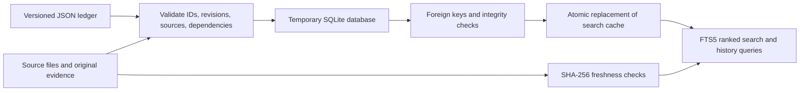

# Project knowledge: facts, evidence and decisions

Use this small index to recover the current project state. The authoritative,
reviewable source is **project.json, schema 2**. The SQLite database is a disposable
search cache at `build/knowledge/project.sqlite`. Neither tool reads the full chat
or invents measurements. This stores concise project knowledge and decision
reasons, not private reasoning traces or an unstructured transcript dump.

[Read the generated current overview](current.md). Run `.\qcopter.ps1 knowledge-overview` after adding ledger revisions. The overview is a derived reading view; SQLite remains a disposable search index.

## Architecture



| Entity | Purpose |
|---|---|
| Fact | Stable ID, topic and scope: ESP32 branch, airframe, or historical |
| Revision | Dated statement, status, evidence level and reason for change |
| Source | Reusable file, directory, HTTPS URL, immutable Git object, user decision or explicit note |
| Evidence link | Connects each revision to one or more sources |
| Relation | depends_on, limited_by, supersedes, related_to |
| Search | Latest revision only, indexed with SQLite FTS5; history available by ID |

Every migrated fact retains revision 1. A changed fact gains revision 2, rather
than erasing what we previously believed. Different facts may be linked with
`supersedes` when their identities differ. Both depend-on and supersedes graphs
must be acyclic. Relationships are explicit; the tool does not infer semantic truth.

## Evidence is a separate dimension from status

Statuses: `confirmed`, `implemented`, `assumed`, `measured`, `historical`, `pending`.
Evidence levels: `requirement`, `source`, `build`, `emulated`, `simulated`, `physical`, `none`.

For example, an emulated CRC check is a measured execution result with evidence
level `emulated`; it does not establish physical flash persistence. User battery
thresholds are confirmed requirements. A 1.2 kg scenario is an assumption. The
schema makes these distinctions explicit rather than assigning an unsupported
numerical confidence percentage.

## Commands

Run from the branch root with Python 3.10+ and SQLite FTS5 support (included in
the installed PlatformIO Python):

```powershell
python tools/knowledge/update_knowledge.py validate
python tools/knowledge/update_knowledge.py build
python tools/knowledge/update_knowledge.py query "calibration"
python tools/knowledge/update_knowledge.py query --status pending --scope esp32-xbox
python tools/knowledge/update_knowledge.py show emulation
```

`query` treats search words literally, uses parameterized SQL and ranks results
with FTS5/BM25. It returns at most 12 entries by default; `--limit` accepts 1..100.
`show` returns a fact's latest state, revision history, sources and relationships.

## Integrity and recovery

- Validation rejects duplicate IDs, unsupported enums, missing evidence, references
  to absent facts/sources, revision gaps, reversed dates and dependency cycles.
- File evidence is hashed into the cache. Querying after ledger or evidence changes
  fails with a rebuild instruction. Sources may also pin an immutable `sha256` in JSON.
- A temporary database is built in one transaction, checked, closed and atomically
  replaces the cache. A validation/build failure retains the previous database.
- An exclusive build lock prevents competing builders. A stale lock after a crash
  needs manual removal only after confirming no builder is still running.
- Existing cache revisions cannot be edited or removed by a later build. Append a
  revision. Git is the durable audit history if the cache has been removed.
- The source ledger is hashed before/after building to reject concurrent edits.
- File hashes establish byte identity, not factual correctness. Directory sources,
  URLs and user-decision notes are not automatically verified as live external data.

The entire index can be regenerated; do not manually edit SQLite. Removing the
cache never removes facts, source files, original evidence or Git history. The old
schema-1 JSON and checked-in SQLite remain recoverable at commit `bb93f11`.

## Updating a fact

Append the next consecutive revision with the current date, a concrete statement,
its status/evidence class, source IDs and a short reason. Preserve older revisions.
Add new source records when necessary; do not change an immutable old log to
make a claim look supported. Rebuild, inspect the relevant query, then commit JSON,
source changes and original evidence together. Keep SDKs, generated databases,
credentials and unrelated files out of the commit.

Read [current status](../docs/status.md), [the active code map](../docs/code-map.md),
[the illustrated model](../docs/current-model-and-fc-integration.html), or
[the original archive](../archive/README.md) when a search points there.

Historical RP2350 sources now use immutable commit:path Git locators. They remain
resolvable without requiring the local archive cache to be present. Git locators
are syntax-validated; the archive verifier checks the restored payload hashes.
