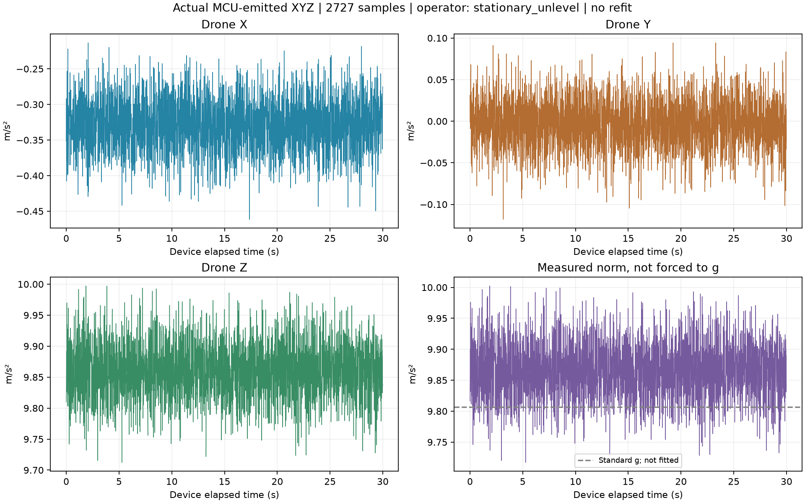

# First real full-XYZ recording review

Engine: offline Python/NumPy/Matplotlib checks of real ESP32-S3/MPU6050 serial output. No simulator or synthetic samples are used in the figures. The user uploaded and ran the firmware; the assistant only reads the saved files and did not flash or open the serial port.

Verified **2727 actual samples** spanning 29.987 device seconds at **90.906 reports/s**. Original-file SHA, source/configuration identity, coefficients, known boot states, sample timestamps, saved-sample equality and every reported XYZ computation were checked.

## Observed register restoration and arithmetic

| Axis | Observed word at initialization | Applied/verified target |
|---|---:|---:|
| X | -2074 | -2348 |
| Y | 2979 | 2993 |
| Z | 1074 | 1212 |

Maximum difference between actual MCU XYZ and independent double-precision recomputation from its ADC counts is **0.000001542 m/s²**. This checks implementation/float rounding, not absolute sensor accuracy. The source verifies the register targets before reporting; this single recording is evidence of restoration in this run, not a repeated reset/power-cycle series. These writable register targets are absolute values, not cumulative corrections.

## Operator reference and measured vector

Operator-reported condition: **stationary_unlevel**. Motionless on a support; not independently checked level. The indicated tilt cannot be identified as calibration error from this pose.

Mean drone-frame XYZ: **(-0.328488, -0.002985, +9.860142) m/s²**. Its direction is 1.908 degrees from body Z. This is an acceleration-derived static indication, not a validated attitude estimate or independent reference measurement.

Mean measured magnitude: **9.865730 m/s²**, about **+0.602%** relative to assumed standard gravity 9.80665 m/s². Non-level orientation can explain the nonzero X/Y components, but does not by itself explain magnitude error. Scale/bias/reference/temperature/model effects remain possible; this one pose cannot identify their causes. No normalization to g, new level trim, bias refit or coefficient change was made.

Per-axis sample spread and covariance are in analysis.json. Samples may be time-correlated; this near-91 Hz register stream is not the original 1000 Hz FIFO noise characterization or a 500 Hz flight loop. No Gaussian, independence, Kalman-gain or flight-accuracy claim follows from this log.

## Next: verify restoration across separate boots

1. Reset the ESP32, then run record-accel again with the same firmware. Record the run as after reset.
2. Power-cycle both ESP32 and MPU, then record another separate run. Record the run as after full power cycle.
No reflash is needed. Preserve the fixed mounting. The reference can be any resting orientation; do not compare mean direction across different poses as if it were sensor drift. Known baseline or retained-target startup words are allowed; the final targets must stay -2348, 2993, 1212. Any unexpected startup word must stop/report rather than trigger another subtraction. Actual repeated-boot evidence is still pending.

Motor outputs remain disabled. Physical correction response and absolute multi-orientation accuracy remain limited by the earlier reference quality; do not mark all calibration or flight readiness accepted from this one implementation check.
