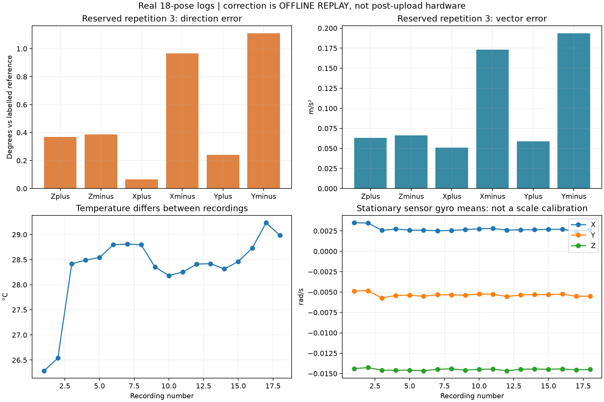
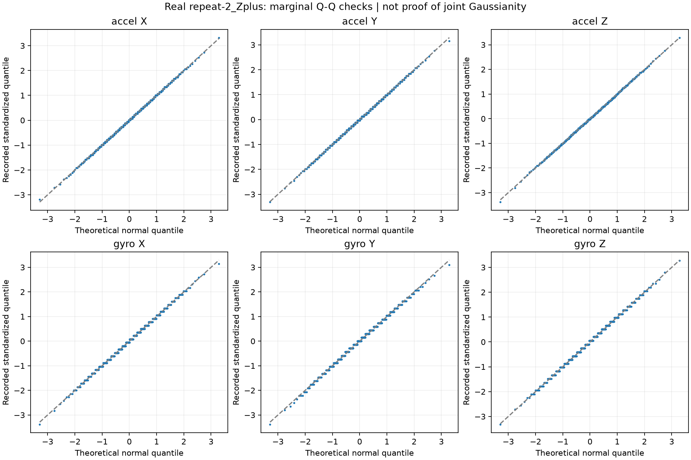
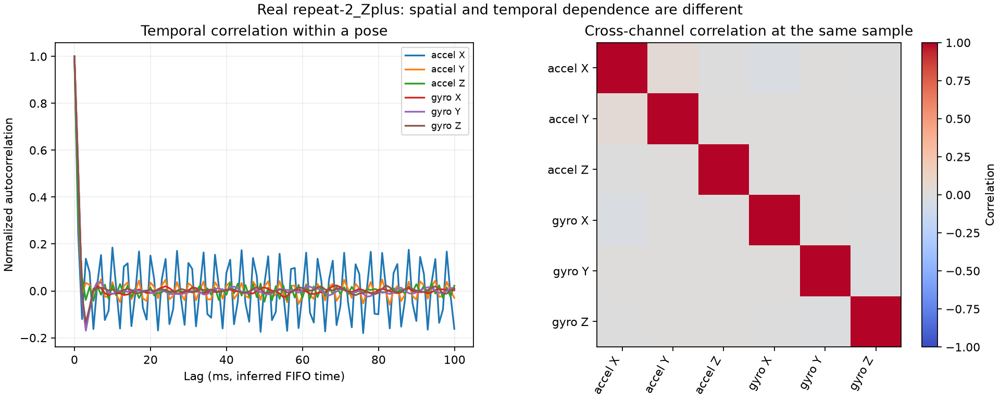
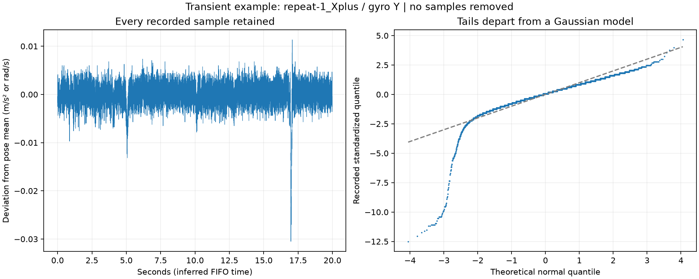

# Eighteen-pose calibration and noise analysis

Engine: Python/NumPy/Matplotlib offline analysis of original real MPU6050 FIFO logs from ESP32-S3. No simulator, serial connection or upload. Raw console logs remain local; these are derived results.

All 18 log hashes, sample sequences, firmware/configuration identities, checksums and final averages were rechecked. A complete capture is not physical calibration acceptance. Actual reference angles, fixture accuracy, mounting rigidity, gyro scaling/axis alignment and physical offset-register correction are not independently validated.

## Candidate calibration

Fit repeats 1-2 only, with equal weights for the 12 pose means. Model: r = b + A a; correction: a = inverse(A) (r - b). Assumed gravity magnitude is 9.80665 m/s² (standard gravity, not an independently measured local value). The pose labels are treated as exact gravity directions for this provisional fit. Equal weights do not imply equal or zero reference uncertainty. No extra level-only rotation was fitted.

```text
bias (sensor m/s²): [ 1.30868341 -0.06766973 -0.65718879]
correction matrix:
[[ 0.95345773 -0.08514414 -0.28727131]
 [ 0.08808005  0.99076155 -0.00259432]
 [ 0.2874295  -0.03029773  0.94729977]]
```

Repetition 3 was reserved before this fit. These offline replay errors include reference/placement error; they are not certified sensor accuracy.

| Reserved pose | Direction error (deg) | Vector error (m/s²) |
|---|---:|---:|
| repeat-3_Zplus | 0.3682 | 0.06325 |
| repeat-3_Zminus | 0.3877 | 0.06636 |
| repeat-3_Xplus | 0.0668 | 0.05101 |
| repeat-3_Xminus | 0.9660 | 0.17320 |
| repeat-3_Yplus | 0.2406 | 0.05897 |
| repeat-3_Yminus | 1.1093 | 0.19338 |



## Noise and Gaussian approximation

Covariance is calculated separately within each pose, on SENSOR accel XYZ (m/s²) and gyro XYZ (rad/s), with N-1. Off-diagonal entries are retained. Mixed accel/gyro covariance entries have mixed units; correlation is dimensionless. No pooled distribution of different pose means is called noise.

The JSON contains per-pose covariance/correlation, skewness, excess kurtosis, selected autocorrelations, linear drift slopes and several acceleration projection diagnostics. Gaussian reference skewness/excess kurtosis are zero, but finite-sample values and temporal correlation matter. No IID normality p-value or independence claim is made. Projection and marginal checks are diagnostics, not a proof of joint Gaussianity.





The curves use a representative second-repetition Z+ record; all 18 per-pose statistics remain in analysis.json. No detrending, outlier deletion or temperature compensation is applied. Drift, vibration and positioning effects therefore remain visible. Gyro means are stationary bias observations, not a validated universal bias or rate-scale calibration.

## Transients prevent a blanket Gaussian assumption

The largest observed channel excess kurtosis is 25.727, whereas a Gaussian population has zero excess kurtosis. This is a descriptive diagnostic, not an IID hypothesis test. A quiet-looking marginal Q-Q plot cannot justify the same distribution for every recording or establish joint Gaussianity.



## Next physical step

Validate the frozen candidate on independently measured static tilted orientations. Start with +30/-30 degree roll and pitch, then combined tilts. Record actual reference angles, their uncertainty and the unchanged mounting. Keep these records out of the fit initially. A separate 2-3 minute stationary log can then improve short-term correlation/drift diagnostics; longer records are needed for long-term Allan/bias characterization.

Do not install the candidate as accepted calibration, enable motors or progress to PID yet. Current firmware remains the raw recorder. After tilt review, implement bias restoration and matrix correction as separate small lessons, followed by reset/power-cycle verification and remeasurement. A full calibration matrix cannot be represented by bias registers alone.

Sources: [NXP AN4399](https://www.nxp.com/docs/en/application-note/AN4399.pdf), [NIST normal probability plots](https://www.itl.nist.gov/div898/handbook/eda/section3/normprpl.htm), [NIST measurement assumptions](https://www.itl.nist.gov/div898/handbook/mpc/section1/mpc121.htm). Sources support the method, not the accuracy of this hardware.
