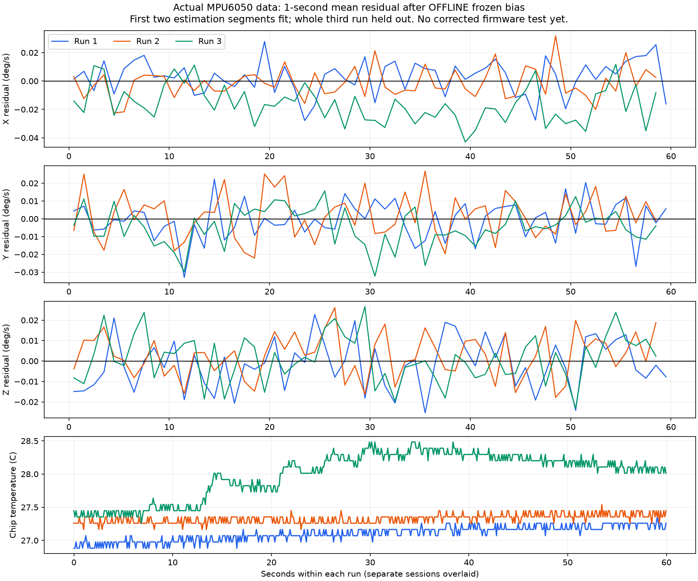

# Three actual gyro recordings: review

Original hashes, both headers, board/source continuity, conversions, every selected original sample and stored statistics were independently replayed and verified. No serial port was opened; no upload or firmware bias change was made. Failed and interrupted captures remain untouched.

The data were recorded by the user on a support, with motionlessness confirmed at the recorder prompt. This is a real-sensor analysis, not a simulation.

## Frozen candidate bias

Fit only the first two-thirds of runs 1 and 2. Reserve both final thirds and the entire third run. Rates are in sensor axes.

$$\widehat{\mathbf b}_g=[0.003098404, -0.004985037, -0.014435425]^T\ \mathrm{rad/s}.$$

Equivalent degrees/s: +0.177525, -0.285622, -0.827089.

$$\boldsymbol\omega_{\mathrm{corrected}}=\boldsymbol\omega_{\mathrm{reported}}-\widehat{\mathbf b}_g.$$

Here that subtraction is **offline only**. All three actual MPU gyro offset words remained zero. The accelerometer calibration was unchanged.

| Run | Samples | Raw mean X/Y/Z (deg/s) | Frozen-bias residual X/Y/Z (deg/s) | Temperature (C) |
|---|---:|---|---|---|
| 1 | 5456 | +0.18029, -0.28645, -0.82858 | +0.00276, -0.00083, -0.00149 | 26.789-27.354 |
| 2 | 5455 | +0.17641, -0.28421, -0.82443 | -0.00112, +0.00141, +0.00266 | 27.165-27.542 |
| 3 | 5455 | +0.16143, -0.29016, -0.82579 | -0.01610, -0.00454, +0.00130 | 27.259-28.577 |

The graph shows one-second block means to expose slow changes; it does not show the full instantaneous noise amplitude. Each session has its own time zero. Run 3 never alters the fitted bias.

## Interpretation and next small step

A fixed bias removes the large repeatable mean, especially sensor Z. Run-to-run differences and temperature changes remain; a constant correction does not promise zero drift. The JSON retains full covariance, individual sample deviations, lag-one correlation, one-second block variability and the offline integrated residual angle. Integrated angles are diagnostic replay, not measured orientation error.

Sample deviations describe this subsampled wide-band bench stream. They are not final Kalman noise at 500 Hz. Do not divide by the square root of sample count to claim a precision without accounting for temporal correlation. Neither independence nor Gaussianity is established. A single support test cannot validate scale/mounting errors; chip temperature is not an external thermometer.

**Next:** apply this frozen candidate in a small gyro-bias firmware lesson, with recorded baseline and rounding accounted for once, then make a new stationary recording and repeat reset/power-cycle checks. Keep attitude estimation behind that gate. No motor output is enabled.

Original raw console logs remain local under artifacts/gyro-recordings. Only reviewed derived values and graphs are published. Exact session IDs and SHA-256 hashes are in [analysis.json](analysis.json).
