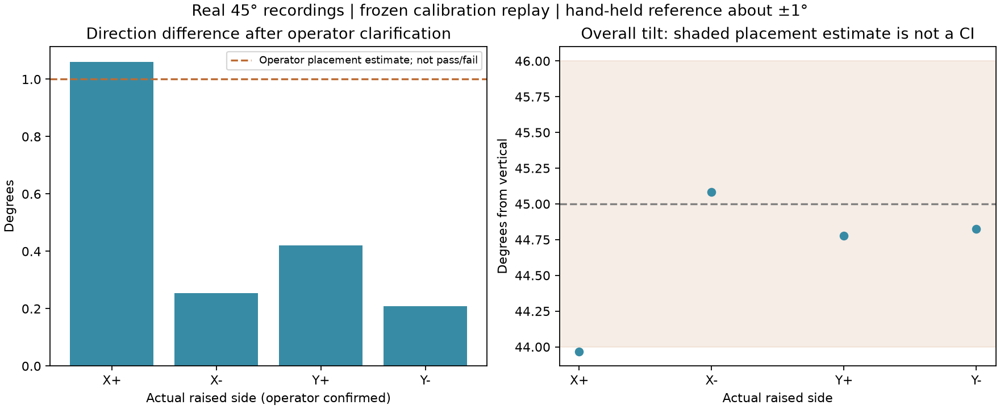

# Independent tilted-pose review

All four original recordings passed source/configuration, 20,000-sample sequence, checksum, average and original-file SHA checks: 80,000 samples total. Engine: Python/NumPy/Matplotlib offline replay of real ESP32-S3/MPU6050 data. No simulator, upload or new hardware action.

## Reference clarification

The original files say roll+, roll-, pitch+, pitch-. The operator subsequently confirmed raised-side order **+X, -X, +Y, -Y**, using the drone axes. This is explicit operator evidence, not a direction chosen to minimize residuals. Original labels, reference.json, validation.json and raw samples remain unchanged. The operator also reports a hand-held 45-degree ruler with about ±1 degree positioning error; original metadata left the method/uncertainty unknown. That estimate has no specified probability distribution or confidence and is not treated as sigma or a certified bound.

For this documented frame, raised +X means pitch -45; raised -X means pitch +45; raised +Y means roll +45; raised -Y means roll -45. The frozen calibration from the earlier six-pose training set is unchanged and was not refitted to these records. Standard gravity 9.80665 m/s² and the declared nominal angles are model assumptions.

| Original label | Confirmed raised side | Overall tilt (deg) | Direction difference (deg) | Magnitude (m/s²) |
|---|---|---:|---:|---:|
| roll-plus | X+ | 43.968 | 1.061 | 9.77049 |
| roll-minus | X- | 45.082 | 0.254 | 9.86470 |
| pitch-plus | Y+ | 44.777 | 0.420 | 9.80349 |
| pitch-minus | Y- | 44.825 | 0.209 | 9.83332 |

## Interpretation

The approximately 60-degree errors originally printed compared the samples with the wrong named axis/sign convention. They are retained in the JSON; they are not evidence of a 60-degree sensor calibration fault. The clarified direction differences are on the scale of the stated hand-held placement uncertainty. This supports the candidate for the next controlled bench-implementation lesson, but does not establish sub-degree absolute accuracy, exact bias/scale, gyro mounting/scale or flight readiness. The first overall tilt is about 1.03 degrees below 45: do not hide that small departure or call every result strictly inside a proven ±1-degree bound.

No reference uncertainty was subtracted in quadrature from the observed differences. Separating reference error from sensor/model error requires a better fixed reference and/or repeated placements. Movement can add nongravitational acceleration; mean and covariance do not independently prove perfect stillness. Physical MPU offset response and power-cycle restoration still require tests.

## Next small software lesson

Prepare one named accelerometer bias correction in the firmware, then validate its sensor-axis behavior before adding other axes and matrix rows in separate lessons. Keep the raw recorder checkpoint for new measurements. Coefficients stay provisional, motor outputs remain disabled and the user controls uploads. Do not jump to PID or silently install all calibration changes from this report.
