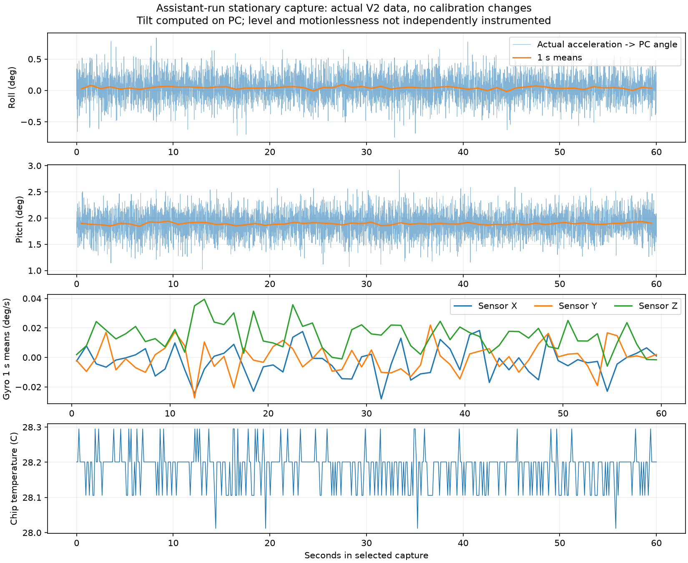

# Assistant-run stationary IMU test: math and results

Actual capture: **5,001 selected samples**, **60.000 seconds**, **83.33 Hz**. COM3 was opened by the assistant under the user's explicit stationary-test delegation. Only identity queries were sent; no upload, calibration/motor command or deliberate reset. Original serial hashes, source identity at known local Git checkpoint, profile, offsets, selected samples, conversions and timing were verified.

The board runs V2. Therefore roll/pitch below are calculated **on the PC from actual calibrated MCU acceleration**; they do not prove that the prepared V3 MCU angle code ran. Motionlessness is an assumption from the requested fixed-support test; no independent level measurement or camera observation was available.

## Measured results

| Quantity | Mean | Sample standard deviation |
|---|---:|---:|
| Roll, degrees | +0.042873 | 0.194589 |
| Pitch, degrees | +1.893162 | 0.225819 |
| Gyro sensor X, degrees/s | -0.002896 | 0.103110 |
| Gyro sensor Y, degrees/s | -0.000449 | 0.096530 |
| Gyro sensor Z, degrees/s | +0.014514 | 0.093987 |

Chip temperature: 28.012-28.389 C. Mean acceleration vector (m/s²): -0.325858, +0.007378, +9.857657.

A nonzero angle is the observed gravity-vector direction. Without an independently level reference it cannot be attributed to calibration error, and it is not subtracted away. The reported standard deviations describe fluctuations of individual samples, not absolute accuracy or uncertainty of the mean.

## 1. Recover roll and pitch from the measured vector

For stationary gravity observations in the project's calibrated Z-up drone frame, define roll phi and pitch theta with R = Rz(yaw) Ry(theta) Rx(phi). The gravity-opposing acceleration vector is

$$\mathbf a=g[-\sin\theta,\;\sin\phi\cos\theta,\;\cos\phi\cos\theta]^T.$$

For |theta| < 90 degrees,

$$h=\sqrt{a_y^2+a_z^2}=g\cos\theta,\qquad\phi=\operatorname{atan2}(a_y,a_z),\quad\theta=\operatorname{atan2}(-a_x,h).$$

The exact trigonometric formulas are used for every measured sample. No startup zeroing or angle fitting is performed. Yaw does not appear in the gravity direction and cannot be recovered by this observation. Translation adds non-gravity acceleration, so these formulas are not a complete dynamic flight estimator.

## 2. Measure the full covariance

$$\bar{\mathbf a}=\frac1N\sum_{k=1}^{N}\mathbf a_k,\qquad S_a=\frac1{N-1}\sum_{k=1}^{N}(\mathbf a_k-\bar{\mathbf a})(\mathbf a_k-\bar{\mathbf a})^T.$$

Each diagonal contains a component variance; each off-diagonal contains measured co-fluctuation of two components. All terms are retained. The same calculation is applied directly to the exact per-sample angle vectors to obtain empirical angle covariance. It does not require a jointly Gaussian model.

## 3. Explain how acceleration noise becomes angle noise

For u and v, differential angle obeys

$$d\operatorname{atan2}(u,v)=\frac{v\,du-u\,dv}{u^2+v^2}.$$

With u = ay and v = az,

$$d\phi=\frac{a_z\,da_y-a_y\,da_z}{h^2}.$$

For pitch, u = -ax and v = h. First differentiate h, then substitute:

$$dh=\frac{a_y\,da_y+a_z\,da_z}{h},$$

$$d\theta=\frac{-h\,da_x+a_x\,dh}{a_x^2+h^2}.$$

Let d = ax²+h². Collect coefficients into the two-by-three Jacobian:

$$J=\begin{bmatrix}0&a_z/h^2&-a_y/h^2\\-h/d&a_xa_y/(hd)&a_xa_z/(hd)\end{bmatrix}.$$

The small-noise approximation is delta_angle approximately J delta_acceleration, evaluated at the measured mean vector. Thus

$$S_{\rm angle}\approx J S_a J^T.$$

This is a local uncertainty-propagation approximation, not a replacement for the exact angle formula. A central finite-difference check independently verifies the analytical derivatives.

| Angle | Empirical sample std (degrees) | Jacobian prediction (degrees) |
|---|---:|---:|
| Roll | 0.194589 | 0.194592 |
| Pitch | 0.225819 | 0.225826 |

## 4. Why averaging does not automatically prove high precision

$$\operatorname{Cov}(\bar{\mathbf a})=\frac1{N^2}\sum_{i=1}^{N}\sum_{j=1}^{N}\operatorname{Cov}(\mathbf a_i,\mathbf a_j).$$

Only if the cross-time covariance terms vanish does this reduce to Sa/N (as an estimated covariance). Filtered sensor outputs, temperature and slow motion can create time dependence. Therefore no standard error or confidence interval is obtained merely by dividing the sample standard deviation by sqrt(N). One-second block means are shown and their spread saved as diagnostics; their independence is not assumed either.

## What these results establish

A real stationary-intended data stream was acquired and its calibration arithmetic verified. Noise, gyro residuals, temperature and gravity-vector direction are quantified. No bias was refitted. These results do not independently prove the pose was level/still, validate V3 angle execution, establish all-temperature accuracy, or supply final 500 Hz Kalman noise. Full numerical covariance/Jacobian values and original evidence hashes are in [analysis.json](analysis.json). Original raw logs remain private and unchanged.
