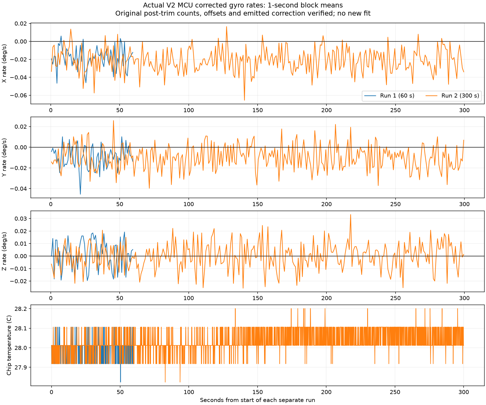
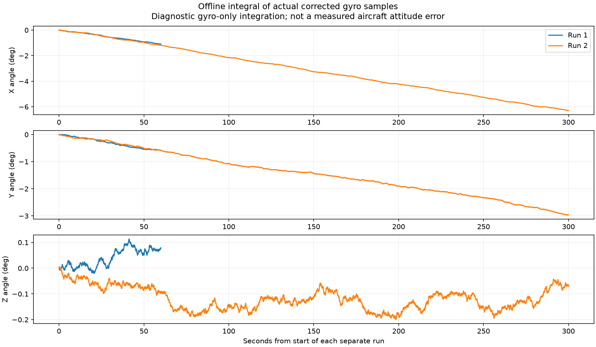

# Corrected gyro: 60-second and 300-second hardware recordings

The 300-second original log contains one additional valid packet after the selected measurement ended and before the final query. The selected 25,002 samples match the exact original contiguous segment; the extra packet is preserved and verified but excluded from measurement statistics. Both original captures passed SHA-256, source/profile/board continuity, beginning/end metadata, raw-to-corrected conversion, exact selected-sample replay, timestamp and stored-statistic checks. The assistant opened no serial port and uploaded nothing. No coefficients were changed or refitted. Original raw logs remain private; failed earlier trials remain untouched.

Total selected samples: **30,003**. All gyro boot words were [0,0,0]; target readbacks were **[-6,+9,+27]**. Accelerometer metadata remains unchanged. Readbacks at both queries plus the verified source and continuing output support the intended application; they do not identify the exact physical trim sensitivity.

| Run | Duration | Samples | Full-run mean X/Y/Z (deg/s) | Sample std X/Y/Z (deg/s) | Temperature (C) |
|---|---:|---:|---|---|---|
| 1 | 60.000 s | 5001 | -0.01822, -0.00983, +0.00130 | +0.10943, +0.10289, +0.10026 | 27.824-28.106 |
| 2 | 300.012 s | 25002 | -0.02099, -0.00987, -0.00022 | +0.10904, +0.10392, +0.10092 | 27.824-28.201 |

The earlier terminal residual mean used the first two-thirds of a run; the table above uses every selected sample. They need not be identical. Noise standard deviation is not the uncertainty of the bias estimate.

The rate graph uses one-second means so that slow variation is visible. The full-resolution data were used for all statistics. A residual around -0.02 degree/s on X remains; do not hide it by fitting and subtracting this same dataset again. Earlier observation runs had a large sensor-Z bias near -0.83 degree/s. These fresh corrected rates are consistent with its removal, but were not collected as a controlled alternating before/after test.

For samples with nonuniform intervals, the integral is calculated using the trapezoidal rule:

$$\theta_{i,k}=\theta_{i,k-1}+\frac{\omega_{i,k}+\omega_{i,k-1}}{2}(t_k-t_{k-1}).$$

A small remaining constant rate integrates into several degrees over five minutes. This is an offline gyro-only diagnostic, not a measured physical angle or a prediction of a fused roll/pitch estimator. It explains why bias/drift matter even after the large offset is removed. Accelerometer fusion can constrain gravity-referenced tilt; absolute yaw requires another reference.

## Acceptance and next test

Implementation is observed in these two operator-attested stationary runs: source, trim readbacks and per-sample subtraction are consistent. Residual means are quantified rather than declared zero. No arbitrary pass tolerance, sub-degree accuracy, temperature compensation or final Kalman gain is inferred.

Both recordings carry the same initial-test label. Their headers alone cannot prove an intervening ESP reset or battery/USB power removal, so gyro restart acceptance remains pending. Next, use the unchanged V2 firmware: after an ESP reset record 30 seconds with `--note "after reset"`; after full power removal/reconnection record 30 seconds with `--note "after power cycle"`. Keep those physical actions separate from the recording command. No reflash or extra bias is needed for those tests.

Rate output was about 83.3 Hz with a maximum 12 ms packet gap. This is bench telemetry, not the future 500 Hz flight loop. Full covariance, lag-one correlation, one-second block variability, temperature, drift slopes and first/last segment means are preserved in [analysis.json](analysis.json). No IID or joint-Gaussian assumption is made. Known-rotation/frame tests and properly timed acquisition remain later steps. Motor arming stays disabled.
