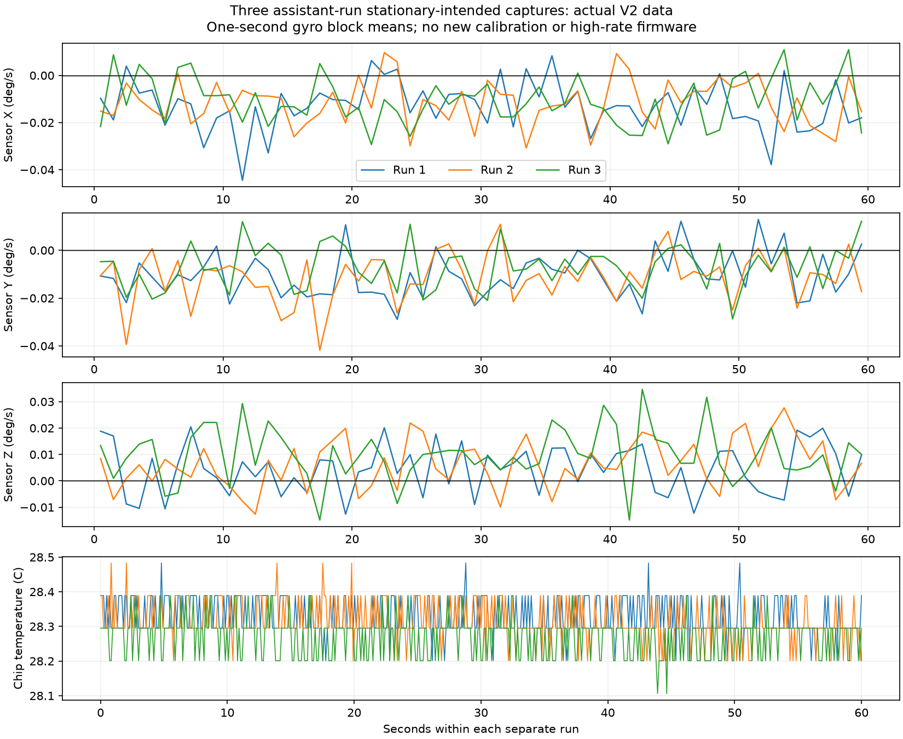

# Sampling limits and three real repeatability tests

The assistant ran three consecutive 60-second COM3 captures on the verified V2 firmware. Five settling seconds preceded each selected interval. No flash, calibration update, deliberate reset or motor command was sent. Stationarity was assumed from the user's delegated fixed-support test, not independently observed.

All original SHA-256 hashes, source/profile/board continuity, offset readbacks, exact selected samples, per-sample conversions and timestamps were checked. Total: **15,003 selected samples**. Original logs remain private and unchanged.

## 1. Why 10,000 Hz cannot be obtained from this sensor

The [manufacturer register map, section 4.2](https://invensense.tdk.com/wp-content/uploads/2015/02/MPU-6000-Register-Map1.pdf) specifies gyro output at 8 kHz for DLPF_CFG = 0, or 1 kHz for the enabled low-pass modes. The accelerometer produces new outputs at 1 kHz. Higher scheduled rates can repeat acceleration samples.

$$f_s=\frac{f_{\rm gyro}}{1+\mathrm{SMPLRT\_DIV}}.$$

Current DLPF mode 0 and divider 7 therefore schedule

$$f_s=\frac{8000}{1+7}=1000\;\mathrm{Hz}.$$

This is the sensor update schedule, not the rate recorded by the PC. The active loop polls, checks offsets and prints text with a delay. Its measured report rate is about 83.3 Hz. Intermediate sensor outputs are not all captured. A 10 kHz loop would reread old data; it would not create 10,000 fresh observations or 10,000 independent samples. Identical digital values alone also do not prove duplicate timing, because quantization can produce equal consecutive fresh values.

| Quantity | Rate or limit |
|---|---:|
| Requested fresh measurements | 10,000 Hz: unsupported |
| Maximum gyro output schedule | 8,000 Hz under specified configuration |
| Maximum new accelerometer outputs | 1,000 Hz |
| Current configured schedule | 1,000 Hz |
| Actual PC capture rate | About 83.3 Hz, measured |

## 2. Sensor rate, bus throughput and serial throughput are different

I²C requires eight data bits plus an ACK/NACK clock per transferred byte. Even ignoring addresses and register overhead, three gyro words require six bytes per sample. At 8 kHz this payload alone costs

$$8000\cdot6\cdot9=432000\;\mathrm{bits/s}>400000\;\mathrm{bits/s}.$$

Thus the present 400 kHz I²C link cannot continuously drain that complete 8 kHz gyro stream, even if a FIFO batches transfers. Full accel+temperature+gyro samples require 14 bytes. At 1 kHz the payload is

$$1000\cdot14\cdot9=126000\;\mathrm{bits/s}.$$

This fits the bus payload budget, leaving room for bounded protocol overhead. A single 14-byte register burst also needs three overhead bytes (write address, register index, read address), giving an idealized bound

$$f_{\rm read}<\frac{400000}{9(14+3)}\approx2614\;\mathrm{reads/s}.$$

Real overhead lowers that bound further. Repeated six-axis offset checks in the current loop consume additional traffic. Therefore lossless 1 kHz acquisition needs a different FIFO/batched sampling path, with overflow detection and bounded logging. This is a feasible next acquisition design, not a test that has already run.

For UART 8N1, each transmitted byte consumes ten line bits. With C text bytes per sample, the required line rate is

$$B=10 C f_s.$$

The measured average packet size in run 1 was 106.01 bytes. Reusing that format at 1 kHz would require approximately 1,060,061 bit/s, compared with the nominal configured 921,600 baud. A lean binary 14-byte payload at 1 kHz requires only 140,000 UART bit/s before framing. Native USB transports can have different limits; the UART calculation is explicitly an 8N1 line budget.

## 3. Actual repeatability results

| Run | Samples | Gyro mean X/Y/Z (degrees/s) | Gyro sample std X/Y/Z (degrees/s) | Temperature (C) |
|---|---:|---|---|---|
| 1 | 5001 | -0.012955, -0.010410, +0.004480 | +0.094445, +0.091434, +0.089190 | 28.201-28.483 |
| 2 | 5001 | -0.011588, -0.011262, +0.006327 | +0.094421, +0.091161, +0.089853 | 28.201-28.483 |
| 3 | 5001 | -0.010828, -0.006854, +0.009792 | +0.094331, +0.089348, +0.090072 | 28.106-28.483 |

The figure shows one-second block means, not instantaneous noise or confidence intervals. Sensor axes remain distinct from the calibrated drone axes used for PC gravity angles.

## 4. Repeatability is not accuracy

For each run j, calculate its gyro mean and sample covariance without refitting the firmware bias:

$$\bar{\boldsymbol\omega}_j=\frac1{N_j}\sum_k\boldsymbol\omega_{j,k},\qquad S_j=\frac1{N_j-1}\sum_k(\boldsymbol\omega_{j,k}-\bar{\boldsymbol\omega}_j)(\boldsymbol\omega_{j,k}-\bar{\boldsymbol\omega}_j)^T.$$

The standard deviation across the three run means describes this short-session repeatability:

$$s_{\rm runs,i}=\sqrt{\frac1{3-1}\sum_{j=1}^{3}(\bar\omega_{j,i}-\bar{\bar\omega}_i)^2}.$$

Measured X/Y/Z values (degrees/s): 0.001078, 0.002338, 0.002697. Mean spans, max minus min: 0.002128, 0.004408, 0.005312.

These consecutive runs do not establish independent long-term trials, temperature compensation or zero bias. A stable nonzero mean can be repeatable and still biased. Full covariance and PC tilt means/noise are retained in [analysis.json](analysis.json). No current angle is forced to zero because no independent level reference was supplied.

## 5. Why these samples are not final Kalman-noise measurements

$$f_{\rm Nyquist}=\frac{f_{\rm recorded}}2\approx41.7\;\mathrm{Hz}.$$

The existing sensor bandwidth is much wider than this recorded Nyquist frequency. Faster variations can alias into the sampled signal. Noise covariance depends on bandwidth and sampling, so the approximately 83 Hz statistics cannot simply be copied into a 500 Hz filter and called validated. Full-rate FIFO acquisition plus suitable anti-alias filtering/timing is needed for that later measurement. Neither Gaussianity nor independence is inferred, and sample standard deviations are not divided by sqrt(N) to promise bias accuracy.

**Result:** 10 kHz fresh MPU6050 data is unavailable; these three actual lower-rate runs were completed and preserved. No higher-rate capture, firmware upload, bias refit or motor activation is claimed.
