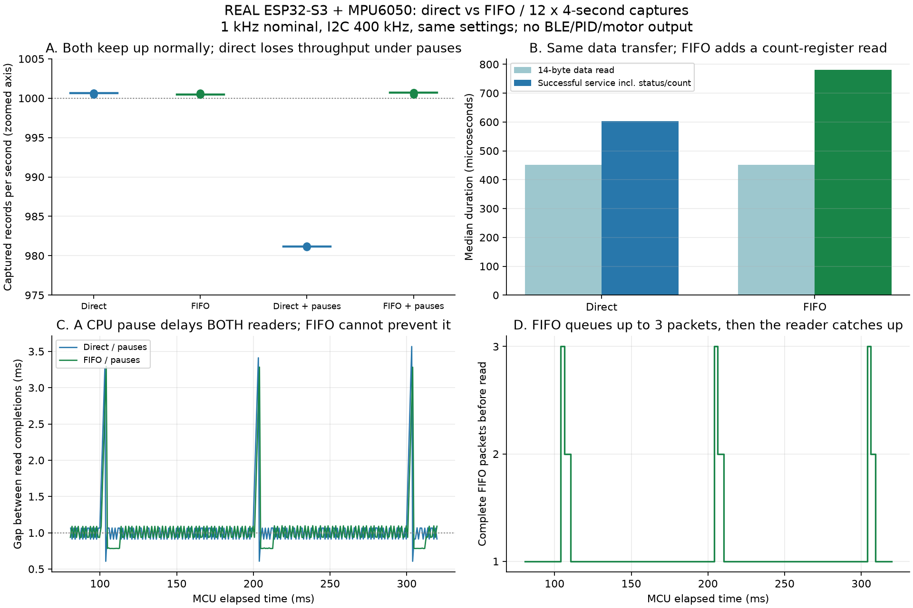

# Real direct-read versus FIFO comparison

30 October 2026. **12 real ESP32-S3/MPU6050 trials; 47,798 samples independently verified.** No simulated timing is presented as hardware evidence. No motors, BLE, PIDs or calibration acceptance were involved.



| Mode | Records in 4 s (3 trials) | Median read | Median successful service | Largest completion gap | Max FIFO queue |
|---|---|---|---|---|---|
| Direct / normal | 4003, 4002, 4003 | 451 us | 603 us | 1072 us | not applicable |
| FIFO / normal | 4002, 4002, 4003 | 451 us | 780 us | 1096 us | 1 |
| Direct / pauses | 3925, 3925, 3925 | 451 us | 603 us | 3573 us | not applicable |
| FIFO / pauses | 4003, 4003, 4002 | 451 us | 780 us | 3596 us | 3 |

## What we changed - and kept the same

Both paths used GPIO9/8, 400 kHz I2C, ±8 g, ±500 deg/s, DLPF_CFG=0, divider=7, gyro-X PLL and 14-byte raw packets. Both polled INT_STATUS and used the same Adafruit BusIO burst-read primitive. FIFO additionally read its byte-count register before each packet. Capture duration was 4 seconds; raw data/timestamps were buffered in ESP RAM, then printed afterward. Three randomized blocks included both readers with and without injected 2500 us CPU pauses every 100 ms. All twelve completed without reported I2C failure or FIFO overflow; sequence/checksum/timestamp and CSV-vs-original replay checks passed. Physical stationarity/level was not independently attested and was not used to claim angle accuracy.

The sample clock is the MPU and timestamps use ESP micros; no external clock calibration was available. About 1000.5-1000.7 records/s is observed in the unpaused trials, not an externally certified exact frequency. The independent baseline of each four-second window is not phase-synchronized, so one-sample count differences are expected.

## Interpretation

1. The 14-byte payload read has the same 451 us median with either method. FIFO did not make that transaction slower.
2. Successful direct service is 603 us median; FIFO is about 780 us, including its count read: approximately 177 us additional overhead for THIS implementation. This is not an inherent minimum or total CPU utilization. Empty-status polling, scheduling, calibration/filter/PID work and motor output are outside that service-only comparison.
3. With pauses, direct delivered 3925 records per window versus roughly 4003 in its unpaused baseline: about 78 fewer (about1.95%). These are throughput differences, not an exact hardware count of which physical samples were skipped. There is no per-sample hardware sequence number or external DRDY trace here.
4. FIFO retained roughly 4002-4003 records per window and reached 3 queued packets. The oldest had approximately 2 ms MORE queue history than the newest at that count observation. This nominal packet-spacing proxy is not its absolute measurement age; read transfer, polling and sensor filtering add latency.
5. BOTH readers had about 3.6 ms maximum read-completion gaps under pauses. FIFO cannot compute a control output while the CPU is deliberately stalled. Retaining sample history and meeting a fresh 1 kHz actuation deadline are different requirements.

**Decision:** direct is a credible lower-overhead candidate if scheduling keeps it timely. FIFO is useful for retaining history when servicing is delayed. Do not switch the production path or declare flight readiness from these short standalone trials. A next comparison can use data-ready synchronization and representative BLE/estimation load; external DRDY timing is needed to measure sample age accurately. This study does not compare getEvent() overhead, FIFO batch optimizations or different filter settings.

## Learn to analyse these data with me

### Step1 - identify the columns and units

Each private raw CSV contains index,service_start_us,ready_observed_us,read_start_us,read_end_us,fifo_bytes,ax,ay,az,temp,gx,gy,gz. Times are relative MCU microseconds; raw sensor words are not calibrated physical values. ready_observed is when software finished the status check, NOT the sensor's physical sampling instant.

### Step2 - subtract the correct timestamps

For real row10 of the first recorded trial:

read duration = 10816 - 10365 = **451us**

successful service duration = 10816 - 10213 = **603us**

Neither equals complete physical sensor latency. For consecutive records, completion gap = current read_end - previous read_end. A1ms average can hide occasional3.6ms gaps.

### Step3 - inspect distribution, not only average

Sort durations. Median is the middle value; p99 has approximately99%of samples at or below it; maximum is the largest observed value, not a guaranteed worst case. In the stressed direct runs, p99 gaps are near 1.075 ms but maxima reach 3.573 ms: the 39 injected gaps occupy only about 1% of intervals. Read the CSV's long-gap count too; a percentile alone can hide rare deadline failures.

### Step4 - compare repetitions before deciding

Open runs-summary.csv. Modes d/f are unpaused direct/FIFO; D/F include pauses. Compare like with like inside each block. Do not treat thousands of samples from one run as thousands of independent experiments: timing is periodic and correlated. Three short blocks show repeatability here, not statistical certification across hardware, temperatures or flight workloads.

### Step5 - verify before plotting

The tool checks record order, all raw-word checksum bytes, timestamp ordering, capture windows, FIFO limits, pause metadata and saved CSV equality with original serial data. It must reject corrupt data rather than silently cleaning away failed samples. Eight synthetic checker controls are provided separately; they are not additional hardware trials.

### Step6 - ask the useful engineering question

Does the full FC receive a sufficiently recent observation and finish the whole estimator/PID/mixer/output path within its deadline under realistic load? Our graphs answer only part of that question. Speed, data preservation and sample freshness must be reported separately.

## Reproduce the analysis without touching the drone

```powershell
.\qcopter.ps1 analyze-acquisition-comparison
```

This reuses the private experiment-01 originals. The public repo contains timing summaries, figures and hashes, not the full flash backup or private serial identifiers. Do not run the recorder as a replacement for this analysis command: it would start NEW hardware measurements. The uploaded source is lessons/imu-acquisition-benchmark/main.cpp. The original firmware/main.cpp and its local user edit remain untouched. The board is left on the motor-disabled benchmark; the old program's complete 16 MB flash backup is preserved privately and is not automatically restored.
