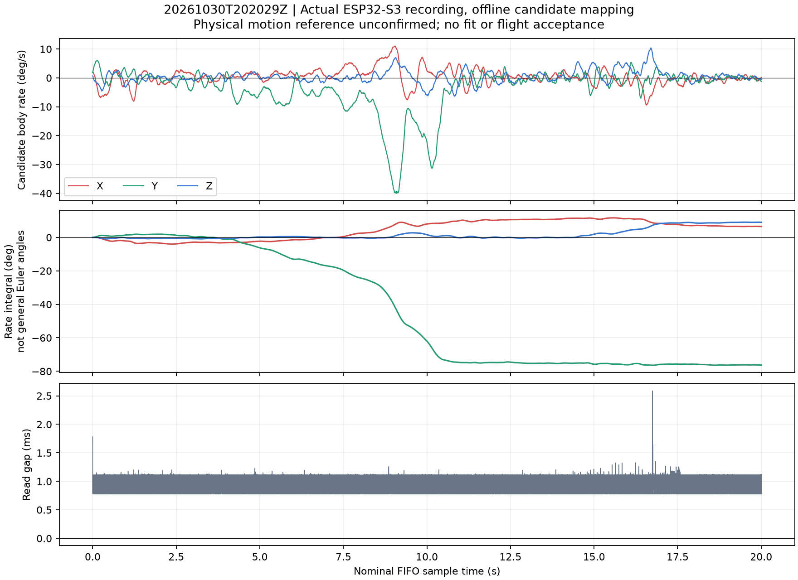
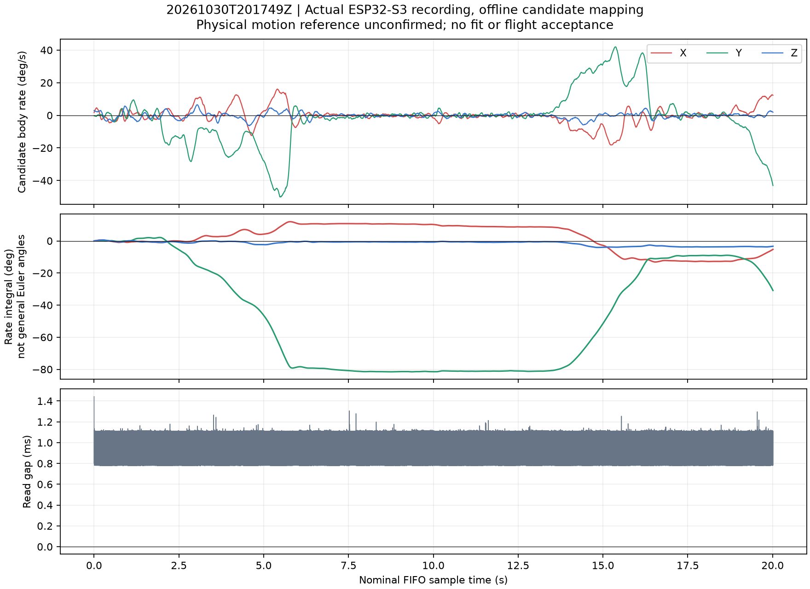

# Two 20-second gyro recordings — 30 October 2026

Engine: offline NumPy processing of actual ESP32-S3 FIFO recordings, not a simulator. Original serial logs and CSVs remain privately preserved. Both original log hashes, every gyro CSV row against serial, sequence/count/payload checksum, duration and retrieval gap checks passed independently. No calibration or firmware changed.

The operator says the first motion was unsuitable and the second is better. Keep the first as exploratory, never delete it or treat it as a failed sensor calibration. The physical direction and reference angle of the second are still unspecified.

## Preferred run

Samples: **20012**, observed read throughput **1000.57 Hz**; maximum retrieval gap **2.586 ms**. Near-full-scale samples: **0**. Candidate net axis integrals X/Y/Z: **6.53, -76.33, 9.06 degrees**. These are provisional rate integrals, not validated physical angles.

Top: candidate drone-axis angular rates. Middle: sums of rate × nominal 0.001s. Bottom: intervals between FIFO retrieval completions, not sensor measurement times. Downsampling is for drawing only; calculations use all samples. Integrating body angular-rate components is not general 3D Euler-angle reconstruction; a near-pure axis motion is needed for simple angle interpretation.

Conversion: sensor deg/s = raw / 65.5. Candidate body rate = R × (sensor rate − historical frozen sensor bias). R is the proper-rotation candidate from config/gyro-frame.json, not the accelerometer scaling matrix. That file retains the reviewed historical value; the separate unreviewed production source coefficient edit is untouched. The harness did not write gyro calibration offsets; applying the frozen bias in this offline diagnostic is an assumption, not fresh bias acceptance. First/last2second means and standard deviations are diagnostics, not refitted offsets or proof the assembly was stationary.

No full-scale clip observed if the clipped count is zero. A large integral alone does not prove a correct +90 degree rotation: returning motion can cancel net angle, cross-axis motion can contaminate it, and the physical sign/reference is still required. No sign/scale pass is inferred from the same sensor data being tested. Full accepted_record in transport-results refers to recording integrity only.

## Exploratory first run

Next: identify which side physically rose and whether the second motion was approximately90degrees once or included a return. If not remembered, use a labelled fixture or short phone video on the next run; do not retroactively guess its sign. No PID or attitude flight acceptance yet.

The preferred trace is dominated by candidate Y (about -76.33 degrees net), rather than candidate X. This is not enough to diagnose an axis error: rotating about X and raising the X end are different motions. First-two-second rate variations also show this was not an independently stationary bias reference. Do not adjust calibration from this run. Retrieval gaps are plotted without decimation to preserve their visible maxima.

