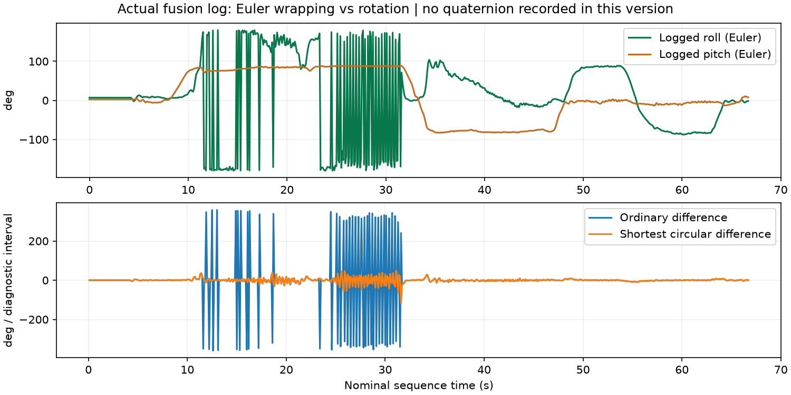

# Why the previous symptom remained

Actual log confirms FUSION_PREVIEW_V1, source53a7f37086916ed53eb6b6ac257aafe1ee19e964a96974d86fb41b1cc329e10e. The quaternion implementation was running. analysis.json counts wrap boundaries and reports circular differences; wrap-comparison.png uses every diagnostic record. Large raw roll changes near±180degrees are coordinate wraps. Near±90degree Euler pitch also makes roll/yaw individually poorly conditioned. These are distinct effects; neither is removed merely by using quaternion propagation. Not every residual fluctuation is therefore solved or explained.

V2 adds queued, same-sample quaternion telemetry Q,sequence,w,x,y,z. No estimator gain, calibration, axis labels or filter algorithm changed. Viewer adds quaternion traces and breaks the drawn roll line at±180degree crossings rather than drawing a false full turn. Original D and Q values remain unchanged in saved logs. No low-pass plot trick or forced angle freeze. This is a diagnostic change, not a claim of fixed physical accuracy.

Next one short physical check: upload V2, start resting, tilt/return gently, then inspect quaternion norm and sign-invariant relative rotation between consecutive samples against body rates. Any large quaternion discontinuity must be investigated as a genuine state/timing/frame issue. Current Euler-only logs cannot supply that missing evidence. Stop requesting calibration runs until a specific sensor/reference error is demonstrated.

There is no PID motor loop implemented in this preview. Future large-angle feedback must use a suitable quaternion/vector attitude error, or explicitly restrict a near-hover Euler controller's operating region; feeding raw Euler wrap jumps to derivative feedback would be wrong. Choosing a higher-order filter cannot make a globally unique Euler chart exist. Absolute yaw remains unobservable without an external heading reference.

Research sources: NASA aircraft kinematics, https://ntrs.nasa.gov/api/citations/20160002944/downloads/20160002944.pdf ; Adafruit pinned algorithm, https://github.com/adafruit/Adafruit_AHRS ; x-io acceleration rejection design, https://github.com/xioTechnologies/Fusion/blob/main/README.md . x-io rejects acceleration using angular disagreement and recovery logic; it is a possible later robustness improvement, not evidence that changing libraries fixes Euler wraps. No blind algorithm replacement here.

Commands unchanged: upload-attitude-preview --upload-port COM3, then view-attitude --port COM3. New hardware validation pending; motors disabled.
